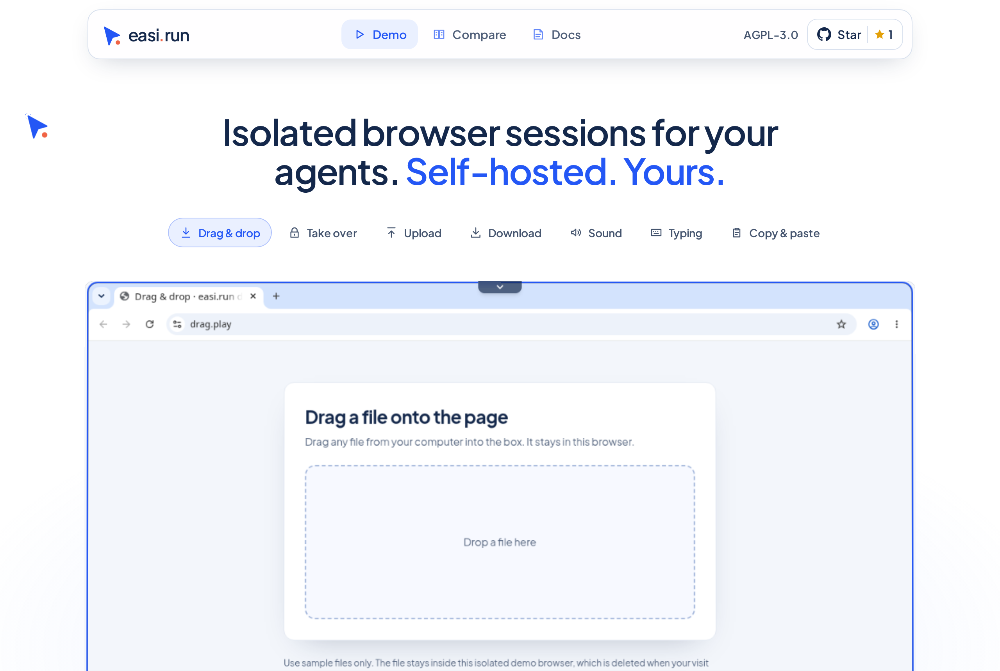
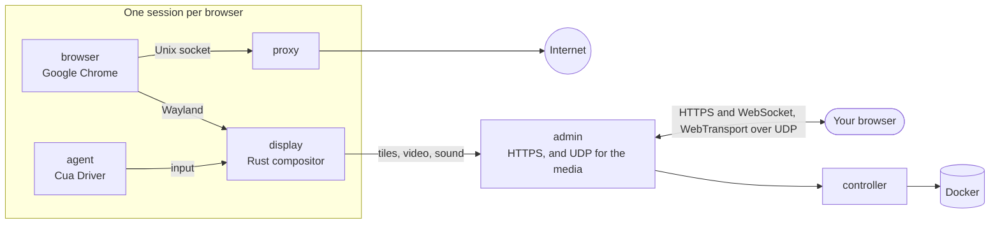

<div align="center">

<a href="https://easi.run"></a>

# easi.run

**Truly secure browser sessions for you and your agents.**

Give every agent its own real Chrome on your own server. Watch it live, and take over with one click when it hits
a login, a 2FA code or a CAPTCHA. Then hand it back.

[](https://github.com/julianosig/easi.run/actions/workflows/ci.yml)
[](CONTRIBUTING.md#coverage)
[](LICENSE)
[](https://github.com/julianosig/easi.run/stargazers)
[](https://github.com/julianosig/easi.run/commits/main)
[](https://www.rust-lang.org)
[](https://docs.easi.run/#/agents)

[**▶ Try the live demo**](https://easi.run/demo/) · [Features](https://easi.run/features/) ·
[Documentation](https://docs.easi.run) · [Quick start](#quick-start) · [Compare](https://easi.run/compare/)

<a href="https://easi.run/demo/"></a>

</div>

## What is it?

Agents that use the web need a browser. Most teams rent one by the hour from a cloud service, or glue together a
headless Chrome and a VNC server. easi.run is a third way: **one command starts it on your own Linux server**, and
from then on every agent gets an isolated Google Chrome, fresh or with your saved logins, and you get a live window
into each one.

When the agent gets stuck at something only a person can do, you take control from the session's bar. The agent
waits. You type the password, approve the 2FA prompt, or solve the puzzle. You give control back, and the agent carries
on.

## Why people use it

- 💸 **No per-hour bills.** It runs on your server, so you pay for the server and nothing else.
- 🙋 **A person can step in.** One click to take over, and the agent waits until you hand it back.
- 🔑 **Stay logged in.** A persistent session brings back your logins, site data (caches aside), history and
  preferences each time you resume it, on any site that keeps you logged in when Chrome closes, encrypted with a key only your password
  unlocks ([how](docs/security.md#boundaries)).
- 🔒 **What you type stays yours.** What's in a password field never reaches your agent. Once you take over,
  screenshots stop, and the exact text you type or paste, four characters or more, reaches it as `[redacted]`
  ([how](docs/security.md#boundaries)).
- 🧱 **Every browser in its own sandbox.** Its own containers, no network of its own, and no way into your private
  network ([security model](docs/security.md)).
- 🕵️ **A real Chrome that sites treat as a real Chrome.** Google Chrome itself, clean on BrowserScan, sannysoft and
  rebrowser's bot detector ([what sites see](docs/stealth.md)).
- 📁 **Files, sound and clipboard just work.** Drag a file onto the page, pick one with the page's own upload
  button, get downloads straight into your Downloads folder, hear the page, and copy and paste both ways.
- 🎥 **Record a session** on the server in high quality, with your camera and microphone if you like.
- 🤖 **Plugs into your agent.** A built-in [MCP server](https://docs.easi.run/#/agents) for Claude Code, Codex and any
  MCP client: on your server or over SSH with no token, or over HTTPS with one token per agent. The same tools over a
  plain REST API. The installer adds it to Claude Code for you when Claude Code is there and has no other server
  named `easi`.
- 📂 **Your agent's own downloads and uploads.** It saves what the page downloads and uploads files of its own, like
  an image it made. By default it asks you before each file, and uploading stays off until you turn it on
  ([how](https://docs.easi.run/#/agents)).
- 🌍 **Your own proxy per session**, checked before use, with the browser's time zone and languages suggested from
  where it exits.
- ⚡ **Our own streaming engine, not VNC.** A compositor written in Rust draws Chrome and streams it: still content as
  lossless tiles, motion as AV1, over UDP where your network allows. Crisp text, smooth video, and a fraction of the
  bandwidth of a VNC stream (numbers below).

## How it compares

<!-- compare:start -->

| | **easi.run** | Browserbase | Browserless | KasmVNC |
|---|:---:|:---:|:---:|:---:|
| Runs on your own server | ✅ | – | ✅ | ✅ |
| No usage fees | ✅ | – | – | ✅ |
| No plan limit on browsers at once | ✅ | – | – | ✅ |
| No plan limit on session length | ✅ | – | – | ✅ |
| Take over, and the agent waits | ✅ | – | ✅ | – |
| Build your own takeover screen | ✅ | – | – | – |
| An API your agents can call | ✅ | ✅ | ✅ | – |
| An MCP server for your agents | ✅ | ✅ | ✅ | – |
| Your typing hidden from the agent | ✅ | – | – | – |
| Encrypted session vaults only your password unlocks | ✅ | – | – | – |
| Private network off-limits | ✅ | – | – | – |
| Built-in stealth | ✅ | ✅ | ✅ | – |
| Live sound | ✅ | – | – | – |
| Drag a file straight onto the page | ✅ | – | – | – |
| Your own file picker for uploads | ✅ | – | – | – |
| Downloads land on your computer | ✅ | – | – | – |
| Copy and paste both ways | ✅ | – | ✅ | ✅ |
| Record the session | ✅ | ✅ | ✅ | – |
| Turn off input, clipboard, files or sound per session | ✅ | – | – | ✅ |
| Your own proxy per session, location matched | ✅ | – | – | – |
| Works over one HTTPS port, no TURN | ✅ | – | – | ✅ |
| Open source you can audit | ✅ | – | – | ✅ |

✅ has it · – doesn't, partly, not in their docs, or not applicable. The [full comparison](https://easi.run/compare/)
covers 19 alternatives, with [the sources and notes](docs/comparison.md) (October 2026).

<!-- compare:end -->

## Quick start

### Requirements

| | Minimum | Comfortable |
|---|---|---|
| Server | Any Linux x86-64 machine with Docker: a VPS from any cloud (Hetzner, DigitalOcean, AWS EC2 x86…) or your own server | |
| Software | Docker Engine 28+ (rootful, run by docker.service) with Compose and Buildx, systemd, git, curl, flock, iptables, ss, awk, stat, df, timeout and realpath | |
| Account | A non-root user in the docker group (`sudo usermod -aG docker $USER`, then log in again); no sudo needed: the installer makes its few changes as root through a short-lived privileged Docker container, which Docker must allow | |
| CPU | 2 cores | 4+ cores |
| Memory | 4 GB (one browser session at a time) | 8 GB+ (2 sessions at once on 8 GB, 4 on 16 GB) |
| Disk | 10 GB free (the images) | |
| GPU | none | |

Each browser session runs with its own limits: 2 CPUs and 2 GiB for Chrome by default, plus a display, proxy and agent
beside it (1152 MiB together), so it takes up to 3.2 GiB of memory. The installer runs as many sessions at once as
your server's memory holds, from 1 to 16, and its summary says how many; each starts when you or an agent asks for
one. To change these, put `BROWSER_CPUS`, `BROWSER_MEMORY_MIB` or `ADMIN_MAX_SESSIONS` in `~/easi.run/.env`, then run
`bash install.sh` again ([Configuration](https://docs.easi.run/#/configuration)).

### 1. Install

Ask your coding agent (Claude Code, Codex, or another) on your server:

```text
Read https://easi.run/install.md and install easi.run on this server.
```

Or run it yourself:

```sh
curl -fsSLO https://easi.run/install.sh && less install.sh && bash install.sh
```

It checks the server, puts the firewall rule in place that keeps pages off your server's own services, sets the
server's TCP for viewers far away (fq and BBR, when the kernel has BBR), starts easi.run, and adds it to Claude Code
when Claude Code is installed. It needs no sudo: the firewall rule and the TCP settings are made as root through a
short-lived privileged container of Debian's image, pulled by its digest, whose `nsenter` runs your server's own
`iptables`, `systemctl` and `sysctl`. Its summary tells you what it did, and where you create the admin's password.
Nothing is compiled on your server: the installer pulls the images easi.run's CI built and published, each checked
against the digest the installer names, and adds Google Chrome to the browser image from
Google's signed repository (Google's terms let no one else ship Chrome). The first run downloads about 550 MB and
takes one to two minutes on 2 cores with a fast connection.

### 2. Open the admin

- **On the server:** `https://localhost:9443`.
- **From your computer:** use the command you already use to log in to the server, adding
  `-N -L 9443:127.0.0.1:9443`, and keep it running; then open `https://localhost:9443`. For example:

  ```sh
  ssh -N -L 9443:127.0.0.1:9443 you@your-server
  ```

  The installer's summary prints this line, filled in with your login when it can tell it.
- **VS Code or Cursor over Remote-SSH** forward the port for you: open the link from their terminal, or add port 9443
  in their Ports view; either way, the local port must be 9443 too.

The certificate is your server's own, so the browser warns you about it: the installer keeps a copy in
`~/.config/easi-run/tls-cert.pem`, and the admin logs its fingerprint (`docker compose logs admin | grep fingerprint`,
in `~/easi.run`) for you to compare.

### 3. Create your password

Open `https://localhost:9443` (from your computer, through the SSH tunnel of step 2) right after the install: until a
password is set, the admin's first screen asks for one. Choose it, 12 characters or more; you are logged in at once.

- The admin keeps only its Argon2id hash. Wrong passwords and wrong second-step codes count together: the fifth
  starts a 2-second wait before the next attempt, each further one doubles it, up to 256 seconds, and a completed
  sign-in starts the count over.

Next, the admin offers a second step at sign-in. It is optional, and we suggest it: with it on, your password alone
opens nothing.

- **An authenticator app**, in every browser: scan the QR code with any app that shows 6-digit codes, then type the
  code it shows. Each code signs in once.
- **A passkey**, where your browser offers one: it signs you in on its own, with your fingerprint, face or device PIN.
  Chrome offers none on a site whose certificate it does not trust, such as the server's own over the tunnel; the page
  then says so, and the app works there.
- Then save the ten **recovery codes** it shows once: if you lose your phone or passkey, sign in with your password
  and one of them; each works once.

Turn either on, off or replace it later under **Security**. Lost your phone or passkey and your recovery codes? Run
`docker exec easi-run-admin-1 admin reset-second-step` on the server, and the password alone signs you in again.

From then on, log in, start a session, and take control from its bar whenever you want.

### Update

```sh
curl -fsSLO https://easi.run/install.sh && bash install.sh --update
```

It moves easi.run to the release the newest installer names, and removes the images of the one before; sessions
running at the time may end.

### Remove

```sh
bash ~/easi.run/install.sh --uninstall
```

After you confirm, it removes easi.run's containers, volumes and images, its firewall rule and the docker.service
drop-in that puts it in place, and its TCP settings, putting back the values they replaced (unless another easi.run
installation on the server still needs them),
its own files in `~/.config/easi-run` (the directory too, when nothing else is in it), and Claude Code's `easi` server
when it is this installation's.
It keeps the checkout, `~/easi.run`, Docker's build cache, and the Debian image its root steps ran in, and says how to
remove them.

### Reach the admin from anywhere

Without an SSH tunnel, you can put one of these in front of the admin, each with your own account. Exposing the admin
beyond the server is your choice. Either way, set `ADMIN_ORIGIN` to the address you will open
([Operations](https://docs.easi.run/#/operations) has the steps):

- **Tailscale:** `sudo tailscale serve --bg https+insecure://localhost:9443` serves it at
  `https://<machine>.<tailnet>.ts.net`, to your tailnet only; the admin stays on the server's `127.0.0.1`.
- **Cloudflare Tunnel with Cloudflare Access:** `cloudflared` carries it to a name on your domain, and Access checks
  who you are before any request reaches the admin's login page.

What protects it then: who may reach the address at all (your tailnet's devices, or your Access policy), then the
admin's sign-in: your password and, when you turned it on, the second step, or a passkey.

## Connect your agent

Every session your agent starts comes with a `watch_url`: open it to watch live and take over.

### Agent on the same server

When the installer's summary says MCP is ready, easi.run is in Claude Code: start a new Claude Code session and ask
it to browse. For Codex, or any MCP client that runs a command:

```sh
codex mcp add easi -- docker exec -i easi-run-admin-1 admin mcp
```

### Agent on your computer, server elsewhere

The same command, carried by SSH (log in with your SSH key): no token, port or certificate to set up.

```sh
claude mcp add --scope user easi -- ssh -T you@your-server docker exec -i easi-run-admin-1 admin mcp
codex mcp add easi -- ssh -T you@your-server docker exec -i easi-run-admin-1 admin mcp
```

Use the login you already use for the server in place of `you@your-server`. Keep the SSH tunnel from step 2 open to
watch the sessions in your browser.

### Agents that speak HTTP

Create a token under **Agent tokens** on the admin page, and use MCP at `/mcp` or the same tools under `/api/agent/`
([Agents guide](https://docs.easi.run/#/agents)).

### Your logins for the agent

Start a **Persistent** session, log in to your sites in it, and stop it: it keeps, encrypted, the logins a site keeps
when Chrome closes, and brings them back when it is resumed. Allow the agent's token (or the local MCP clients) on that saved session; the agent then finds it with
`list_saved_sessions` and resumes it with `start_session`'s `resume`.

## Performance

Against KasmVNC on the same host and CPU budget, medians of the headless runs (2026-10-21, over the WebSocket):

| | easi.run | KasmVNC |
|---|---|---|
| Smooth scroll | **55 fps**, 1.8 Mbit/s | 24 fps, 12.4 Mbit/s |
| Full-motion animation | **38 fps**, 2.0 Mbit/s | 24 fps, 25.4 Mbit/s |
| 1080p video | **36 fps**, 2.1 Mbit/s | 24 fps, 18.1 Mbit/s |
| Scrolling text | **1.9 Mbit/s**, SSIM 0.990 | 16.4 Mbit/s, SSIM 0.977 |
| Typing, key press to drawn frame | **28 ms** | 69 ms |
| Static page | no media traffic | no media traffic |

Every metric, the method and the raw results are in [the benchmark](docs/benchmark.md).

## How it works



A small compositor written in Rust (`display`) draws Chrome's windows into its own memory. Still content travels as
lossless tiles; motion stays lossless while that is cheap, and otherwise streams as AV1 video that sharpens to
pixel-perfect once motion stops; the page's sound travels as Opus, over one HTTPS port, and over UDP
(WebTransport) where your network lets it through, which keeps the stream smooth on lossy networks. Only the viewer
who holds control can type and click.

- [Security model](docs/security.md): every boundary, and the test that proves it
- [Architecture](docs/architecture.md): the repository's layout, and where each piece of code lives, following a frame
  and a key press
- [Design](docs/design.md) and [topology](docs/topology.md): the reasoning, the containers, their limits

## Contributing

Issues and pull requests are welcome. [`CONTRIBUTING.md`](CONTRIBUTING.md) covers building, testing and review, and
`scripts/dev/run.sh scripts/check.sh` runs the checks a change needs in the same image CI uses. Please report security
problems privately, as [`SECURITY.md`](SECURITY.md) describes.

## License

easi.run is free software under the [GNU Affero General Public License, version 3 only](LICENSE). Run it, change it,
and share it; if you offer a modified version to people over a network, offer them its source too. Every dependency
keeps its own license, listed in [`docs/licenses.md`](docs/licenses.md). The published images encode video only as
AV1, which is royalty-free; an H.264 encoder is an opt-in build feature (`--build-arg DISPLAY_FEATURES=h264`). They
are published as `ghcr.io/julianosig/easi.run-<role>`, each tagged and labelled with the commit of this repository it
was built from, which is its source; the browser image carries no Google Chrome, which each installation adds itself.
Each carries, in `/usr/share/doc/easi.run`, this license, where its source is, and the license and notice texts of what
it ships.

<div align="center">

**If easi.run saves your agents a headache, a ⭐ helps others find it.**

</div>
