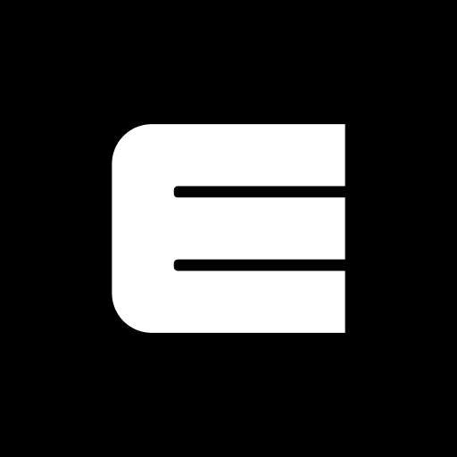
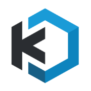
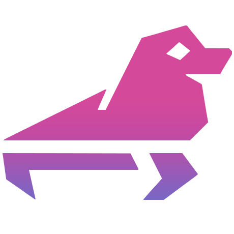

<div align="center">

<a href="https://easi.run"></a>

# easi.run

**Isolated browser sessions for your agents. Self-hosted. Yours.**

Give every agent its own real Chrome on your own server. Watch it live, and take over with one click when it hits
a login, a 2FA code or a CAPTCHA. Then hand it back.

[](https://github.com/julianosig/easi.run/actions/workflows/ci.yml)
[](LICENSE)
[](https://github.com/julianosig/easi.run/stargazers)
[](https://github.com/julianosig/easi.run/commits/main)
[](https://www.rust-lang.org)
[](https://docs.easi.run/#/agents)

[**▶ Try the live demo**](https://easi.run/demo/) · [Documentation](https://docs.easi.run) ·
[Quick start](#quick-start) · [Compare](https://easi.run/#compare)

<a href="https://easi.run/demo/"></a>

</div>

## What is it?

Agents that use the web need a browser. Most teams rent one by the hour from a cloud service, or glue together a
headless Chrome and a VNC server. easi.run is a third way: **one command starts it on your own Linux server**, and
from then on every agent gets a fresh, isolated Google Chrome, and you get a live window into each one.

When the agent gets stuck at something only a person can do, you click **Take control**. The agent waits. You type
the password, approve the 2FA prompt, or solve the puzzle. You click **Give back**, and the agent carries on. What
you typed (four characters or more) reaches the agent as `[redacted]`.

## Why people use it

- 💸 **No per-hour bills.** It runs on your server, so you pay for the server and nothing else. No plan limits on
  how long a session runs.
- 🙋 **A person can step in.** One click to take over, and the agent waits until you hand it back.
- 🔒 **Your passwords stay yours.** Text you type or paste while you are in control (four characters or more) reaches
  the agent as `[redacted]`, and the agent gets no screenshots after a takeover.
- 🧱 **Every browser in its own sandbox.** Each session gets its own containers; the browser has no network of its
  own and no way into your private network.
- 🕵️ **A real Chrome that sites treat as a real Chrome.** Google Chrome itself, clean on BrowserScan, sannysoft and
  rebrowser's bot detector ([what sites see](docs/stealth.md)).
- 📁 **Files, sound and clipboard just work.** Drag a file onto the page, pick one with the page's own upload
  button, get downloads straight into your Downloads folder, hear the page, and copy and paste both ways.
- 🎥 **Record a session** on the server in high quality, with your camera and microphone if you like.
- 🤖 **Plugs into your agent.** A built-in [MCP server](https://docs.easi.run/#/agents) that works with Claude Code,
  and a plain REST API, each with its own token per agent.
- 🌍 **Your own proxy per session**, with the browser's time zone and languages set to match where it connects from.
- ⚡ **Fast and light.** Crisp text, smooth video, and a fraction of the bandwidth of a VNC stream (numbers below).

## How it compares

What hurts when your agents run on someone else's browsers: hourly bills, logins only a person can finish, passwords
on a vendor's machine, files and sound that never reach you. Here is who solves it, across 21 criteria and 19
alternatives, from each product's own documentation, pricing and source (October 2026,
[the sources and notes](docs/comparison.md)).

<!-- compare:start -->

#### Against cloud browsers for agents

| | <br>**easi.run** | <br>Browserbase | <br>Browserless | <br>Steel | <br>Browser Use Cloud | <br>Hyperbrowser | <br>Anchor | <br>Kernel | <br>Cloudflare Browser Run | <br>AWS AgentCore Browser | <br>Bright Data Browser API | <br>E2B Desktop | <br>Hyperbeam |
|---|:---:|:---:|:---:|:---:|:---:|:---:|:---:|:---:|:---:|:---:|:---:|:---:|:---:|
| Runs on your own server | ✅ | – | ✅ | ✅ | – | – | ✅ | ✅ | – | – | – | ✅ | – |
| No usage fees | ✅ | – | – | – | – | – | – | – | – | – | – | – | – |
| No plan limit on browsers at once | ✅ | – | – | – | – | – | – | – | – | – | ✅ | – | – |
| No plan limit on session length | ✅ | – | – | – | – | – | ✅ | – | – | – | – | – | ✅ |
| Take over, and the agent waits | ✅ | – | ✅ | – | – | – | – | – | ✅ | – | – | – | – |
| Build your own takeover screen | ✅ | – | – | – | – | – | – | – | – | ✅ | – | – | ✅ |
| An API your agents can call | ✅ | ✅ | ✅ | ✅ | ✅ | ✅ | ✅ | ✅ | ✅ | ✅ | – | ✅ | – |
| An MCP server for your agents | ✅ | ✅ | ✅ | ✅ | ✅ | ✅ | ✅ | ✅ | ✅ | ✅ | ✅ | – | – |
| Your typing hidden from the agent | ✅ | – | – | – | – | – | – | – | – | – | – | – | – |
| Private network off-limits | ✅ | – | – | – | – | – | – | ✅ | – | – | – | – | – |
| Built-in stealth | ✅ | ✅ | ✅ | ✅ | ✅ | ✅ | ✅ | ✅ | – | – | ✅ | – | – |
| Live sound | ✅ | – | – | – | – | – | – | – | – | – | – | – | ✅ |
| Drag a file straight onto the page | ✅ | – | – | – | – | – | – | – | – | – | – | – | – |
| Your own file picker for uploads | ✅ | – | – | – | – | – | – | – | – | – | – | – | – |
| Downloads land on your computer | ✅ | – | – | – | – | – | – | – | – | – | – | – | – |
| Copy and paste both ways | ✅ | – | ✅ | – | – | – | – | ✅ | – | – | – | – | – |
| Record the session | ✅ | ✅ | ✅ | ✅ | ✅ | ✅ | ✅ | ✅ | ✅ | ✅ | – | – | – |
| Turn off input, clipboard, files or sound per session | ✅ | – | – | – | – | – | – | – | – | – | – | – | ✅ |
| Your own proxy per session, location matched | ✅ | – | – | – | – | – | – | – | – | – | – | – | – |
| One HTTPS port, no TURN or UDP | ✅ | – | – | – | – | – | – | – | – | – | – | – | – |
| Open source you can audit | ✅ | – | – | ✅ | – | – | – | ✅ | – | – | – | ✅ | – |

#### Against self-hosted remote browsers

| | <br>**easi.run** | <br>Kasm Workspaces | <br>neko | <br>Selkies / LinuxServer | <br>KasmVNC | <br>Apache Guacamole | <br>xpra | <br>noVNC |
|---|:---:|:---:|:---:|:---:|:---:|:---:|:---:|:---:|
| Runs on your own server | ✅ | ✅ | ✅ | ✅ | ✅ | ✅ | ✅ | ✅ |
| No usage fees | ✅ | ✅ | ✅ | ✅ | ✅ | ✅ | ✅ | ✅ |
| No plan limit on browsers at once | ✅ | – | ✅ | ✅ | ✅ | ✅ | ✅ | ✅ |
| No plan limit on session length | ✅ | ✅ | ✅ | ✅ | ✅ | ✅ | ✅ | ✅ |
| Take over, and the agent waits | ✅ | – | – | – | – | – | – | – |
| Build your own takeover screen | ✅ | – | ✅ | ✅ | – | ✅ | – | ✅ |
| An API your agents can call | ✅ | – | – | – | – | – | – | – |
| An MCP server for your agents | ✅ | – | – | – | – | – | – | – |
| Your typing hidden from the agent | ✅ | – | – | – | – | – | – | – |
| Private network off-limits | ✅ | – | – | – | – | – | – | – |
| Built-in stealth | ✅ | – | – | – | – | – | – | – |
| Live sound | ✅ | ✅ | ✅ | ✅ | – | ✅ | ✅ | – |
| Drag a file straight onto the page | ✅ | – | ✅ | – | – | – | – | – |
| Your own file picker for uploads | ✅ | – | – | – | – | – | – | – |
| Downloads land on your computer | ✅ | – | – | – | – | – | – | – |
| Copy and paste both ways | ✅ | ✅ | ✅ | ✅ | ✅ | ✅ | – | – |
| Record the session | ✅ | – | – | ✅ | – | ✅ | – | – |
| Turn off input, clipboard, files or sound per session | ✅ | – | ✅ | ✅ | ✅ | ✅ | ✅ | – |
| Your own proxy per session, location matched | ✅ | – | – | – | – | – | – | – |
| One HTTPS port, no TURN or UDP | ✅ | – | – | – | – | ✅ | ✅ | ✅ |
| Open source you can audit | ✅ | – | ✅ | ✅ | ✅ | ✅ | ✅ | ✅ |

<!-- compare:end -->

✅ has it · – doesn't, partly, not in their docs, or not applicable · Tap any mark on
[the landing](https://easi.run/#compare) for the details · Names and logos belong to their owners.

## Quick start

### Requirements

| | Minimum | Comfortable |
|---|---|---|
| Server | Linux on x86-64, any cloud VM or bare metal | |
| Software | Docker Engine 28+ with Compose, git, and sudo for one firewall rule | |
| CPU | 2 cores | 4+ cores |
| Memory | 4 GB | 8 GB+ (about 3 GB more per browser running at once) |
| Disk | 20 GB free (images and the first build) | |
| GPU | none | |

Each browser session runs with its own limits: 2 CPUs and 2 GiB for Chrome by default (`BROWSER_CPUS`,
`BROWSER_MEMORY_MIB`), plus a small display, proxy and agent beside it. Up to four sessions run at once by default
(`ADMIN_MAX_SESSIONS`, up to 16), each started when you or an agent asks for one.

### Let your agent install it

Paste this into Claude Code, Codex, or any coding agent running on your server:

```text
Install easi.run (https://github.com/julianosig/easi.run) on this Linux server:
1. Check the requirements: x86-64, Docker Engine 28+ with Compose, git, curl, iptables, sudo, 4 GB of memory and
   20 GB of free disk. If anything is missing, stop and tell me what.
2. Clone the repository and enter it.
3. Run `sudo iptables -I INPUT -i er-+ -j DROP` and save it in this host's persistent firewall configuration.
4. Run `DOCKER_GID=$(stat -c %g /var/run/docker.sock) docker compose up -d --build`, then wait until
   `curl -ksf https://localhost:9443/api/status` succeeds.
5. From `docker compose logs admin`, show me the one-time enrollment token and the HTTPS certificate's SHA-256
   fingerprint, and tell me how to open https://localhost:9443 from my computer (an SSH tunnel if this server is
   remote: ssh -L 9443:127.0.0.1:9443 user@server).
```

### Or by hand

```sh
git clone https://github.com/julianosig/easi.run && cd easi.run
sudo iptables -I INPUT -i er-+ -j DROP        # pages reach the internet, never the server's own services
DOCKER_GID=$(stat -c %g /var/run/docker.sock) docker compose up -d --build
docker compose logs admin | grep -i enroll    # a one-time enrollment token, valid for 15 minutes
```

Save the firewall rule in your host's persistent firewall configuration, so it holds after a reboot. It is written for
Docker's default userland proxy.

1. Open `https://localhost:9443`. On a remote server, reach it through SSH first:
   `ssh -L 9443:127.0.0.1:9443 you@your-server`. The certificate is self-signed, and the admin logs its SHA-256
   fingerprint so you can check it.
2. Enroll a password of at least 12 characters with the token. (Token expired? `docker compose restart admin` and run
   the last line again.)
3. Start a session with a public web address, watch it live, and press **Take control** whenever you want.

The [documentation](https://docs.easi.run) covers configuration, upstream proxies, limits per session and operations.

## Connect your agent

Create a token under **Agent tokens** on the admin page, then add easi.run to Claude Code:

```sh
# Claude Code checks certificates: trust the admin's own one first.
docker compose cp admin:/var/lib/admin/tls-cert.pem easi-run.pem
export NODE_EXTRA_CA_CERTS=$PWD/easi-run.pem

claude mcp add --transport http easi https://localhost:9443/mcp \
  --header "Authorization: Bearer easi_…"
```

Ask it to open a session and browse. Each session it starts comes with a `watch_url`, where you can watch and take
over. Prefer plain HTTP? The same tools are under `/api/agent/` ([Agents guide](https://docs.easi.run/#/agents)).

## Performance

Against KasmVNC on the same host and CPU budget, medians of the headless runs:

| | easi.run | KasmVNC |
|---|---|---|
| Smooth scroll | **55 fps**, 1.8 Mbit/s | 24 fps, 12.4 Mbit/s |
| Full-motion animation | **38 fps**, 2.0 Mbit/s | 24 fps, 25.4 Mbit/s |
| 1080p video | **36 fps**, 2.1 Mbit/s | 24 fps, 18.1 Mbit/s |
| Scrolling text | **1.9 Mbit/s**, SSIM 0.990 | 16.4 Mbit/s, SSIM 0.977 |
| Typing, key press to drawn frame | **28 ms** | 69 ms |
| Static page | no media traffic | no media traffic |

Every metric, the method and the raw results are in [the benchmark](docs/benchmark.md).

## How it works

```text
              ┌───────────── session (one per browser) ──────────────┐
 Internet ◀── │ proxy ◀─unix── browser ──wayland──▶ display ◀── agent  │
              └──────────────────────────────────────│───────────────┘
                                                unix │ link frames
                                                     ▼
 person's browser ◀──── HTTPS / WebSocket ──── admin ──── controller ──▶ Docker
```

A small compositor written in Rust (`display`) draws Chrome's windows into its own memory. Text and still content
travel as lossless tiles, motion as AV1 video, and the page's sound as Opus, all over one HTTPS port. Only the viewer
who holds control can type and click, and taking control stops the agent first, and proves it stopped.

- [Security model](docs/security.md): every boundary, and the test that proves it
- [Architecture](docs/architecture.md): where each piece of code lives, following a frame and a key press
- [Design](docs/design.md) and [topology](docs/topology.md): the reasoning, the containers, their limits

<details>
<summary><b>Repository layout</b></summary>

| Path | What |
|---|---|
| `display/` | the headless Wayland compositor (Smithay) and the per-viewer encoder |
| `protocol/` | the wire protocol, the admin-display link framing, and golden vectors |
| `client/` | the TypeScript viewer, the admin page, and the benchmark page |
| `admin/` | the HTTPS application: enrollment, login, sessions, the viewer relay, the lease, the agent, agent tokens, the agent API and MCP |
| `controller/` | the only Docker-socket holder: a closed set of operations on fixed templates |
| `proxy/` | the browser's egress proxy, which refuses private and special destinations |
| `browser/`, `agent/` | the Chrome image and the Cua Driver image |
| `egress/`, `locale/` | an upstream proxy and a session's time zone and languages, as every holder checks them |
| `affinity/` | keeps a process on the physical core it starts on |
| `bench/` | the fixtures, the KasmVNC baseline, the measuring runner, and results |
| `tests/` | end-to-end tests, hostile Wayland clients, and fuzz targets |
| `scripts/` | the checks, the development image, SBOMs, and the license report |
| `site/` | the easi.run landing and its documentation pages, and how they are published |
| `demo/` | the public demo's installation: the walled-garden pages and their Compose file |
| `third_party/` | a patched dependency ([`third_party/README.md`](third_party/README.md)) |

</details>

## Contributing

Issues and pull requests are welcome. [`CONTRIBUTING.md`](CONTRIBUTING.md) covers building, testing and review, and
`scripts/dev/run.sh scripts/check.sh` runs the checks a change needs in the same image CI uses. Please report security
problems privately, as [`SECURITY.md`](SECURITY.md) describes.

## License

easi.run is free software under the [GNU Affero General Public License, version 3 only](LICENSE). Run it, change it,
and share it; if you offer a modified version to people over a network, offer them its source too. Every dependency
keeps its own license, listed in [`docs/licenses.md`](docs/licenses.md). The published images encode video only as
AV1, which is royalty-free; an H.264 encoder is an opt-in build feature (`DISPLAY_FEATURES=h264`).

<div align="center">

**If easi.run saves your agents a headache, a ⭐ helps others find it.**

</div>
