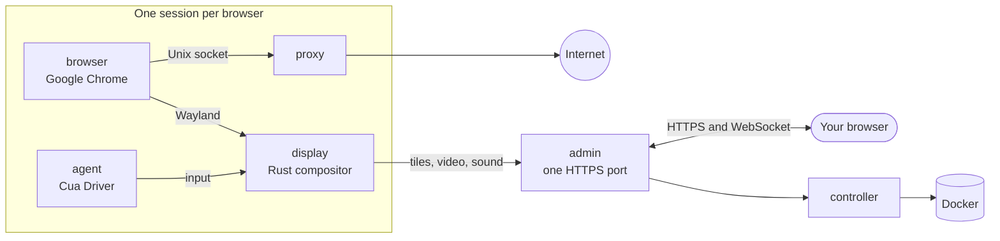

<div align="center">

<a href="https://easi.run"></a>

# easi.run

**Isolated browser sessions for your agents. Self-hosted. Yours.**

Give every agent its own real Chrome on your own server. Watch it live, and take over with one click when it hits
a login, a 2FA code or a CAPTCHA. Then hand it back.

[](https://github.com/julianosig/easi.run/actions/workflows/ci.yml)
[](LICENSE)
[](https://github.com/julianosig/easi.run/stargazers)
[](https://github.com/julianosig/easi.run/commits/main)
[](https://www.rust-lang.org)
[](https://docs.easi.run/#/agents)

[**▶ Try the live demo**](https://easi.run/demo/) · [Documentation](https://docs.easi.run) ·
[Quick start](#quick-start) · [Compare](https://easi.run/#compare)

<a href="https://easi.run/demo/"></a>

</div>

## What is it?

Agents that use the web need a browser. Most teams rent one by the hour from a cloud service, or glue together a
headless Chrome and a VNC server. easi.run is a third way: **one command starts it on your own Linux server**, and
from then on every agent gets a fresh, isolated Google Chrome, and you get a live window into each one.

When the agent gets stuck at something only a person can do, you click **Take control**. The agent waits. You type
the password, approve the 2FA prompt, or solve the puzzle. You click **Give back**, and the agent carries on. Text of
four characters or more you type or paste reaches the agent as `[redacted]`.

## Why people use it

- 💸 **No per-hour bills.** It runs on your server, so you pay for the server and nothing else. No plan limits on
  how long a session runs.
- 🙋 **A person can step in.** One click to take over, and the agent waits until you hand it back.
- 🔒 **Your passwords stay yours.** Text of four characters or more you type or paste while you are in control reaches
  the agent as `[redacted]`, and after a takeover its results lose their image items and `*_b64` screenshot fields.
- 🧱 **Every browser in its own sandbox.** Each session gets its own containers; the browser has no network of its
  own and no way into your private network.
- 🕵️ **A real Chrome that sites treat as a real Chrome.** Google Chrome itself, clean on BrowserScan, sannysoft and
  rebrowser's bot detector ([what sites see](docs/stealth.md)).
- 📁 **Files, sound and clipboard just work.** Drag a file onto the page, pick one with the page's own upload
  button, get downloads straight into your Downloads folder, hear the page, and copy and paste both ways.
- 🎥 **Record a session** on the server in high quality, with your camera and microphone if you like.
- 🤖 **Plugs into your agent.** A built-in [MCP server](https://docs.easi.run/#/agents) that works with Claude Code,
  and a plain REST API, each with its own token per agent.
- 🌍 **Your own proxy per session**, with the browser's time zone and languages set to match where it connects from.
- ⚡ **Fast and light.** Crisp text, smooth video, and a fraction of the bandwidth of a VNC stream (numbers below).

## How it compares

<!-- compare:start -->

| | **easi.run** | Browserbase | Browserless | KasmVNC |
|---|:---:|:---:|:---:|:---:|
| Runs on your own server | ✅ | – | ✅ | ✅ |
| No usage fees | ✅ | – | – | ✅ |
| No plan limit on browsers at once | ✅ | – | – | ✅ |
| No plan limit on session length | ✅ | – | – | ✅ |
| Take over, and the agent waits | ✅ | – | ✅ | – |
| Build your own takeover screen | ✅ | – | – | – |
| An API your agents can call | ✅ | ✅ | ✅ | – |
| An MCP server for your agents | ✅ | ✅ | ✅ | – |
| Your typing hidden from the agent | ✅ | – | – | – |
| Private network off-limits | ✅ | – | – | – |
| Built-in stealth | ✅ | ✅ | ✅ | – |
| Live sound | ✅ | – | – | – |
| Drag a file straight onto the page | ✅ | – | – | – |
| Your own file picker for uploads | ✅ | – | – | – |
| Downloads land on your computer | ✅ | – | – | – |
| Copy and paste both ways | ✅ | – | ✅ | ✅ |
| Record the session | ✅ | ✅ | ✅ | – |
| Turn off input, clipboard, files or sound per session | ✅ | – | – | ✅ |
| Your own proxy per session, location matched | ✅ | – | – | – |
| One HTTPS port, no TURN or UDP | ✅ | – | – | – |
| Open source you can audit | ✅ | – | – | ✅ |

<!-- compare:end -->

✅ has it · – doesn't, partly, not in their docs, or not applicable. The [full comparison](https://easi.run/#compare)
covers 19 alternatives, with [the sources and notes](docs/comparison.md) (October 2026).

## Quick start

### Requirements

| | Minimum | Comfortable |
|---|---|---|
| Server | Any Linux x86-64 machine with Docker: a VPS from any cloud (Hetzner, DigitalOcean, AWS EC2 x86…) or your own server | |
| Software | Docker Engine 28+ with Compose, systemd, git, curl, and sudo for the firewall rule | |
| CPU | 2 cores | 4+ cores |
| Memory | 4 GB | 8 GB+ (about 3 GB more per browser running at once) |
| Disk | 20 GB free (images and the first build) | |
| GPU | none | |

Each browser session runs with its own limits: 2 CPUs and 2 GiB for Chrome by default (`BROWSER_CPUS`,
`BROWSER_MEMORY_MIB`), plus a small display, proxy and agent beside it. Up to four sessions run at once by default
(`ADMIN_MAX_SESSIONS`, up to 16), each started when you or an agent asks for one.

### Install

Ask your agent (Claude Code, Codex, or any coding agent) on your server:

```text
Read https://easi.run/install.md and install easi.run on this server.
```

Or by hand:

```sh
curl -fsSLO https://easi.run/install.sh && less install.sh && bash install.sh
```

The installer checks the server, sets up the firewall rule that keeps pages off your server's own services, generates
a password for a new admin into `~/.config/easi-run/password`, starts easi.run, and offers it to Claude Code over MCP.
Its summary says where your password is and whether MCP is ready, with the line to add it otherwise. Then open
`https://localhost:9443` (from your computer: `ssh -N -L 9443:127.0.0.1:9443 you@your-server`), log in, and watch
your agent's sessions.

## Connect your agent

On the server, once the installer's summary says MCP is ready, easi.run is in Claude Code from its next session: ask
it to open a session and browse. Each session comes with a `watch_url`, where you watch it live and press **Take control** whenever you want.

From another computer, over SSH, with no token or certificate to copy:

```sh
claude mcp add --scope user easi -- ssh -T you@your-server docker exec -i easi-run-admin-1 admin mcp
```

Agents that speak HTTP use a token from **Agent tokens** on the admin page, over MCP at `/mcp` or the same tools under
`/api/agent/` ([Agents guide](https://docs.easi.run/#/agents)).

## Performance

Against KasmVNC on the same host and CPU budget, medians of the headless runs:

| | easi.run | KasmVNC |
|---|---|---|
| Smooth scroll | **55 fps**, 1.8 Mbit/s | 24 fps, 12.4 Mbit/s |
| Full-motion animation | **38 fps**, 2.0 Mbit/s | 24 fps, 25.4 Mbit/s |
| 1080p video | **36 fps**, 2.1 Mbit/s | 24 fps, 18.1 Mbit/s |
| Scrolling text | **1.9 Mbit/s**, SSIM 0.990 | 16.4 Mbit/s, SSIM 0.977 |
| Typing, key press to drawn frame | **28 ms** | 69 ms |
| Static page | no media traffic | no media traffic |

Every metric, the method and the raw results are in [the benchmark](docs/benchmark.md).

## How it works



A small compositor written in Rust (`display`) draws Chrome's windows into its own memory. Text and still content
travel as lossless tiles, motion as AV1 video, and the page's sound as Opus, all over one HTTPS port. Only the viewer
who holds control can type and click, and taking control pauses the agent's calls and proves none still runs,
stopping the agent's container if one does.

- [Security model](docs/security.md): every boundary, and the test that proves it
- [Architecture](docs/architecture.md): where each piece of code lives, following a frame and a key press
- [Design](docs/design.md) and [topology](docs/topology.md): the reasoning, the containers, their limits

<details>
<summary><b>Repository layout</b></summary>

| Path | What |
|---|---|
| `display/` | the headless Wayland compositor (Smithay) and the per-viewer encoder |
| `protocol/` | the wire protocol, the admin-display link framing, and golden vectors |
| `client/` | the TypeScript viewer, the admin page, and the benchmark page |
| `admin/` | the HTTPS application: enrollment, login, sessions, the viewer relay, the lease, the agent, agent tokens, the agent API and MCP |
| `controller/` | the only Docker-socket holder: a closed set of operations on fixed templates |
| `proxy/` | the browser's egress proxy, which refuses private and special destinations |
| `browser/`, `agent/` | the Chrome image and the Cua Driver image |
| `egress/`, `locale/` | an upstream proxy and a session's time zone and languages, as every holder checks them |
| `affinity/` | keeps a process on as many neighboring physical cores as its CPU quota, rounded up |
| `bench/` | the fixtures, the KasmVNC baseline, the measuring runner, and results |
| `tests/` | end-to-end tests, hostile Wayland clients, and fuzz targets |
| `scripts/` | the checks, the development image, SBOMs, and the license report |
| `site/` | the easi.run landing and its documentation pages, and how they are published |
| `demo/` | the public demo's installation: the walled-garden pages and their Compose file |
| `third_party/` | a patched dependency ([`third_party/README.md`](third_party/README.md)) |

</details>

## Contributing

Issues and pull requests are welcome. [`CONTRIBUTING.md`](CONTRIBUTING.md) covers building, testing and review, and
`scripts/dev/run.sh scripts/check.sh` runs the checks a change needs in the same image CI uses. Please report security
problems privately, as [`SECURITY.md`](SECURITY.md) describes.

## License

easi.run is free software under the [GNU Affero General Public License, version 3 only](LICENSE). Run it, change it,
and share it; if you offer a modified version to people over a network, offer them its source too. Every dependency
keeps its own license, listed in [`docs/licenses.md`](docs/licenses.md). The published images encode video only as
AV1, which is royalty-free; an H.264 encoder is an opt-in build feature (`--build-arg DISPLAY_FEATURES=h264`).

<div align="center">

**If easi.run saves your agents a headache, a ⭐ helps others find it.**

</div>
