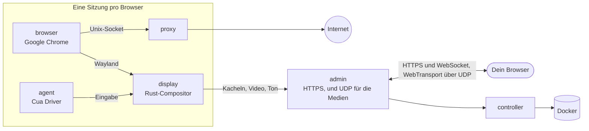

<div align="center">

<a href="https://easi.run/de/"></a>

# easi.run

**Wirklich sicheres Surfen für dich und deine Agenten.**

Gib jedem Agenten sein eigenes, echtes Chrome auf deinem eigenen Server. Schau live zu und übernimm mit einem Klick,
wenn er an einem Login, einem 2FA-Code oder einem CAPTCHA hängt. Dann gib ihm die Kontrolle zurück.

[](https://github.com/julianosig/easi.run/actions/workflows/ci.yml)
[](../../CONTRIBUTING.md#coverage)
[](../../LICENSE)
[](https://github.com/julianosig/easi.run/stargazers)
[](https://github.com/julianosig/easi.run/commits/main)
[](https://www.rust-lang.org)
[](https://docs.easi.run/de/#/agents)

[**▶ Live-Demo ausprobieren**](https://easi.run/demo/?locale=de) · [Features](https://easi.run/de/features/) ·
[Dokumentation](https://docs.easi.run/de/) · [Schnellstart](#schnellstart) · [Vergleich](https://easi.run/de/compare/)

[English](../../README.md) · [Português (Brasil)](pt-BR.md) · [Español](es.md) · [简体中文](zh-CN.md) · [हिन्दी](hi.md) ·
[Français](fr.md) · Deutsch · [日本語](ja.md) · [Русский](ru.md) · [Bahasa Indonesia](id.md) · [한국어](ko.md)

<a href="https://easi.run/de/"></a>

</div>

## Was ist das?

Agenten, die das Web nutzen, brauchen einen Browser. Die meisten Teams mieten einen stundenweise bei einem Cloud-Dienst
oder kleben ein headless Chrome und einen VNC-Server zusammen. easi.run ist ein dritter Weg: **Ein Befehl startet es auf
deinem eigenen Linux-Server**, und von da an bekommt jeder Agent ein isoliertes Google Chrome, frisch oder mit deinen
gespeicherten Logins, und du bekommst ein Live-Fenster in jedes davon.

Wenn der Agent an etwas hängen bleibt, das nur ein Mensch kann, übernimmst du die Kontrolle über die Leiste der Sitzung.
Der Agent wartet. Du tippst das Passwort, bestätigst die 2FA-Anfrage oder löst das Rätsel. Du gibst die Kontrolle
zurück, und der Agent macht weiter.

## Warum man es nutzt

- 💸 **Keine Stundenabrechnung.** Es läuft auf deinem Server, also zahlst du den Server und sonst nichts.
- 🙋 **Ein Mensch kann eingreifen.** Ein Klick zum Übernehmen, und der Agent wartet, bis du zurückgibst.
- 🔑 **Bleib eingeloggt.** Eine dauerhafte Sitzung bringt deine Logins, die Websitedaten (ohne Caches), den Verlauf und
  die Einstellungen bei jedem Fortsetzen zurück, auf jeder Website, die dich eingeloggt lässt, wenn Chrome schließt,
  verschlüsselt mit einem Schlüssel, den nur dein Passwort entsperrt ([wie](../security.md#boundaries)).
- 🔒 **Was du tippst, gehört dir.** Was in einem Passwortfeld steht, erreicht deinen Agenten nie. Sobald du übernimmst,
  stoppen die Screenshots, und der genaue Text, den du tippst oder einfügst, ab vier Zeichen, kommt bei ihm als
  `[redacted]` an ([wie](../security.md#boundaries)).
- 🧱 **Jeder Browser in seiner eigenen Sandbox.** Eigene Container, kein eigenes Netzwerk und kein Weg in dein privates
  Netzwerk ([Sicherheitsmodell](../security.md)).
- 🕵️ **Ein echtes Chrome, das Websites als echtes Chrome behandeln.** Google Chrome selbst, sauber bei BrowserScan,
  sannysoft und dem Bot-Detektor von rebrowser ([was Websites sehen](../stealth.md)).
- 📁 **Dateien, Ton und Zwischenablage funktionieren einfach.** Zieh eine Datei auf die Seite, wähle eine mit dem
  eigenen Upload-Button der Seite, bekomm Downloads direkt in deinen Downloads-Ordner, hör die Seite, und kopiere und
  füge in beide Richtungen ein.
- 🎥 **Nimm eine Sitzung auf** dem Server in hoher Qualität auf, auf Wunsch mit deiner Kamera und deinem Mikrofon.
- 🤖 **Passt an deinen Agenten.** Ein eingebauter [MCP-Server](https://docs.easi.run/de/#/agents) für Claude Code, Codex
  und jeden MCP-Client: auf deinem Server oder über SSH ohne Token, oder über HTTPS mit einem Token pro Agent. Dieselben
  Werkzeuge über eine einfache REST-API. Der Installer trägt ihn für dich in Claude Code ein, wenn Claude Code da ist und
  keinen anderen Server namens `easi` hat.
- 📂 **Downloads und Uploads deines Agenten.** Er speichert, was die Seite herunterlädt, und lädt eigene Dateien hoch,
  etwa ein Bild, das er erstellt hat. Standardmäßig fragt er dich vor jeder Datei
  ([wie](https://docs.easi.run/de/#/agents)).
- 🌍 **Dein eigener Proxy pro Sitzung**, vor der Nutzung geprüft, mit Zeitzone und Sprachen des Browsers passend zu
  seinem Ausgangsort vorgeschlagen.
- ⚡ **Unsere eigene Streaming-Engine, kein VNC.** Ein in Rust geschriebener Compositor zeichnet Chrome und streamt es:
  stehende Inhalte als verlustfreie Kacheln, Bewegung als AV1, über UDP, wo dein Netzwerk es zulässt. Scharfer Text,
  flüssiges Video und ein Bruchteil der Bandbreite eines VNC-Streams (Zahlen unten).

## Im Vergleich

<!-- compare:start -->

| | **easi.run** | Browserbase | Browserless | KasmVNC |
|---|:---:|:---:|:---:|:---:|
| Läuft auf deinem eigenen Server | ✅ | – | ✅ | ✅ |
| Keine Nutzungsgebühren | ✅ | – | – | ✅ |
| Kein Tarif-Limit für gleichzeitige Browser | ✅ | – | – | ✅ |
| Kein Tarif-Limit für die Sitzungsdauer | ✅ | – | – | ✅ |
| Übernimm, der Agent wartet | ✅ | – | ✅ | – |
| Eigene Übernahme-Oberfläche bauen | ✅ | – | – | – |
| Eine API, die deine Agenten aufrufen können | ✅ | ✅ | ✅ | – |
| Ein MCP-Server für deine Agenten | ✅ | ✅ | ✅ | – |
| Deine Eingaben bleiben dem Agenten verborgen | ✅ | – | – | – |
| Verschlüsselte Sitzungstresore, die nur dein Passwort öffnet | ✅ | – | – | – |
| Privates Netzwerk tabu | ✅ | – | – | – |
| Eingebauter Stealth-Modus | ✅ | ✅ | ✅ | – |
| Live-Ton | ✅ | – | – | – |
| Datei direkt auf die Seite ziehen | ✅ | – | – | – |
| Deine eigene Dateiauswahl für Uploads | ✅ | – | – | – |
| Downloads landen auf deinem Computer | ✅ | – | – | – |
| Kopieren und Einfügen in beide Richtungen | ✅ | – | ✅ | ✅ |
| Sitzung aufzeichnen | ✅ | ✅ | ✅ | – |
| Eingabe, Zwischenablage, Dateien oder Ton pro Sitzung abschalten | ✅ | – | – | ✅ |
| Eigener Proxy pro Sitzung, passend zum Standort | ✅ | – | – | – |
| Ein HTTPS-Port genügt, kein TURN | ✅ | – | – | ✅ |
| Quelloffen und prüfbar | ✅ | – | – | ✅ |

✅ vorhanden · – nicht vorhanden, teilweise, nicht in ihrer Doku oder nicht zutreffend. Der
[vollständige Vergleich](https://easi.run/de/compare/) umfasst 19 Alternativen, mit [Quellen und Notizen](../comparison.md) (Oktober 2026).

<!-- compare:end -->

## Schnellstart

### Voraussetzungen

| | Minimum | Komfortabel |
|---|---|---|
| Server | Jede Linux-x86-64-Maschine mit Docker: ein VPS bei einer beliebigen Cloud (Hetzner, DigitalOcean, AWS EC2 x86…) oder dein eigener Server | |
| Software | Docker Engine 28+ (rootful, von docker.service gestartet) mit Compose und Buildx, systemd, git, curl, flock, iptables, ss, awk, stat, df, timeout und realpath | |
| Konto | Ein Nicht-root-Benutzer in der Gruppe docker (`sudo usermod -aG docker $USER`, dann neu anmelden); kein sudo nötig: Der Installer macht seine wenigen Änderungen als root über einen kurzlebigen privilegierten Docker-Container, den Docker erlauben muss | |
| CPU | 2 Kerne | 4+ Kerne |
| Arbeitsspeicher | 4 GB (eine Browser-Sitzung gleichzeitig) | 8 GB+ (2 Sitzungen gleichzeitig mit 8 GB, 4 mit 16 GB) |
| Festplatte | 10 GB frei (die Images) | |
| GPU | keine | |

Jede Browser-Sitzung läuft mit eigenen Grenzen: standardmäßig 2 CPUs und 2 GiB für Chrome, dazu ein Display, ein Proxy
und ein Agent daneben (zusammen 1152 MiB), also belegt sie bis zu 3,2 GiB Arbeitsspeicher. Der Installer betreibt so
viele Sitzungen gleichzeitig, wie der Arbeitsspeicher deines Servers fasst, von 1 bis 16, und seine Zusammenfassung sagt,
wie viele; jede startet, wenn du oder ein Agent eine anfordert. Um das zu ändern, setz `BROWSER_CPUS`,
`BROWSER_MEMORY_MIB` oder `ADMIN_MAX_SESSIONS` in `~/easi.run/.env` und führ `bash install.sh` erneut aus
([Konfiguration](https://docs.easi.run/de/#/configuration)).

### 1. Installieren

Bitte deinen Coding-Agenten (Claude Code, Codex oder einen anderen) auf deinem Server:

```text
Read https://easi.run/install.md and install easi.run on this server.
```

Oder führ es selbst aus:

```sh
curl -fsSLO https://easi.run/install.sh && less install.sh && bash install.sh
```

Er prüft den Server, richtet die Firewall-Regel ein, die Seiten von den eigenen Diensten des Servers fernhält, stellt
das TCP des Servers auf weit entfernte Zuschauer ein (fq und BBR, wenn der Kernel BBR hat), startet easi.run und trägt
es in Claude Code ein, wenn Claude Code installiert ist. Er braucht kein sudo: Die Firewall-Regel und die
TCP-Einstellungen werden als root über einen kurzlebigen privilegierten Container aus Debians Image gesetzt, per Digest
geladen, dessen `nsenter` die eigenen `iptables`, `systemctl` und `sysctl` des Servers ausführt. Seine Zusammenfassung
sagt dir, was er getan hat und wo du das Passwort des Admins anlegst. Auf deinem Server wird nichts kompiliert: Der
Installer lädt die Images, die die CI von easi.run gebaut und veröffentlicht hat, jedes gegen den Digest geprüft, den
der Installer nennt, und fügt Google Chrome aus Googles signiertem Repository zum Browser-Image hinzu (Googles
Bedingungen erlauben niemand anderem, Chrome auszuliefern). Der erste Lauf lädt etwa 550 MB und dauert ein bis zwei
Minuten auf 2 Kernen mit schneller Verbindung.

### 2. Den Admin öffnen

- **Auf dem Server:** `https://localhost:9443`.
- **Von deinem Computer:** Nimm den Befehl, mit dem du dich schon am Server anmeldest, häng `-N -L
  9443:127.0.0.1:9443` an und lass ihn laufen; öffne dann `https://localhost:9443`. Zum Beispiel:

  ```sh
  ssh -N -L 9443:127.0.0.1:9443 you@your-server
  ```

  Die Zusammenfassung des Installers gibt diese Zeile aus, mit deinem Login ausgefüllt, wenn er ihn erkennen kann.
- **VS Code oder Cursor mit Remote-SSH** leiten den Port für dich weiter: Öffne den Link aus ihrem Terminal oder füge
  Port 9443 in ihrer Ports-Ansicht hinzu; in beiden Fällen muss auch der lokale Port 9443 sein.

Das Zertifikat ist das eigene des Servers, also warnt dich der Browser davor: Der Installer bewahrt eine Kopie in
`~/.config/easi-run/tls-cert.pem` auf, und der Admin protokolliert seinen Fingerabdruck (`docker compose logs admin |
grep fingerprint`, in `~/easi.run`), damit du ihn vergleichen kannst.

### 3. Dein Passwort anlegen

Öffne `https://localhost:9443` (von deinem Computer, durch den SSH-Tunnel aus Schritt 2) direkt nach der Installation:
Solange kein Passwort gesetzt ist, fragt der erste Bildschirm des Admins nach einem. Wähl eines mit 12 Zeichen oder
mehr; du bist sofort angemeldet.

- Der Admin speichert nur seinen Argon2id-Hash. Falsche Passwörter und falsche Codes des zweiten Schritts zählen
  zusammen: Der fünfte startet eine Wartezeit von 2 Sekunden vor dem nächsten Versuch, jeder weitere verdoppelt sie, bis
  zu 256 Sekunden, und eine abgeschlossene Anmeldung setzt die Zählung zurück.

Danach bietet der Admin einen zweiten Schritt bei der Anmeldung an. Er ist optional, und wir empfehlen ihn: Ist er an,
öffnet dein Passwort allein nichts.

- **Eine Authenticator-App**, in jedem Browser: Scann den QR-Code mit einer beliebigen App, die 6-stellige Codes zeigt,
  und tipp den angezeigten Code ein. Jeder Code meldet einmal an.
- **Ein Passkey**, wo dein Browser einen anbietet: Er meldet dich von selbst an, mit Fingerabdruck, Gesicht oder der PIN
  des Geräts. Chrome bietet keinen auf einer Website an, deren Zertifikat es nicht vertraut, etwa der des Servers durch
  den Tunnel; die Seite sagt das dann, und die App funktioniert dort.
- Speichere dann die zehn **Wiederherstellungscodes**, die er einmal zeigt: Verlierst du dein Handy oder deinen Passkey,
  meld dich mit deinem Passwort und einem davon an; jeder funktioniert einmal.

Schalte beides später unter **Sicherheit** ein, aus oder ersetze es. Handy oder Passkey und Wiederherstellungscodes
verloren? Führ `docker exec easi-run-admin-1 admin reset-second-step` auf dem Server aus, dann meldet dich das Passwort
allein wieder an.

Ab dann: anmelden, eine Sitzung starten und über ihre Leiste übernehmen, wann immer du willst.

### Aktualisieren

```sh
curl -fsSLO https://easi.run/install.sh && bash install.sh --update
```

Er bringt easi.run auf das Release, das der neueste Installer nennt, und entfernt die Images des vorherigen; zu dem
Zeitpunkt laufende Sitzungen können enden.

### Entfernen

```sh
bash ~/easi.run/install.sh --uninstall
```

Nach deiner Bestätigung entfernt er die Container, Volumes und Images von easi.run, seine Firewall-Regel und das
docker.service-Drop-in, das sie einrichtet, und seine TCP-Einstellungen, wobei er die ersetzten Werte wiederherstellt
(außer eine andere easi.run-Installation auf dem Server braucht sie noch), seine eigenen Dateien in
`~/.config/easi-run` (auch das Verzeichnis, wenn sonst nichts darin liegt) und den `easi`-Server von Claude Code, wenn
er zu dieser Installation gehört. Er behält den Checkout, `~/easi.run`, den Build-Cache von Docker und das
Debian-Image, in dem seine root-Schritte liefen, und sagt, wie man sie entfernt.

### Den Admin von überall erreichen

Ohne SSH-Tunnel kannst du einen dieser Dienste vor den Admin setzen, jeweils mit deinem eigenen Konto. Ob du den Admin
über den Server hinaus freigibst, entscheidest du. So oder so: Setz `ADMIN_ORIGIN` auf die Adresse, die du öffnen wirst
([Betrieb](https://docs.easi.run/de/#/operations) hat die Schritte):

- **Tailscale:** `sudo tailscale serve --bg https+insecure://localhost:9443` stellt ihn unter
  `https://<machine>.<tailnet>.ts.net` bereit, nur für dein Tailnet; der Admin bleibt auf `127.0.0.1` des Servers.
- **Cloudflare Tunnel mit Cloudflare Access:** `cloudflared` bringt ihn zu einem Namen in deiner Domain, und Access
  prüft, wer du bist, bevor eine Anfrage die Anmeldeseite des Admins erreicht.

Was ihn dann schützt: wer die Adresse überhaupt erreichen darf (die Geräte deines Tailnets oder deine Access-Richtlinie),
dann die Anmeldung am Admin: dein Passwort und, wenn du ihn eingeschaltet hast, der zweite Schritt, oder ein Passkey.

## Deinen Agenten verbinden

Jede Sitzung, die dein Agent startet, kommt mit einer `watch_url`: Öffne sie, um live zuzusehen und zu übernehmen.

### Agent auf demselben Server

Wenn die Zusammenfassung des Installers sagt, dass MCP bereit ist, ist easi.run in Claude Code: Starte eine neue
Claude-Code-Sitzung und bitte sie zu surfen. Für Codex oder jeden MCP-Client, der einen Befehl ausführt:

```sh
codex mcp add easi -- docker exec -i easi-run-admin-1 admin mcp
```

### Agent auf deinem Computer, Server woanders

Derselbe Befehl, über SSH getragen (meld dich mit deinem SSH-Schlüssel an): kein Token, Port oder Zertifikat
einzurichten.

```sh
claude mcp add --scope user easi -- ssh -T you@your-server docker exec -i easi-run-admin-1 admin mcp
codex mcp add easi -- ssh -T you@your-server docker exec -i easi-run-admin-1 admin mcp
```

Setz statt `you@your-server` den Login ein, den du schon für den Server nutzt. Lass den SSH-Tunnel aus Schritt 2 offen,
um die Sitzungen in deinem Browser zu verfolgen.

### Agenten, die HTTP sprechen

Erstelle ein Token auf der Seite **Agenten** des Admins und nutze MCP unter `/mcp` oder dieselben Werkzeuge unter
`/api/agent/` ([Leitfaden für Agenten](https://docs.easi.run/de/#/agents)).

### Deine Logins für den Agenten

Starte eine **Dauerhafte** Sitzung, melde dich darin bei deinen Websites an und stoppe sie: Sie bewahrt, verschlüsselt,
die Logins auf, die eine Website behält, wenn Chrome schließt, und bringt sie beim Fortsetzen zurück. Erlaube das Token
des Agenten (oder die lokalen MCP-Clients) für diese gespeicherte Sitzung; der Agent findet sie dann mit
`list_saved_sessions` und setzt sie mit `resume` von `start_session` fort.

## Leistung

Gegen KasmVNC auf demselben Host mit demselben CPU-Budget, Mediane der headless Läufe (2026-10-21, über den WebSocket):

| | easi.run | KasmVNC |
|---|---|---|
| Flüssiges Scrollen | **55 fps**, 1,8 Mbit/s | 24 fps, 12,4 Mbit/s |
| Vollbewegte Animation | **38 fps**, 2,0 Mbit/s | 24 fps, 25,4 Mbit/s |
| 1080p-Video | **36 fps**, 2,1 Mbit/s | 24 fps, 18,1 Mbit/s |
| Scrollender Text | **1,9 Mbit/s**, SSIM 0,990 | 16,4 Mbit/s, SSIM 0,977 |
| Tippen, vom Tastendruck zum gezeichneten Frame | **28 ms** | 69 ms |
| Stehende Seite | kein Medienverkehr | kein Medienverkehr |

Jede Messgröße, die Methode und die Rohdaten stehen im [Benchmark](../benchmark.md).

## Wie es funktioniert



Ein kleiner, in Rust geschriebener Compositor (`display`) zeichnet die Fenster von Chrome in seinen eigenen Speicher.
Stehende Inhalte reisen als verlustfreie Kacheln; Bewegung bleibt verlustfrei, solange das günstig ist, und wird sonst
als AV1-Video gestreamt, das pixelgenau scharf wird, sobald die Bewegung stoppt; der Ton der Seite reist als Opus, über
einen einzigen HTTPS-Port, und über UDP (WebTransport), wo dein Netzwerk es durchlässt, was den Stream in verlustreichen
Netzen flüssig hält. Nur wer die Kontrolle hat, kann tippen und klicken.

- [Sicherheitsmodell](../security.md): jede Grenze und der Test, der sie belegt
- [Architektur](../architecture.md): der Aufbau des Repositorys und wo welcher Code liegt, entlang eines Frames und
  eines Tastendrucks
- [Design](../design.md) und [Topologie](../topology.md): die Überlegungen, die Container, ihre Grenzen

Diese Dokumente sind auf Englisch.

## Mitmachen

Issues und Pull Requests sind willkommen. [`CONTRIBUTING.md`](../../CONTRIBUTING.md) behandelt Bauen, Testen und
Review, und `scripts/dev/run.sh scripts/check.sh` führt die Prüfungen, die eine Änderung braucht, im selben Image aus,
das die CI nutzt. Bitte melde Sicherheitsprobleme vertraulich, wie [`SECURITY.md`](../../SECURITY.md) es beschreibt.

## Lizenz

easi.run ist freie Software unter der [GNU Affero General Public License, nur Version 3](../../LICENSE). Nutze es,
ändere es und teile es; wenn du eine geänderte Version anderen über ein Netzwerk anbietest, biete ihnen auch ihren
Quellcode an. Jede Abhängigkeit behält ihre eigene Lizenz, aufgeführt in [`docs/licenses.md`](../licenses.md). Die
veröffentlichten Images kodieren Video nur als AV1, das lizenzgebührenfrei ist; ein H.264-Encoder ist ein optionales
Build-Feature (`--build-arg DISPLAY_FEATURES=h264`). Sie werden als `ghcr.io/julianosig/easi.run-<role>` veröffentlicht,
jedes mit dem Commit dieses Repositorys getaggt und gelabelt, aus dem es gebaut wurde, das sein Quellcode ist; das
Browser-Image enthält kein Google Chrome, das jede Installation selbst hinzufügt. Jedes enthält in
`/usr/share/doc/easi.run` diese Lizenz, den Ort seines Quellcodes und die Lizenz- und Hinweistexte dessen, was es
mitliefert.

<div align="center">

**Wenn easi.run deinen Agenten Kopfschmerzen erspart, hilft ein ⭐ anderen, es zu finden.**

</div>
