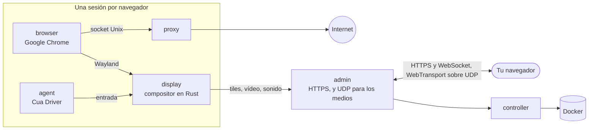

<div align="center">

<a href="https://easi.run/es/"></a>

# easi.run

**Navegación segura de verdad para ti y tus agentes.**

Dale a cada agente su propio Chrome de verdad, en tu propio servidor. Míralo en vivo y toma el control con un clic
cuando se tope con un inicio de sesión, un código de 2FA o un CAPTCHA. Después, devuélveselo.

[](https://github.com/julianosig/easi.run/actions/workflows/ci.yml)
[](../../CONTRIBUTING.md#coverage)
[](../../LICENSE)
[](https://github.com/julianosig/easi.run/stargazers)
[](https://github.com/julianosig/easi.run/commits/main)
[](https://www.rust-lang.org)
[](https://docs.easi.run/es/#/agents)

<a href="https://www.producthunt.com/products/easi-run?utm_source=badge-follow&utm_medium=badge&utm_source=badge-easi&#0045;run" target="_blank"></a>

[**▶ Prueba la demo en vivo**](https://easi.run/demo/?locale=es) · [Funciones](https://easi.run/es/features/) ·
[Documentación](https://docs.easi.run/es/) · [Inicio rápido](#inicio-rápido) · [Comparar](https://easi.run/es/compare/)

[English](../../README.md) · [Português (Brasil)](pt-BR.md) · Español · [简体中文](zh-CN.md) · [हिन्दी](hi.md) ·
[Français](fr.md) · [Deutsch](de.md) · [日本語](ja.md) · [Русский](ru.md) · [Bahasa Indonesia](id.md) · [한국어](ko.md)

<a href="https://easi.run/es/"></a>

</div>

## ¿Qué es?

Los agentes que usan la web necesitan un navegador. La mayoría de los equipos alquila uno por horas a un servicio en la
nube, o junta un Chrome headless con un servidor VNC. easi.run es una tercera vía: **un comando lo inicia en tu propio
servidor Linux**, y a partir de ahí cada agente recibe un Google Chrome aislado, nuevo o con tus inicios de sesión
guardados, y tú recibes una ventana en vivo a cada uno.

Cuando el agente se atasca en algo que solo una persona puede hacer, tomas el control desde la barra de la sesión. El
agente espera. Escribes la contraseña, apruebas el aviso de 2FA o resuelves el reto. Le devuelves el control, y el
agente sigue.

## Por qué la gente lo usa

- 💸 **Sin facturas por hora.** Corre en tu servidor, así que pagas el servidor y nada más.
- 🙋 **Una persona puede intervenir.** Un clic para tomar el control, y el agente espera hasta que se lo devuelvas.
- 🔔 **Tu agente te avisa cuando te necesita.** Ante un inicio de sesión o un CAPTCHA, te pide ayuda y dice por qué:
  su sesión muestra *Te necesita* con la hora, y un webhook firmado puede avisar a Slack, Discord o tu propia
  herramienta ([cómo](https://docs.easi.run/es/#/agents)).
- 🔑 **Mantén la sesión iniciada.** Una sesión persistente recupera tus inicios de sesión, los datos de los sitios
  (salvo las cachés), el historial y las preferencias cada vez que la reanudas, en cualquier sitio que mantiene tu
  sesión cuando Chrome se cierra, cifrados con una clave que solo tu contraseña desbloquea
  ([cómo](../security.md#boundaries)).
  Una actualización guarda antes las que están en marcha.
- 🔒 **Lo que escribes es tuyo.** Lo que hay en un campo de contraseña nunca llega a tu agente. Cuando tomas el
  control, las capturas de pantalla se detienen, y el texto exacto que escribes o pegas, de cuatro caracteres o más, le
  llega como `[redacted]` ([cómo](../security.md#boundaries)).
- 🧱 **Cada navegador en su propio sandbox.** Sus propios contenedores, ninguna red propia y ningún camino hacia tu
  red privada ([modelo de seguridad](../security.md)).
- 🕵️ **Un Chrome de verdad que los sitios tratan como un Chrome de verdad.** El propio Google Chrome, limpio en
  BrowserScan, sannysoft y el detector de bots de rebrowser ([lo que ven los sitios](../stealth.md)).
- 📁 **Archivos, sonido y portapapeles funcionan sin más.** Arrastra un archivo a la página, elige uno con el propio
  botón de subida de la página, recibe las descargas directamente en tu carpeta Descargas, escucha la página, y copia y
  pega en ambos sentidos.
- 🎥 **Graba una sesión** en el servidor en alta calidad, con tu cámara y tu micrófono si quieres.
- 🧾 **Mira qué pasó mientras no estabas.** Cada sesión guarda una cronología de las acciones de su agente: quién hizo
  cada una y cómo fue, con lo tecleado contado en caracteres. Con la grabación activa, como viene por defecto, también
  repites la pantalla del agente ([cómo](https://docs.easi.run/es/#/sessions)).
- 💬 **Chatea con tu propio agente junto a la página.** Abre tu Claude Code o Codex en una terminal sobre una sesión, con tu
  propia cuenta: solo alcanza ese navegador y no puede actuar mientras tienes el control ([cómo](https://docs.easi.run/#/sessions)).
- 🤖 **Se conecta a tu agente.** Un [servidor MCP](https://docs.easi.run/es/#/agents) integrado para Claude Code,
  Codex y cualquier cliente MCP: en tu servidor o por SSH sin token, o por HTTPS con un token por agente. Las mismas
  herramientas en una API REST sencilla. El instalador lo añade a Claude Code por ti cuando Claude Code está ahí y no
  tiene otro servidor llamado `easi`.
- 📂 **Las descargas y subidas del propio agente.** Guarda lo que la página descarga y sube archivos propios, como una
  imagen que hizo. Por defecto te pregunta antes de cada archivo
  ([cómo](https://docs.easi.run/es/#/agents)).
- 🌍 **Tu propio proxy por sesión**, comprobado antes de usarlo, con la zona horaria y los idiomas del navegador
  sugeridos según dónde sale.
- ⚡ **Nuestro propio motor de streaming, no VNC.** Un compositor escrito en Rust dibuja Chrome y lo transmite: el
  contenido quieto como tiles sin pérdida, el movimiento como AV1, por UDP donde tu red lo permite. Texto nítido, vídeo
  fluido y una fracción del ancho de banda de un stream VNC (cifras más abajo).

## Cómo se compara

<!-- compare:start -->

| | **easi.run** | Browserbase | Browserless | KasmVNC |
|---|:---:|:---:|:---:|:---:|
| Funciona en tu propio servidor | ✅ | – | ✅ | ✅ |
| Sin cargos por uso | ✅ | – | – | ✅ |
| Sin límite del plan en navegadores simultáneos | ✅ | – | – | ✅ |
| Sin límite del plan de duración de sesión | ✅ | – | – | ✅ |
| Tomas el control y el agente espera | ✅ | – | ✅ | – |
| Tu agente te llama y te avisan | ✅ | – | ✅ | – |
| Crea tu propia pantalla de toma de control | ✅ | – | – | – |
| Una API que tus agentes pueden llamar | ✅ | ✅ | ✅ | – |
| Un servidor MCP para tus agentes | ✅ | ✅ | ✅ | – |
| El agente no ve lo que escribes | ✅ | – | – | – |
| Bóvedas de sesión cifradas que solo abre tu contraseña | ✅ | – | – | – |
| Red privada fuera de alcance | ✅ | – | – | – |
| Modo stealth integrado | ✅ | ✅ | ✅ | – |
| Sonido en vivo | ✅ | – | – | – |
| Arrastra un archivo directo a la página | ✅ | – | – | – |
| Tu propio selector de archivos para subidas | ✅ | – | – | – |
| Las descargas llegan a tu ordenador | ✅ | – | – | – |
| Copiar y pegar en ambos sentidos | ✅ | – | ✅ | ✅ |
| Graba la sesión | ✅ | ✅ | ✅ | – |
| Cronología de las acciones del agente, con repetición | ✅ | ✅ | – | – |
| Tu propio Claude Code o Codex junto al navegador en vivo | ✅ | – | – | – |
| Desactiva entrada, portapapeles, archivos o sonido por sesión | ✅ | – | – | ✅ |
| Tu propio proxy por sesión, con la misma ubicación | ✅ | – | – | – |
| Funciona con un solo puerto HTTPS, sin TURN | ✅ | – | – | ✅ |
| Código abierto que puedes auditar | ✅ | – | – | ✅ |

✅ lo tiene · – no lo tiene, lo tiene en parte, no está en su documentación, o no aplica. La
[comparación completa](https://easi.run/es/compare/) cubre 19 alternativas, con [las fuentes y notas](../comparison.md) (octubre a noviembre de 2026).

<!-- compare:end -->

## Inicio rápido

### Requisitos

| | Mínimo | Cómodo |
|---|---|---|
| Servidor | Cualquier máquina Linux x86-64 con Docker: un VPS de cualquier nube (Hetzner, DigitalOcean, AWS EC2 x86…) o tu propio servidor | |
| Software | Docker Engine 28+ (rootful, ejecutado por docker.service) con Compose y Buildx, systemd, git, curl, flock, iptables, ss, awk, stat, df, timeout y realpath | |
| Cuenta | Un usuario no root en el grupo docker (`sudo usermod -aG docker $USER`, y vuelve a iniciar sesión); sin sudo: el instalador hace sus pocos cambios como root mediante un contenedor Docker privilegiado de corta duración, que Docker debe permitir | |
| CPU | 2 núcleos | 4+ núcleos |
| Memoria | 4 GB (una sesión de navegador a la vez) | 8 GB+ (2 sesiones a la vez con 8 GB, 4 con 16 GB) |
| Disco | 10 GB libres (las imágenes) | |
| GPU | ninguna | |

Cada sesión de navegador corre con sus propios límites: 2 CPU y 2 GiB para Chrome por defecto, más un display, un proxy
y un agente al lado (1152 MiB juntos), así que ocupa hasta 3,2 GiB de memoria. El instalador ejecuta tantas sesiones a
la vez como cabe en la memoria de tu servidor, de 1 a 16, y su resumen dice cuántas; cada una empieza cuando tú o un
agente la piden. Para cambiarlo, pon `BROWSER_CPUS`, `BROWSER_MEMORY_MIB` o `ADMIN_MAX_SESSIONS` en `~/easi.run/.env`
y vuelve a ejecutar `bash install.sh` ([Configuración](https://docs.easi.run/es/#/configuration)).

### 1. Instálalo

Pídeselo a tu agente de programación (Claude Code, Codex u otro) en tu servidor:

```text
Read https://easi.run/install.md and install easi.run on this server.
```

O ejecútalo tú mismo:

```sh
curl -fsSLO https://easi.run/install.sh && less install.sh && bash install.sh
```

Comprueba el servidor, pone la regla de firewall que mantiene las páginas lejos de los servicios del propio servidor,
ajusta el TCP del servidor para espectadores lejanos (fq y BBR, cuando el kernel tiene BBR), inicia easi.run y lo añade
a Claude Code cuando Claude Code está instalado. No necesita sudo: la regla de firewall y los ajustes de TCP se hacen
como root mediante un contenedor privilegiado de corta duración de la imagen de Debian, obtenida por su digest, cuyo
`nsenter` ejecuta el `iptables`, el `systemctl` y el `sysctl` del propio servidor. Su resumen te dice qué hizo y dónde
creas la contraseña del admin. No se compila nada en tu servidor: el instalador descarga las imágenes que la CI de
easi.run construyó y publicó, cada una comprobada contra el digest que el instalador indica, y añade Google Chrome a la
imagen del navegador desde el repositorio firmado de Google (los términos de Google no permiten que nadie más distribuya
Chrome). La primera ejecución descarga unos 550 MB y tarda de uno a dos minutos con 2 núcleos y una conexión rápida.

### 2. Abre el admin

- **En el servidor:** `https://localhost:9443`.
- **Desde tu ordenador:** usa el comando que ya usas para entrar al servidor, añadiendo `-N -L 9443:127.0.0.1:9443`,
  y déjalo corriendo; luego abre `https://localhost:9443`. Por ejemplo:

  ```sh
  ssh -N -L 9443:127.0.0.1:9443 you@your-server
  ```

  El resumen del instalador imprime esta línea, completada con tu usuario cuando puede saberlo.
- **VS Code o Cursor con Remote-SSH** reenvían el puerto por ti: abre el enlace desde su terminal, o añade el puerto
  9443 en su vista Ports; en ambos casos, el puerto local también debe ser 9443.

El certificado es del propio servidor, así que el navegador te avisa: el instalador guarda una copia en
`~/.config/easi-run/tls-cert.pem`, y el admin registra su huella (`docker compose logs admin | grep fingerprint`, en
`~/easi.run`) para que la compares.

### 3. Crea tu contraseña

Abre `https://localhost:9443` (desde tu ordenador, por el túnel SSH del paso 2) justo después de instalar: mientras no
haya contraseña, la primera pantalla del admin te pide una. Elígela, de 12 caracteres o más; entras al momento.

- El admin guarda solo su hash Argon2id. Las contraseñas erróneas y los códigos erróneos del segundo paso cuentan
  juntos: el quinto inicia una espera de 2 segundos antes del siguiente intento, cada uno más la duplica, hasta 256
  segundos, y un inicio de sesión completado pone la cuenta a cero.

Después, el admin ofrece un segundo paso al iniciar sesión. Es opcional, y lo recomendamos: con él activado, tu
contraseña sola no abre nada.

- **Una app de autenticación**, en cualquier navegador: escanea el código QR con cualquier app que muestre códigos de 6
  dígitos y escribe el código que muestra. Cada código sirve para entrar una vez.
- **Una passkey**, donde tu navegador ofrezca una: inicia sesión por sí sola, con tu huella, tu cara o el PIN del
  dispositivo. Chrome no ofrece ninguna en un sitio cuyo certificado no reconoce, como el del propio servidor por el
  túnel; la página entonces lo dice, y la app funciona ahí.
- Luego guarda los diez **códigos de recuperación** que muestra una sola vez: si pierdes el teléfono o la passkey,
  entra con tu contraseña y uno de ellos; cada uno funciona una vez.

Activa, desactiva o reemplaza cualquiera más tarde en **Seguridad**. ¿Perdiste el teléfono o la passkey y tus códigos
de recuperación? Ejecuta `docker exec easi-run-admin-1 admin reset-second-step` en el servidor, y la contraseña sola
vuelve a darte acceso.

A partir de ahí, inicia sesión, empieza una sesión y toma el control desde su barra cuando quieras.

### Actualizar

```sh
curl -fsSLO https://easi.run/install.sh && bash install.sh --update
```

Lleva easi.run a la versión que indica el instalador más reciente y elimina las imágenes de la anterior; las sesiones
en curso en ese momento pueden terminar.

### Desinstalar

```sh
bash ~/easi.run/install.sh --uninstall
```

Tras tu confirmación, elimina los contenedores, volúmenes e imágenes de easi.run, su regla de firewall y el drop-in de
docker.service que la pone en su sitio, y sus ajustes de TCP, restaurando los valores que reemplazaron (salvo que otra
instalación de easi.run en el servidor aún los necesite), sus propios archivos en `~/.config/easi-run` (también el
directorio, cuando no queda nada más en él), y el servidor `easi` de Claude Code cuando es de esta instalación.
Conserva el checkout, `~/easi.run`, la caché de build de Docker y la imagen de Debian en la que corrieron sus pasos como
root, y te dice cómo eliminarlos.

### Accede al admin desde cualquier lugar

Sin un túnel SSH, puedes poner uno de estos delante del admin, cada uno con tu propia cuenta. Exponer el admin más allá
del servidor es decisión tuya. En cualquier caso, pon en `ADMIN_ORIGIN` la dirección que vas a abrir
([Operaciones](https://docs.easi.run/es/#/operations) tiene los pasos):

- **Tailscale:** `sudo tailscale serve --bg https+insecure://localhost:9443` lo sirve en
  `https://<machine>.<tailnet>.ts.net`, solo para tu tailnet; el admin sigue en el `127.0.0.1` del servidor.
- **Cloudflare Tunnel con Cloudflare Access:** `cloudflared` lo lleva a un nombre de tu dominio, y Access comprueba
  quién eres antes de que ninguna petición llegue a la página de inicio de sesión del admin.

Lo que lo protege entonces: quién puede llegar a la dirección (los dispositivos de tu tailnet, o tu política de
Access), y después el inicio de sesión del admin: tu contraseña y, si lo activaste, el segundo paso, o una passkey.

## Conecta tu agente

Cada sesión que inicia tu agente trae una `watch_url`: ábrela para mirar en vivo y tomar el control.

### Agente en el mismo servidor

Cuando el resumen del instalador dice que MCP está listo, easi.run está en Claude Code y en Codex (cada uno instalado
para la cuenta que ejecutó el instalador): abre una nueva sesión y pídele que navegue. Para otra cuenta, o cualquier
cliente MCP que ejecuta un comando:

```sh
codex mcp add easi -- docker exec -i easi-run-admin-1 admin mcp
```

### Agente en tu ordenador, servidor en otro sitio

El mismo comando, llevado por SSH (entra con tu clave SSH): ningún token, puerto ni certificado que configurar.

```sh
claude mcp add --scope user easi -- ssh -T you@your-server docker exec -i easi-run-admin-1 admin mcp
codex mcp add easi -- ssh -T you@your-server docker exec -i easi-run-admin-1 admin mcp
```

Usa el usuario que ya usas para el servidor en lugar de `you@your-server`. Deja abierto el túnel SSH del paso 2 para
mirar las sesiones en tu navegador.

### Agentes que hablan HTTP

Crea un token en la página **Agentes** del admin, y usa MCP en `/mcp` o las mismas herramientas en `/api/agent/`
([guía de agentes](https://docs.easi.run/es/#/agents)).

### Tus inicios de sesión para el agente

Inicia una sesión **Persistente**, entra en tus sitios en ella y detenla: guarda, cifrados, los inicios de sesión que un
sitio mantiene cuando Chrome se cierra, y los recupera cuando se reanuda. Permite el token del agente (o los clientes
MCP locales) en esa sesión guardada; el agente la encuentra entonces con `list_saved_sessions` y la reanuda con el
`resume` de `start_session`.

## Rendimiento

Frente a KasmVNC en el mismo host y con el mismo presupuesto de CPU, medianas de las ejecuciones headless (2026-10-21,
por el WebSocket):

| | easi.run | KasmVNC |
|---|---|---|
| Desplazamiento suave | **55 fps**, 1,8 Mbit/s | 24 fps, 12,4 Mbit/s |
| Animación a pantalla completa | **38 fps**, 2,0 Mbit/s | 24 fps, 25,4 Mbit/s |
| Vídeo 1080p | **36 fps**, 2,1 Mbit/s | 24 fps, 18,1 Mbit/s |
| Texto desplazándose | **1,9 Mbit/s**, SSIM 0,990 | 16,4 Mbit/s, SSIM 0,977 |
| Escritura, de la tecla al fotograma dibujado | **28 ms** | 69 ms |
| Página quieta | sin tráfico de medios | sin tráfico de medios |

Cada métrica, el método y los resultados en bruto están en [el benchmark](../benchmark.md).

## Cómo funciona



Un pequeño compositor escrito en Rust (`display`) dibuja las ventanas de Chrome en su propia memoria. El contenido
quieto viaja como tiles sin pérdida; el movimiento sigue sin pérdida mientras eso sale barato, y si no se transmite como
vídeo AV1 que se vuelve perfecto al píxel en cuanto el movimiento se detiene; el sonido de la página viaja como Opus,
por un único puerto HTTPS, y por UDP (WebTransport) donde tu red lo deja pasar, lo que mantiene el stream fluido en
redes con pérdidas. Solo quien tiene el control puede escribir y hacer clic.

- [Modelo de seguridad](../security.md): cada frontera, y la prueba que lo demuestra
- [Arquitectura](../architecture.md): la estructura del repositorio, y dónde vive cada parte del código, siguiendo un
  fotograma y una pulsación de tecla
- [Diseño](../design.md) y [topología](../topology.md): el razonamiento, los contenedores, sus límites

Estos documentos están en inglés.

## Contribuir

Los issues y pull requests son bienvenidos. [`CONTRIBUTING.md`](../../CONTRIBUTING.md) explica cómo compilar, probar y
revisar, y `scripts/dev/run.sh scripts/check.sh` ejecuta las comprobaciones que necesita un cambio en la misma imagen
que usa la CI. Por favor, informa de los problemas de seguridad en privado, como describe
[`SECURITY.md`](../../SECURITY.md).

## Licencia

easi.run es software libre bajo la [GNU Affero General Public License, solo la versión 3](../../LICENSE). Ejecútalo,
modifícalo y compártelo; si ofreces una versión modificada a otras personas a través de una red, ofréceles también su
código fuente. Cada dependencia conserva su propia licencia, listadas en [`docs/licenses.md`](../licenses.md). Las
imágenes publicadas codifican vídeo solo como AV1, que está libre de regalías; un codificador H.264 es una función de
build opcional (`--build-arg DISPLAY_FEATURES=h264`). Se publican como `ghcr.io/julianosig/easi.run-<role>`, cada una
con la etiqueta y el label del commit de este repositorio desde el que se construyó, que es su código fuente; la imagen
del navegador no lleva Google Chrome, que cada instalación añade por su cuenta. Cada una incluye, en
`/usr/share/doc/easi.run`, esta licencia, dónde está su código fuente, y los textos de licencia y aviso de lo que
incluye.

<div align="center">

**Si easi.run les ahorra un dolor de cabeza a tus agentes, una ⭐ ayuda a que otros lo encuentren.**

</div>
