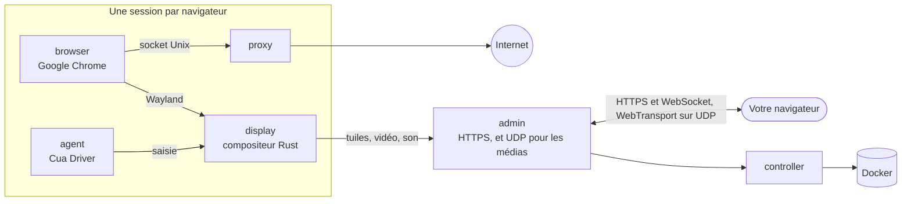

<div align="center">

<a href="https://easi.run/fr/"></a>

# easi.run

**Une navigation vraiment sûre pour vous et vos agents.**

Donnez à chaque agent son propre vrai Chrome, sur votre propre serveur. Suivez-le en direct, et prenez la main en un
clic quand il bute sur une connexion, un code 2FA ou un CAPTCHA. Puis rendez-lui la main.

[](https://github.com/julianosig/easi.run/actions/workflows/ci.yml)
[](../../CONTRIBUTING.md#coverage)
[](../../LICENSE)
[](https://github.com/julianosig/easi.run/stargazers)
[](https://github.com/julianosig/easi.run/commits/main)
[](https://www.rust-lang.org)
[](https://docs.easi.run/fr/#/agents)

[**▶ Essayez la démo en direct**](https://easi.run/demo/?locale=fr) · [Fonctionnalités](https://easi.run/fr/features/) ·
[Documentation](https://docs.easi.run/fr/) · [Démarrage rapide](#démarrage-rapide) · [Comparer](https://easi.run/fr/compare/)

[English](../../README.md) · [Português (Brasil)](pt-BR.md) · [Español](es.md) · [简体中文](zh-CN.md) · [हिन्दी](hi.md) ·
Français · [Deutsch](de.md) · [日本語](ja.md) · [Русский](ru.md) · [Bahasa Indonesia](id.md) · [한국어](ko.md)

<a href="https://easi.run/fr/"></a>

</div>

## Qu'est-ce que c'est ?

Les agents qui utilisent le web ont besoin d'un navigateur. La plupart des équipes en louent un à l'heure à un service
cloud, ou assemblent un Chrome headless et un serveur VNC. easi.run est une troisième voie : **une commande le lance sur
votre propre serveur Linux**, et dès lors chaque agent reçoit un Google Chrome isolé, neuf ou avec vos connexions
enregistrées, et vous recevez une fenêtre en direct sur chacun.

Quand l'agent bloque sur quelque chose que seule une personne peut faire, vous prenez la main depuis la barre de la
session. L'agent attend. Vous tapez le mot de passe, approuvez la demande 2FA ou résolvez l'énigme. Vous lui rendez la
main, et l'agent continue.

## Pourquoi on l'utilise

- 💸 **Pas de facture à l'heure.** Il tourne sur votre serveur : vous payez le serveur, et rien d'autre.
- 🙋 **Une personne peut intervenir.** Un clic pour prendre la main, et l'agent attend que vous la lui rendiez.
- 🔑 **Restez connecté.** Une session persistante restaure vos connexions, les données des sites (hors caches),
  l'historique et les préférences à chaque reprise, sur tout site qui vous garde connecté quand Chrome se ferme,
  chiffrés avec une clé que seul votre mot de passe déverrouille ([comment](../security.md#boundaries)).
- 🔒 **Ce que vous tapez reste à vous.** Le contenu d'un champ de mot de passe n'atteint jamais votre agent. Dès que
  vous prenez la main, les captures d'écran s'arrêtent, et le texte exact que vous tapez ou collez, de quatre caractères
  ou plus, lui parvient sous la forme `[redacted]` ([comment](../security.md#boundaries)).
- 🧱 **Chaque navigateur dans son propre bac à sable.** Ses propres conteneurs, aucun réseau à lui, et aucun accès à
  votre réseau privé ([modèle de sécurité](../security.md)).
- 🕵️ **Un vrai Chrome que les sites traitent comme un vrai Chrome.** Google Chrome lui-même, propre sur BrowserScan,
  sannysoft et le détecteur de bots de rebrowser ([ce que voient les sites](../stealth.md)).
- 📁 **Fichiers, son et presse-papiers, tout simplement.** Glissez un fichier sur la page, choisissez-en un avec le
  propre bouton d'envoi de la page, recevez les téléchargements directement dans votre dossier Téléchargements, écoutez
  la page, et copiez-collez dans les deux sens.
- 🎥 **Enregistrez une session** sur le serveur en haute qualité, avec votre caméra et votre micro si vous le souhaitez.
- 🤖 **Se branche sur votre agent.** Un [serveur MCP](https://docs.easi.run/fr/#/agents) intégré pour Claude Code,
  Codex et tout client MCP : sur votre serveur ou via SSH sans jeton, ou via HTTPS avec un jeton par agent. Les mêmes
  outils via une simple API REST. L'installateur l'ajoute à Claude Code pour vous quand Claude Code est présent et n'a
  aucun autre serveur nommé `easi`.
- 📂 **Les téléchargements et envois de votre agent.** Il enregistre ce que la page télécharge et envoie ses propres
  fichiers, comme une image qu'il a créée. Par défaut il vous demande avant chaque fichier
  ([comment](https://docs.easi.run/fr/#/agents)).
- 🌍 **Votre propre proxy par session**, vérifié avant usage, avec le fuseau horaire et les langues du navigateur
  suggérés d'après son point de sortie.
- ⚡ **Notre propre moteur de streaming, pas du VNC.** Un compositeur écrit en Rust dessine Chrome et le diffuse : le
  contenu immobile en tuiles sans perte, le mouvement en AV1, via UDP là où votre réseau le permet. Un texte net, une
  vidéo fluide, et une fraction de la bande passante d'un flux VNC (chiffres plus bas).

## Comment il se compare

<!-- compare:start -->

| | **easi.run** | Browserbase | Browserless | KasmVNC |
|---|:---:|:---:|:---:|:---:|
| Tourne sur votre propre serveur | ✅ | – | ✅ | ✅ |
| Pas de frais d’utilisation | ✅ | – | – | ✅ |
| Navigateurs simultanés sans limite de forfait | ✅ | – | – | ✅ |
| Durée de session sans limite de forfait | ✅ | – | – | ✅ |
| Vous prenez la main, l’agent attend | ✅ | – | ✅ | – |
| Votre propre écran de prise de contrôle | ✅ | – | – | – |
| Une API que vos agents peuvent appeler | ✅ | ✅ | ✅ | – |
| Un serveur MCP pour vos agents | ✅ | ✅ | ✅ | – |
| Votre saisie masquée à l’agent | ✅ | – | – | – |
| Coffres de session chiffrés que seul votre mot de passe déverrouille | ✅ | – | – | – |
| Réseau privé inaccessible | ✅ | – | – | – |
| Furtivité intégrée | ✅ | ✅ | ✅ | – |
| Son en direct | ✅ | – | – | – |
| Glissez un fichier directement sur la page | ✅ | – | – | – |
| Votre propre sélecteur de fichiers pour les envois | ✅ | – | – | – |
| Les téléchargements arrivent sur votre ordinateur | ✅ | – | – | – |
| Copier-coller dans les deux sens | ✅ | – | ✅ | ✅ |
| Enregistrer la session | ✅ | ✅ | ✅ | – |
| Désactiver saisie, presse-papiers, fichiers ou son par session | ✅ | – | – | ✅ |
| Votre propre proxy par session, calé sur sa localisation | ✅ | – | – | – |
| Un seul port HTTPS suffit, sans TURN | ✅ | – | – | ✅ |
| Open source et auditable | ✅ | – | – | ✅ |

✅ l'a · – ne l'a pas, en partie, absent de leur documentation, ou sans objet. La
[comparaison complète](https://easi.run/fr/compare/) couvre 19 alternatives, avec [les sources et les notes](../comparison.md) (octobre 2026).

<!-- compare:end -->

## Démarrage rapide

### Prérequis

| | Minimum | Confortable |
|---|---|---|
| Serveur | N'importe quelle machine Linux x86-64 avec Docker : un VPS de n'importe quel cloud (Hetzner, DigitalOcean, AWS EC2 x86…) ou votre propre serveur | |
| Logiciels | Docker Engine 28+ (rootful, lancé par docker.service) avec Compose et Buildx, systemd, git, curl, flock, iptables, ss, awk, stat, df, timeout et realpath | |
| Compte | Un utilisateur non root dans le groupe docker (`sudo usermod -aG docker $USER`, puis reconnectez-vous) ; pas besoin de sudo : l'installateur fait ses quelques changements en root via un conteneur Docker privilégié de courte durée, que Docker doit autoriser | |
| CPU | 2 cœurs | 4+ cœurs |
| Mémoire | 4 Go (une session de navigateur à la fois) | 8 Go+ (2 sessions simultanées avec 8 Go, 4 avec 16 Go) |
| Disque | 10 Go libres (les images) | |
| GPU | aucun | |

Chaque session de navigateur tourne avec ses propres limites : 2 CPU et 2 Gio pour Chrome par défaut, plus un display,
un proxy et un agent à côté (1152 Mio ensemble), elle occupe donc jusqu'à 3,2 Gio de mémoire. L'installateur lance
autant de sessions simultanées que la mémoire de votre serveur le permet, de 1 à 16, et son résumé indique combien ;
chacune démarre quand vous ou un agent en demandez une. Pour changer cela, mettez `BROWSER_CPUS`, `BROWSER_MEMORY_MIB`
ou `ADMIN_MAX_SESSIONS` dans `~/easi.run/.env`, puis relancez `bash install.sh`
([Configuration](https://docs.easi.run/fr/#/configuration)).

### 1. Installez

Demandez à votre agent de code (Claude Code, Codex ou un autre) sur votre serveur :

```text
Read https://easi.run/install.md and install easi.run on this server.
```

Ou lancez-le vous-même :

```sh
curl -fsSLO https://easi.run/install.sh && less install.sh && bash install.sh
```

Il vérifie le serveur, met en place la règle de pare-feu qui tient les pages à l'écart des services du serveur
lui-même, règle le TCP du serveur pour les spectateurs lointains (fq et BBR, quand le noyau a BBR), démarre easi.run et
l'ajoute à Claude Code quand Claude Code est installé. Il n'a pas besoin de sudo : la règle de pare-feu et les réglages
TCP sont faits en root via un conteneur privilégié de courte durée de l'image Debian, récupérée par son digest, dont le
`nsenter` exécute les `iptables`, `systemctl` et `sysctl` du serveur lui-même. Son résumé vous dit ce qu'il a fait, et
où créer le mot de passe de l'admin. Rien n'est compilé sur votre serveur : l'installateur récupère les images que la
CI d'easi.run a construites et publiées, chacune vérifiée contre le digest que l'installateur indique, et ajoute Google
Chrome à l'image du navigateur depuis le dépôt signé de Google (les conditions de Google ne laissent personne d'autre
distribuer Chrome). Le premier lancement télécharge environ 550 Mo et prend une à deux minutes sur 2 cœurs avec une
connexion rapide.

### 2. Ouvrez l'admin

- **Sur le serveur :** `https://localhost:9443`.
- **Depuis votre ordinateur :** utilisez la commande avec laquelle vous vous connectez déjà au serveur, en ajoutant
  `-N -L 9443:127.0.0.1:9443`, et laissez-la tourner ; puis ouvrez `https://localhost:9443`. Par exemple :

  ```sh
  ssh -N -L 9443:127.0.0.1:9443 you@your-server
  ```

  Le résumé de l'installateur affiche cette ligne, complétée avec votre identifiant quand il peut le deviner.
- **VS Code ou Cursor en Remote-SSH** redirigent le port pour vous : ouvrez le lien depuis leur terminal, ou ajoutez le
  port 9443 dans leur vue Ports ; dans les deux cas, le port local doit aussi être 9443.

Le certificat est celui du serveur lui-même, donc le navigateur vous avertit : l'installateur en garde une copie dans
`~/.config/easi-run/tls-cert.pem`, et l'admin journalise son empreinte (`docker compose logs admin | grep fingerprint`,
dans `~/easi.run`) pour que vous la compariez.

### 3. Créez votre mot de passe

Ouvrez `https://localhost:9443` (depuis votre ordinateur, par le tunnel SSH de l'étape 2) juste après l'installation :
tant qu'aucun mot de passe n'est défini, le premier écran de l'admin en demande un. Choisissez-le, de 12 caractères ou
plus ; vous êtes connecté aussitôt.

- L'admin ne garde que son hachage Argon2id. Les mauvais mots de passe et les mauvais codes de deuxième étape comptent
  ensemble : le cinquième déclenche une attente de 2 secondes avant la tentative suivante, chacun de plus la double,
  jusqu'à 256 secondes, et une connexion réussie remet le compteur à zéro.

Ensuite, l'admin propose une deuxième étape à la connexion. Elle est facultative, et nous la conseillons : avec elle,
votre mot de passe seul n'ouvre rien.

- **Une application d'authentification**, dans tous les navigateurs : scannez le QR code avec n'importe quelle
  application qui affiche des codes à 6 chiffres, puis tapez le code qu'elle affiche. Chaque code sert une seule fois.
- **Une passkey**, là où votre navigateur en propose une : elle vous connecte d'elle-même, avec votre empreinte, votre
  visage ou le code PIN de l'appareil. Chrome n'en propose aucune sur un site dont il ne reconnaît pas le certificat,
  comme celui du serveur via le tunnel ; la page le signale alors, et l'application fonctionne là.
- Puis gardez les dix **codes de récupération** qu'elle affiche une seule fois : si vous perdez votre téléphone ou
  votre passkey, connectez-vous avec votre mot de passe et l'un d'eux ; chacun sert une fois.

Activez, désactivez ou remplacez l'une ou l'autre plus tard sous **Sécurité**. Téléphone ou passkey perdus, et codes de
récupération aussi ? Lancez `docker exec easi-run-admin-1 admin reset-second-step` sur le serveur, et le mot de passe
seul vous connecte de nouveau.

Dès lors, connectez-vous, démarrez une session, et prenez la main depuis sa barre quand vous voulez.

### Mettre à jour

```sh
curl -fsSLO https://easi.run/install.sh && bash install.sh --update
```

Il fait passer easi.run à la version qu'indique l'installateur le plus récent, et supprime les images de la précédente ;
les sessions en cours à ce moment peuvent s'arrêter.

### Désinstaller

```sh
bash ~/easi.run/install.sh --uninstall
```

Après votre confirmation, il supprime les conteneurs, volumes et images d'easi.run, sa règle de pare-feu et le drop-in
de docker.service qui la met en place, et ses réglages TCP, en rétablissant les valeurs qu'ils remplaçaient (sauf si une
autre installation d'easi.run sur le serveur en a encore besoin), ses propres fichiers dans `~/.config/easi-run` (le
dossier aussi, quand il ne contient rien d'autre), et le serveur `easi` de Claude Code quand c'est celui de cette
installation. Il garde le checkout, `~/easi.run`, le cache de build de Docker et l'image Debian dans laquelle ses étapes
root ont tourné, et indique comment les supprimer.

### Accédez à l'admin de partout

Sans tunnel SSH, vous pouvez placer l'un de ces services devant l'admin, chacun avec votre propre compte. Exposer
l'admin au-delà du serveur est votre choix. Dans les deux cas, réglez `ADMIN_ORIGIN` sur l'adresse que vous ouvrirez
([Exploitation](https://docs.easi.run/fr/#/operations) donne les étapes) :

- **Tailscale :** `sudo tailscale serve --bg https+insecure://localhost:9443` le sert à
  `https://<machine>.<tailnet>.ts.net`, pour votre tailnet uniquement ; l'admin reste sur le `127.0.0.1` du serveur.
- **Cloudflare Tunnel avec Cloudflare Access :** `cloudflared` l'amène à un nom de votre domaine, et Access vérifie qui
  vous êtes avant qu'une requête atteigne la page de connexion de l'admin.

Ce qui le protège alors : qui peut joindre l'adresse (les appareils de votre tailnet, ou votre politique Access), puis la
connexion à l'admin : votre mot de passe et, si vous l'avez activée, la deuxième étape, ou une passkey.

## Connectez votre agent

Chaque session que lance votre agent vient avec une `watch_url` : ouvrez-la pour suivre en direct et prendre la main.

### Agent sur le même serveur

Quand le résumé de l'installateur indique que MCP est prêt, easi.run est dans Claude Code : ouvrez une nouvelle session
Claude Code et demandez-lui de naviguer. Pour Codex, ou tout client MCP qui lance une commande :

```sh
codex mcp add easi -- docker exec -i easi-run-admin-1 admin mcp
```

### Agent sur votre ordinateur, serveur ailleurs

La même commande, transportée par SSH (connectez-vous avec votre clé SSH) : aucun jeton, port ou certificat à
configurer.

```sh
claude mcp add --scope user easi -- ssh -T you@your-server docker exec -i easi-run-admin-1 admin mcp
codex mcp add easi -- ssh -T you@your-server docker exec -i easi-run-admin-1 admin mcp
```

Remplacez `you@your-server` par l'identifiant que vous utilisez déjà pour le serveur. Gardez ouvert le tunnel SSH de
l'étape 2 pour suivre les sessions dans votre navigateur.

### Agents qui parlent HTTP

Créez un jeton sur la page **Agents** de l'admin, et utilisez MCP sur `/mcp` ou les mêmes outils sous `/api/agent/`
([guide des agents](https://docs.easi.run/fr/#/agents)).

### Vos connexions pour l'agent

Démarrez une session **Persistante**, connectez-vous à vos sites dedans, et arrêtez-la : elle garde, chiffrées, les
connexions qu'un site conserve quand Chrome se ferme, et les restaure à sa reprise. Autorisez le jeton de l'agent (ou les
clients MCP locaux) sur cette session enregistrée ; l'agent la trouve alors avec `list_saved_sessions` et la reprend avec
le `resume` de `start_session`.

## Performances

Face à KasmVNC sur le même hôte et avec le même budget CPU, médianes des exécutions headless (2026-10-21, via le
WebSocket) :

| | easi.run | KasmVNC |
|---|---|---|
| Défilement fluide | **55 fps**, 1,8 Mbit/s | 24 fps, 12,4 Mbit/s |
| Animation plein mouvement | **38 fps**, 2,0 Mbit/s | 24 fps, 25,4 Mbit/s |
| Vidéo 1080p | **36 fps**, 2,1 Mbit/s | 24 fps, 18,1 Mbit/s |
| Texte qui défile | **1,9 Mbit/s**, SSIM 0,990 | 16,4 Mbit/s, SSIM 0,977 |
| Frappe, de la touche à l'image dessinée | **28 ms** | 69 ms |
| Page immobile | aucun trafic média | aucun trafic média |

Chaque mesure, la méthode et les résultats bruts sont dans [le benchmark](../benchmark.md).

## Comment ça marche



Un petit compositeur écrit en Rust (`display`) dessine les fenêtres de Chrome dans sa propre mémoire. Le contenu
immobile voyage en tuiles sans perte ; le mouvement reste sans perte tant que c'est peu coûteux, et sinon passe en vidéo
AV1 qui redevient parfaite au pixel près dès que le mouvement s'arrête ; le son de la page voyage en Opus, par un seul
port HTTPS, et via UDP (WebTransport) là où votre réseau le laisse passer, ce qui garde le flux fluide sur les réseaux
avec pertes. Seul celui qui a la main peut taper et cliquer.

- [Modèle de sécurité](../security.md) : chaque frontière, et le test qui la prouve
- [Architecture](../architecture.md) : l'organisation du dépôt, et où vit chaque partie du code, en suivant une image
  et une frappe de touche
- [Conception](../design.md) et [topologie](../topology.md) : le raisonnement, les conteneurs, leurs limites

Ces documents sont en anglais.

## Contribuer

Les issues et pull requests sont les bienvenues. [`CONTRIBUTING.md`](../../CONTRIBUTING.md) couvre la compilation, les
tests et la revue, et `scripts/dev/run.sh scripts/check.sh` lance les vérifications dont un changement a besoin dans la
même image que la CI. Merci de signaler les problèmes de sécurité en privé, comme le décrit
[`SECURITY.md`](../../SECURITY.md).

## Licence

easi.run est un logiciel libre sous la [GNU Affero General Public License, version 3 uniquement](../../LICENSE).
Utilisez-le, modifiez-le et partagez-le ; si vous proposez une version modifiée à d'autres personnes via un réseau,
proposez-leur aussi son code source. Chaque dépendance garde sa propre licence, listées dans
[`docs/licenses.md`](../licenses.md). Les images publiées n'encodent la vidéo qu'en AV1, libre de redevances ; un
encodeur H.264 est une option de build (`--build-arg DISPLAY_FEATURES=h264`). Elles sont publiées sous
`ghcr.io/julianosig/easi.run-<role>`, chacune taguée et étiquetée avec le commit de ce dépôt à partir duquel elle a été
construite, qui est son code source ; l'image du navigateur ne contient pas Google Chrome, que chaque installation
ajoute elle-même. Chacune contient, dans `/usr/share/doc/easi.run`, cette licence, l'emplacement de son code source, et
les textes de licence et de notice de ce qu'elle embarque.

<div align="center">

**Si easi.run épargne un mal de tête à vos agents, une ⭐ aide d'autres personnes à le trouver.**

</div>
