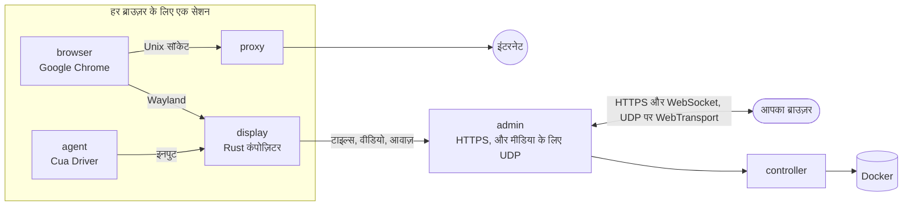

<div align="center">

<a href="https://easi.run/hi/"></a>

# easi.run

**सच में सुरक्षित ब्राउज़िंग आपके और आपके एजेंटों के लिए।**

हर एजेंट को उसका अपना असली Chrome दें, आपके अपने सर्वर पर। लाइव देखें, और जब वह किसी लॉगिन, 2FA कोड या CAPTCHA पर
अटके, तो एक क्लिक में नियंत्रण अपने हाथ में लें। फिर उसे वापस सौंप दें।

[](https://github.com/julianosig/easi.run/actions/workflows/ci.yml)
[](../../LICENSE)
[](https://github.com/julianosig/easi.run/stargazers)
[](https://github.com/julianosig/easi.run/commits/main)
[](https://www.rust-lang.org)
[](https://docs.easi.run/hi/#/agents)

<a href="https://www.producthunt.com/products/easi-run?utm_source=badge-follow&utm_medium=badge&utm_source=badge-easi&#0045;run" target="_blank"></a>

[**▶ लाइव डेमो आज़माएँ**](https://easi.run/demo/?locale=hi) · [फ़ीचर्स](https://easi.run/hi/features/) ·
[डॉक्यूमेंटेशन](https://docs.easi.run/hi/) · [जल्दी शुरू करें](#जल्दी-शुरू-करें) · [तुलना](https://easi.run/hi/compare/)

[English](../../README.md) · [Português (Brasil)](pt-BR.md) · [Español](es.md) · [简体中文](zh-CN.md) · हिन्दी ·
[Français](fr.md) · [Deutsch](de.md) · [日本語](ja.md) · [Русский](ru.md) · [Bahasa Indonesia](id.md) · [한국어](ko.md)

<a href="https://easi.run/hi/"></a>

</div>

## यह क्या है?

वेब इस्तेमाल करने वाले एजेंटों को एक ब्राउज़र चाहिए। ज़्यादातर टीमें किसी क्लाउड सेवा से घंटे के हिसाब से एक किराए पर
लेती हैं, या एक headless Chrome और एक VNC सर्वर को जोड़-तोड़ कर चलाती हैं। easi.run तीसरा रास्ता है: **एक कमांड इसे
आपके अपने Linux सर्वर पर शुरू कर देती है**, और तब से हर एजेंट को एक अलग Google Chrome मिलता है, नया या आपके सहेजे
गए लॉगिन के साथ, और आपको हर एक में झाँकने के लिए एक लाइव खिड़की मिलती है।

जब एजेंट किसी ऐसी चीज़ पर अटकता है जो सिर्फ़ इंसान कर सकता है, तो आप सेशन की बार से नियंत्रण ले लेते हैं। एजेंट
इंतज़ार करता है। आप पासवर्ड टाइप करते हैं, 2FA अनुरोध मंज़ूर करते हैं, या पहेली हल करते हैं। आप नियंत्रण वापस देते
हैं, और एजेंट आगे बढ़ता है।

## लोग इसे क्यों इस्तेमाल करते हैं

- 💸 **घंटे के हिसाब से कोई बिल नहीं।** यह आपके सर्वर पर चलता है, इसलिए आप सर्वर का भुगतान करते हैं और कुछ नहीं।
- 🙋 **इंसान बीच में आ सकता है।** नियंत्रण लेने के लिए एक क्लिक, और एजेंट तब तक इंतज़ार करता है जब तक आप वापस न
  सौंपें।
- 🔔 **ज़रूरत पड़ने पर एजेंट आपको बताता है।** लॉगिन या CAPTCHA पर वह आपको बुलाता है और वजह बताता है: उसके सेशन पर समय के
  साथ *आपकी ज़रूरत* दिखता है, और एक साइन किया वेबहुक Slack, Discord या आपके अपने टूल को बता सकता है। नियंत्रण लें और
  लौटाएँ, तो वह आगे बढ़ता है; छोड़ें दबाएँ, तो उसे आपके बिना आगे बढ़ने को कहा जाता है ([कैसे](https://docs.easi.run/hi/#/agents))।
- 🔑 **लॉग इन बने रहें।** एक स्थायी सेशन हर बार दोबारा शुरू करने पर आपके लॉगिन, साइट डेटा (कैश छोड़कर), इतिहास और पसंदें
  वापस लाता है, हर उस साइट पर जो Chrome बंद होने पर भी आपको लॉग इन रखती है, एक ऐसी कुंजी से एन्क्रिप्ट करके जिसे सिर्फ़
  आपका पासवर्ड खोलता है ([कैसे](../security.md#boundaries))। अपडेट से पहले चल रहे सेशन सेव हो जाते हैं, और अगर कोई सेव
  विफल हो, तो सेशन यह बता देता है।
- 🔒 **आप जो टाइप करते हैं वह आपका रहता है।** पासवर्ड फ़ील्ड में जो है वह कभी आपके एजेंट तक नहीं पहुँचता, जब तक आप उसे
  पेज में स्क्रिप्ट की अनुमति न दें। जैसे ही आप नियंत्रण लेते हैं, स्क्रीनशॉट रुक जाते हैं, और आप जो सटीक टेक्स्ट टाइप
  या पेस्ट करते हैं, चार या उससे ज़्यादा अक्षरों का, वह उस तक `[redacted]` के रूप में पहुँचता है; आपकी अपनी चैट स्क्रीन
  देखती रहती है ([कैसे](../security.md#boundaries))।
- 🧱 **हर ब्राउज़र अपने सैंडबॉक्स में।** उसके अपने कंटेनर, उसका अपना कोई नेटवर्क नहीं, आपके निजी नेटवर्क में जाने का कोई
  रास्ता नहीं, और पब्लिक वेब सिर्फ़ HTTPS से, इसलिए HTTPS के बिना कोई साइट नहीं खुलती ([सुरक्षा मॉडल](../security.md))।
- 🕵️ **असली Chrome, जिसे साइटें असली Chrome मानती हैं।** ख़ुद Google Chrome, BrowserScan, sannysoft और rebrowser के
  बॉट डिटेक्टर पर साफ़ ([साइटें क्या देखती हैं](../stealth.md))।
- 📁 **फ़ाइलें, आवाज़ और क्लिपबोर्ड बस काम करते हैं।** किसी फ़ाइल को पेज पर खींचें, पेज के अपने अपलोड बटन से चुनें,
  डाउनलोड सीधे अपने Downloads फ़ोल्डर में पाएँ, पेज की आवाज़ सुनें, और दोनों तरफ़ कॉपी-पेस्ट करें।
- 🎥 **सेशन रिकॉर्ड करें** सर्वर पर ऊँची क्वालिटी में, चाहें तो अपने कैमरे और माइक्रोफ़ोन के साथ।
- 🧾 **देखें, आपके न रहते क्या हुआ।** हर सेशन एजेंट के कदमों की टाइमलाइन रखता है: हर कदम किसने उठाया और कैसा
  रहा, टाइपिंग सिर्फ़ अक्षरों की गिनती के रूप में। रिकॉर्डिंग चालू हो (जैसा डिफ़ॉल्ट है), तो एजेंट की स्क्रीन का
  रीप्ले भी ([कैसे](https://docs.easi.run/hi/#/sessions))।
- 💬 **पेज के साथ अपने एजेंट से चैट करें।** सेशन के ऊपर एक टर्मिनल में अपना Claude Code या Codex खोलें, अपने ही अकाउंट
  पर: नीचे या साइडबार के रूप में, आकार बदलने योग्य और आंशिक रूप से पारदर्शी, वैसा ही जैसा आपने छोड़ा था। एक अकाउंट कई
  सेशन में खुलता है। वह केवल उसी ब्राउज़र तक पहुँचता है और जब नियंत्रण आपके पास हो तब कुछ नहीं कर सकता ([कैसे](https://docs.easi.run/#/sessions))।
- 🔍 **पेज का ढाँचा पढ़ता है, बिना दिखे।** आपका एजेंट पेज का कोई भी हिस्सा CSS selector से पढ़ता है, ऐसी दुनिया में जिसे
  पेज देख नहीं सकता। किसी सेशन के लिए डेवलपर टूल्स चालू करें, तो वह वहाँ स्क्रिप्ट भी चला सकता है; साइटें इसे भाँप सकती
  हैं ([कैसे](https://docs.easi.run/hi/#/agent))।
- 🤖 **आपके एजेंट से जुड़ता है।** Claude Code, Codex और किसी भी MCP क्लाइंट के लिए बिल्ट-इन
  [MCP सर्वर](https://docs.easi.run/hi/#/agents): आपके सर्वर पर या SSH से बिना टोकन के, या HTTPS से हर एजेंट के लिए
  एक टोकन के साथ। वही टूल एक सादे REST API पर भी। जब Claude Code मौजूद हो और उसमें `easi` नाम का कोई दूसरा सर्वर न
  हो, तो इंस्टॉलर इसे आपके लिए Claude Code में जोड़ देता है।
- 📂 **आपके एजेंट के अपने डाउनलोड और अपलोड।** पेज जो डाउनलोड करता है उसे वह सहेजता है, और अपनी फ़ाइलें अपलोड करता है,
  जैसे उसकी बनाई कोई इमेज। डिफ़ॉल्ट रूप से वह हर फ़ाइल से पहले आपसे पूछता है; सेटिंग्स में आप उन्हें हमेशा अनुमति दे
  सकते हैं या मना कर सकते हैं ([कैसे](https://docs.easi.run/hi/#/agents))।
- 🌍 **हर सेशन के लिए आपका अपना प्रॉक्सी**, इस्तेमाल से पहले जाँचा गया, और ब्राउज़र का टाइम ज़ोन और भाषाएँ उस जगह के
  हिसाब से सुझाई गईं जहाँ से वह बाहर निकलता है।
- ⚡ **हमारा अपना स्ट्रीमिंग इंजन, VNC नहीं।** Rust में लिखा एक कंपोज़िटर Chrome को बनाता और स्ट्रीम करता है: ठहरा
  हुआ कंटेंट लॉसलेस टाइल्स के रूप में, हलचल AV1 के रूप में, जहाँ आपका नेटवर्क अनुमति दे वहाँ UDP से। साफ़ टेक्स्ट,
  स्मूथ वीडियो, और VNC स्ट्रीम की बैंडविड्थ का एक छोटा हिस्सा (आँकड़े नीचे)।

## तुलना

<!-- compare:start -->

| | **easi.run** | Browserbase | Browserless | KasmVNC |
|---|:---:|:---:|:---:|:---:|
| आपके अपने सर्वर पर चलता है | ✅ | – | ✅ | ✅ |
| कोई यूसेज फ़ीस नहीं | ✅ | – | – | ✅ |
| एक साथ ब्राउज़रों पर प्लान की कोई सीमा नहीं | ✅ | – | – | ✅ |
| सेशन की अवधि पर प्लान की कोई सीमा नहीं | ✅ | – | – | ✅ |
| कंट्रोल लें, एजेंट इंतज़ार करता है | ✅ | – | ✅ | – |
| एजेंट आपको बुलाता है, और सूचना मिलती है | ✅ | – | ✅ | – |
| अपनी टेकओवर स्क्रीन खुद बनाएँ | ✅ | – | – | – |
| एक API जिसे आपके एजेंट कॉल कर सकें | ✅ | ✅ | ✅ | – |
| आपके एजेंटों के लिए MCP सर्वर | ✅ | ✅ | ✅ | – |
| आपकी टाइपिंग एजेंट से छिपी रहे | ✅ | – | – | – |
| एन्क्रिप्टेड सेशन वॉल्ट, जिन्हें सिर्फ़ आपका पासवर्ड खोलता है | ✅ | – | – | – |
| निजी नेटवर्क तक पहुँच नहीं | ✅ | – | – | – |
| बिल्ट-इन स्टील्थ | ✅ | ✅ | ✅ | – |
| लाइव आवाज़ | ✅ | – | – | – |
| फ़ाइल सीधे पेज पर ड्रैग करें | ✅ | – | – | – |
| अपलोड के लिए आपका अपना फ़ाइल पिकर | ✅ | – | – | – |
| डाउनलोड आपके कंप्यूटर पर आते हैं | ✅ | – | – | – |
| दोनों तरफ़ कॉपी-पेस्ट | ✅ | – | ✅ | ✅ |
| सेशन रिकॉर्ड करें | ✅ | ✅ | ✅ | – |
| एजेंट के कदमों की टाइमलाइन, रीप्ले के साथ | ✅ | ✅ | – | – |
| लाइव ब्राउज़र के साथ आपका अपना Claude Code या Codex | ✅ | – | – | – |
| हर सेशन में इनपुट, क्लिपबोर्ड, फ़ाइलें या आवाज़ बंद करें | ✅ | – | – | ✅ |
| हर सेशन में आपका अपना प्रॉक्सी, लोकेशन से मेल खाता | ✅ | – | – | – |
| एक HTTPS पोर्ट पर काम करता है, TURN की ज़रूरत नहीं | ✅ | – | – | ✅ |
| ओपन सोर्स, जिसका आप ऑडिट कर सकें | ✅ | – | – | ✅ |

✅ है · – नहीं है, आंशिक है, उनके डॉक्स में नहीं है, या लागू नहीं। [पूरी तुलना](https://easi.run/hi/compare/)
19 विकल्पों को कवर करती है, [स्रोतों और नोट्स](../comparison.md) के साथ (अक्टूबर से नवंबर 2026)।

<!-- compare:end -->

## जल्दी शुरू करें

### ज़रूरतें

| | न्यूनतम | आरामदायक |
|---|---|---|
| सर्वर | Docker वाली कोई भी Linux x86-64 मशीन: किसी भी क्लाउड का VPS (Hetzner, DigitalOcean, AWS EC2 x86…) या आपका अपना सर्वर | |
| सॉफ़्टवेयर | Compose और Buildx के साथ Docker Engine 28+ (rootful, docker.service से चलने वाला), systemd, git, curl, flock, iptables, ss, awk, stat, df, timeout और realpath | |
| खाता | docker ग्रुप में एक non-root यूज़र (`sudo usermod -aG docker $USER`, फिर दोबारा लॉग इन करें); sudo की ज़रूरत नहीं: इंस्टॉलर अपने थोड़े-से बदलाव root के रूप में एक अल्पकालिक privileged Docker कंटेनर के ज़रिए करता है, जिसकी अनुमति Docker को देनी होगी | |
| CPU | 2 कोर | 4+ कोर |
| मेमोरी | 4 GB (एक समय में एक ब्राउज़र सेशन) | 8 GB+ (8 GB पर एक साथ 2 सेशन, 16 GB पर 4) |
| डिस्क | 10 GB खाली (इमेज के लिए) | |
| GPU | कोई नहीं | |

हर ब्राउज़र सेशन अपनी सीमाओं के साथ चलता है: डिफ़ॉल्ट रूप से Chrome के लिए 2 CPU और 2 GiB, साथ में एक display, प्रॉक्सी
और एजेंट (कुल 1152 MiB), इसलिए वह 3.2 GiB तक मेमोरी लेता है; खुली चैट 1 GiB तक और उसका प्रॉक्सी 128 MiB जोड़ता है। इंस्टॉलर एक साथ उतने सेशन चलाता है जितने आपके सर्वर की
मेमोरी में समाते हैं, 1 से 16 तक, और उसका सारांश बताता है कितने; हर सेशन तब शुरू होता है जब आप या कोई एजेंट उसे
माँगता है। इन्हें बदलने के लिए `~/easi.run/.env` में `BROWSER_CPUS`, `BROWSER_MEMORY_MIB` या `ADMIN_MAX_SESSIONS`
डालें, फिर `bash install.sh` दोबारा चलाएँ ([कॉन्फ़िगरेशन](https://docs.easi.run/hi/#/configuration))।

### 1. इंस्टॉल करें

अपने सर्वर पर अपने कोडिंग एजेंट (Claude Code, Codex या कोई और) से कहें:

```text
Read https://easi.run/install.md and install easi.run on this server.
```

या इसे ख़ुद चलाएँ:

```sh
curl -fsSLO https://easi.run/install.sh && less install.sh && bash install.sh
```

यह सर्वर की जाँच करता है, वह firewall नियम लगाता है जो पेजों को सर्वर की अपनी सेवाओं से दूर रखता है, दूर बैठे
दर्शकों के लिए सर्वर का TCP सेट करता है (fq और BBR, जब kernel में BBR हो), easi.run शुरू करता है, और Claude Code
इंस्टॉल होने पर उसे Claude Code में जोड़ता है। इसे sudo नहीं चाहिए: firewall नियम और TCP सेटिंग्स root के रूप में
Debian की इमेज के एक अल्पकालिक privileged कंटेनर के ज़रिए बनती हैं, जिसे उसके digest से पुल किया जाता है और जिसका
`nsenter` सर्वर के अपने `iptables`, `systemctl` और `sysctl` चलाता है। उसका सारांश बताता है कि उसने क्या किया, और
admin का पासवर्ड आप कहाँ बनाएँगे। आपके सर्वर पर कुछ भी कंपाइल नहीं होता: इंस्टॉलर वे इमेज पुल करता है जिन्हें
easi.run की CI ने बनाया और प्रकाशित किया, हर एक को इंस्टॉलर में दिए digest से मिलाकर, और Google के साइन किए हुए
रिपॉज़िटरी से Google Chrome को ब्राउज़र इमेज में जोड़ता है (Google की शर्तें किसी और को Chrome बाँटने नहीं देतीं)। पहली
बार चलाने पर लगभग 550 MB डाउनलोड होता है और 2 कोर और तेज़ कनेक्शन पर एक से दो मिनट लगते हैं।

### 2. admin खोलें

- **सर्वर पर:** `https://localhost:9443`।
- **अपने कंप्यूटर से:** वही कमांड इस्तेमाल करें जिससे आप सर्वर में लॉग इन करते हैं, उसमें
  `-N -L 9443:127.0.0.1:9443` जोड़ें, और उसे चलता रहने दें; फिर `https://localhost:9443` खोलें। उदाहरण के लिए:

  ```sh
  ssh -N -L 9443:127.0.0.1:9443 you@your-server
  ```

  इंस्टॉलर का सारांश यह लाइन प्रिंट करता है, जब पता लगा सके तो आपके लॉगिन के साथ भरकर।
- **Remote-SSH वाले VS Code या Cursor** आपके लिए पोर्ट फ़ॉरवर्ड करते हैं: उनके टर्मिनल से लिंक खोलें, या उनके Ports
  व्यू में पोर्ट 9443 जोड़ें; दोनों ही तरह से, लोकल पोर्ट भी 9443 होना चाहिए।

सर्टिफ़िकेट सर्वर का अपना है, इसलिए ब्राउज़र उसके बारे में चेतावनी देता है: इंस्टॉलर उसकी एक कॉपी
`~/.config/easi-run/tls-cert.pem` में रखता है, और admin उसका फ़िंगरप्रिंट लॉग करता है
(`~/easi.run` में `docker compose logs admin | grep fingerprint`), ताकि आप मिला सकें।

### 3. अपना पासवर्ड बनाएँ

इंस्टॉल के ठीक बाद `https://localhost:9443` खोलें (अपने कंप्यूटर से, स्टेप 2 के SSH टनल से): जब तक पासवर्ड सेट नहीं
होता, admin की पहली स्क्रीन एक पासवर्ड माँगती है। 12 या उससे ज़्यादा अक्षरों का चुनें; आप तुरंत लॉग इन हो जाते हैं।

- admin सिर्फ़ उसका Argon2id हैश रखता है। गलत पासवर्ड और दूसरे चरण के गलत कोड एक साथ गिने जाते हैं: पाँचवाँ अगली
  कोशिश से पहले 2 सेकंड का इंतज़ार शुरू करता है, हर अगला उसे दोगुना करता है, 256 सेकंड तक, और एक पूरा साइन-इन गिनती
  फिर से शुरू करता है।

इसके बाद admin साइन-इन पर दूसरा चरण पेश करता है। यह वैकल्पिक है, और हम इसकी सलाह देते हैं: इसे चालू रखने पर
सिर्फ़ आपका पासवर्ड कुछ नहीं खोलता।

- **एक ऑथेंटिकेटर ऐप**, हर ब्राउज़र में: 6 अंकों के कोड दिखाने वाले किसी भी ऐप से QR कोड स्कैन करें, फिर उसका दिखाया
  कोड टाइप करें। हर कोड एक बार साइन इन करता है।
- **एक पासकी**, जहाँ आपका ब्राउज़र दे: यह अपने-आप साइन इन करती है, आपके फ़िंगरप्रिंट, चेहरे या डिवाइस PIN से। Chrome
  ऐसी साइट पर पासकी नहीं देता जिसके सर्टिफ़िकेट पर वह भरोसा नहीं करता, जैसे टनल पर सर्वर की अपनी साइट; तब पेज यह
  बता देता है, और वहाँ ऑथेंटिकेटर ऐप काम करता है।
- फिर वह जो दस **रिकवरी कोड** एक बार दिखाता है उन्हें सहेज लें: अगर आपका फ़ोन या पासकी खो जाए, तो अपने पासवर्ड और
  उनमें से एक से साइन इन करें; हर एक एक बार काम करता है।

बाद में **सुरक्षा** में किसी को भी चालू, बंद करें या बदलें। फ़ोन या पासकी और रिकवरी कोड खो गए? सर्वर पर
`docker exec easi-run-admin-1 admin reset-second-step` चलाएँ, और सिर्फ़ पासवर्ड से फिर साइन इन हो जाएगा।

तब से, लॉग इन करें, एक सेशन शुरू करें, और जब चाहें उसकी बार से नियंत्रण लें।

### अपडेट करें

```sh
curl -fsSLO https://easi.run/install.sh && bash install.sh --update
```

यह easi.run को उस रिलीज़ पर ले जाता है जिसे सबसे नया इंस्टॉलर बताता है, और पिछली रिलीज़ की इमेज हटा देता है; उस समय
चल रहे सेशन ख़त्म हो सकते हैं।

### हटाएँ

```sh
bash ~/easi.run/install.sh --uninstall
```

आपकी पुष्टि के बाद यह easi.run के कंटेनर, वॉल्यूम और इमेज, उसका firewall नियम और उसे लगाने वाला docker.service
drop-in, और उसकी TCP सेटिंग्स हटाता है, उनकी जगह के पुराने मान वापस रखते हुए (जब तक सर्वर पर easi.run का कोई दूसरा
इंस्टॉलेशन उन्हें अब भी न चाहता हो), `~/.config/easi-run` में उसकी अपनी फ़ाइलें (डायरेक्टरी भी, जब उसमें और कुछ न
हो), और Claude Code का `easi` सर्वर जब वह इसी इंस्टॉलेशन का हो। यह checkout, `~/easi.run`, Docker का build cache,
और वह Debian इमेज जिसमें उसके root चरण चले, रहने देता है, और बताता है कि उन्हें कैसे हटाएँ।

### admin तक कहीं से भी पहुँचें

SSH टनल के बिना, आप admin के आगे इनमें से कोई एक लगा सकते हैं, हर एक अपने खाते के साथ। admin को सर्वर से बाहर
खोलना आपकी पसंद है। दोनों ही तरह से, `ADMIN_ORIGIN` में वह पता डालें जो आप खोलेंगे
([ऑपरेशंस](https://docs.easi.run/hi/#/operations) में चरण हैं):

- **Tailscale:** `sudo tailscale serve --bg https+insecure://localhost:9443` इसे
  `https://<machine>.<tailnet>.ts.net` पर सिर्फ़ आपके tailnet के लिए परोसता है; admin सर्वर के `127.0.0.1` पर ही
  रहता है।
- **Cloudflare Access के साथ Cloudflare Tunnel:** `cloudflared` इसे आपके डोमेन के किसी नाम तक ले जाता है, और कोई भी
  अनुरोध admin के लॉगिन पेज तक पहुँचने से पहले Access जाँचता है कि आप कौन हैं।

तब इसे कौन बचाता है: पहले यह कि पते तक कौन पहुँच सकता है (आपके tailnet के डिवाइस, या आपकी Access नीति), फिर admin का
साइन-इन: आपका पासवर्ड और, अगर आपने चालू किया हो, दूसरा चरण, या एक पासकी।

## अपना एजेंट जोड़ें

आपका एजेंट जो भी सेशन शुरू करता है, उसके साथ एक `watch_url` आता है: लाइव देखने और नियंत्रण लेने के लिए उसे खोलें।

### उसी सर्वर पर एजेंट

जब इंस्टॉलर का सारांश कहे कि MCP तैयार है, तो easi.run Claude Code और Codex में है (हर एक उस अकाउंट के लिए इंस्टॉल होता
है जिसने इंस्टॉलर चलाया): नया सेशन शुरू करें और उससे ब्राउज़ करने को कहें। किसी दूसरे अकाउंट के लिए, या कमांड चलाने वाले
किसी भी MCP क्लाइंट के लिए:

```sh
codex mcp add easi -- docker exec -i easi-run-admin-1 admin mcp
```

### एजेंट आपके कंप्यूटर पर, सर्वर कहीं और

वही कमांड, SSH के ज़रिए (अपनी SSH कुंजी से लॉग इन करें): कोई टोकन, पोर्ट या सर्टिफ़िकेट सेट नहीं करना।

```sh
claude mcp add --scope user easi -- ssh -T you@your-server docker exec -i easi-run-admin-1 admin mcp
codex mcp add easi -- ssh -T you@your-server docker exec -i easi-run-admin-1 admin mcp
```

`you@your-server` की जगह वह लॉगिन इस्तेमाल करें जो आप सर्वर के लिए पहले से इस्तेमाल करते हैं। अपने ब्राउज़र में सेशन
देखने के लिए स्टेप 2 का SSH टनल खुला रखें।

### HTTP बोलने वाले एजेंट

admin के **एजेंट** पेज पर एक टोकन बनाएँ, और `/mcp` पर MCP या `/api/agent/` के तहत वही टूल इस्तेमाल करें
([एजेंट गाइड](https://docs.easi.run/hi/#/agents))।

### एजेंट के लिए आपके लॉगिन

एक **स्थायी** सेशन शुरू करें, उसमें अपनी साइटों पर लॉग इन करें, और उसे रोक दें: वह, एन्क्रिप्ट करके, वे लॉगिन रखता
है जो कोई साइट Chrome बंद होने पर बनाए रखती है, और दोबारा शुरू होने पर उन्हें वापस लाता है। उस सहेजे गए सेशन पर एजेंट
के टोकन (या लोकल MCP क्लाइंट) को अनुमति दें; तब एजेंट उसे `list_saved_sessions` से ढूँढता है और `start_session` के
`resume` से दोबारा शुरू करता है।

## परफ़ॉर्मेंस

उसी होस्ट और उसी CPU बजट पर KasmVNC के मुक़ाबले, headless रन के माध्यिका मान (2026-10-21, WebSocket पर):

| | easi.run | KasmVNC |
|---|---|---|
| स्मूथ स्क्रॉल | **55 fps**, 1.8 Mbit/s | 24 fps, 12.4 Mbit/s |
| पूरी स्क्रीन पर चलता एनिमेशन | **38 fps**, 2.0 Mbit/s | 24 fps, 25.4 Mbit/s |
| 1080p वीडियो | **36 fps**, 2.1 Mbit/s | 24 fps, 18.1 Mbit/s |
| स्क्रॉल होता टेक्स्ट | **1.9 Mbit/s**, SSIM 0.990 | 16.4 Mbit/s, SSIM 0.977 |
| टाइपिंग, की दबाने से फ़्रेम बनने तक | **28 ms** | 69 ms |
| ठहरा हुआ पेज | कोई मीडिया ट्रैफ़िक नहीं | कोई मीडिया ट्रैफ़िक नहीं |

हर मीट्रिक, तरीका और कच्चे नतीजे [बेंचमार्क](../benchmark.md) में हैं।

## यह कैसे काम करता है



Rust में लिखा एक छोटा कंपोज़िटर (`display`) Chrome की खिड़कियों को अपनी मेमोरी में बनाता है। ठहरा हुआ कंटेंट लॉसलेस
टाइल्स के रूप में जाता है; हलचल तब तक लॉसलेस रहती है जब तक यह सस्ता हो, वरना AV1 वीडियो के रूप में स्ट्रीम होती है
जो हलचल रुकते ही पिक्सेल-दर-पिक्सेल सटीक हो जाती है; पेज की आवाज़ Opus के रूप में जाती है, एक ही HTTPS पोर्ट पर, और
जहाँ आपका नेटवर्क जाने दे वहाँ UDP (WebTransport) पर, जिससे पैकेट खोने वाले नेटवर्क पर भी स्ट्रीम स्मूथ रहती है।
सिर्फ़ वही दर्शक टाइप और क्लिक कर सकता है जिसके पास नियंत्रण है।

- [सुरक्षा मॉडल](../security.md): हर सीमा, और उसे साबित करने वाला टेस्ट
- [आर्किटेक्चर](../architecture.md): रिपॉज़िटरी की बनावट, और कोड का हर हिस्सा कहाँ है, एक फ़्रेम और एक की-प्रेस के
  पीछे चलते हुए
- [डिज़ाइन](../design.md) और [टोपोलॉजी](../topology.md): सोच, कंटेनर, उनकी सीमाएँ

ये दस्तावेज़ अंग्रेज़ी में हैं।

## योगदान

Issues और pull requests का स्वागत है। [`CONTRIBUTING.md`](../../CONTRIBUTING.md) बिल्ड, टेस्ट और रिव्यू के बारे में
बताता है, और `scripts/dev/run.sh scripts/check.sh` किसी बदलाव के लिए ज़रूरी जाँचें उसी इमेज में चलाता है जो CI
इस्तेमाल करती है। कृपया सुरक्षा समस्याओं की जानकारी निजी तौर पर दें, जैसा [`SECURITY.md`](../../SECURITY.md) में
बताया गया है।

## लाइसेंस

easi.run [GNU Affero General Public License, सिर्फ़ संस्करण 3](../../LICENSE) के तहत मुक्त सॉफ़्टवेयर है। इसे चलाएँ,
बदलें और बाँटें; अगर आप किसी नेटवर्क पर लोगों को इसका बदला हुआ संस्करण देते हैं, तो उन्हें उसका सोर्स भी दें। हर
डिपेंडेंसी अपना लाइसेंस रखती है, जिनकी सूची [`docs/licenses.md`](../licenses.md) में है। प्रकाशित इमेज वीडियो को सिर्फ़
AV1 में एनकोड करती हैं, जो रॉयल्टी-मुक्त है; H.264 एनकोडर एक वैकल्पिक बिल्ड फ़ीचर है
(`--build-arg DISPLAY_FEATURES=h264`)। वे `ghcr.io/julianosig/easi.run-<role>` के रूप में प्रकाशित होती हैं, हर एक पर
इस रिपॉज़िटरी के उस कमिट का टैग और लेबल होता है जिससे वह बनी, और वही उसका सोर्स है; ब्राउज़र इमेज में Google Chrome
नहीं होता, जिसे हर इंस्टॉलेशन ख़ुद जोड़ता है। हर इमेज `/usr/share/doc/easi.run` में यह लाइसेंस, उसका सोर्स कहाँ है, और
उसमें शामिल चीज़ों के लाइसेंस और नोटिस के टेक्स्ट रखती है।

<div align="center">

**अगर easi.run आपके एजेंटों का सिरदर्द बचाता है, तो एक ⭐ दूसरों को इसे ढूँढने में मदद करता है।**

</div>
