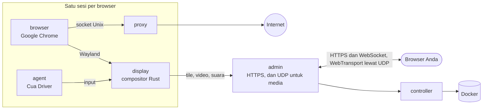

<div align="center">

<a href="https://easi.run/id/"></a>

# easi.run

**Browsing yang benar-benar aman untuk Anda dan agen Anda.**

Beri setiap agen Chrome sungguhan miliknya sendiri, di server Anda sendiri. Tonton secara langsung, dan ambil alih
dengan satu klik saat ia tersangkut di login, kode 2FA, atau CAPTCHA. Lalu kembalikan kendalinya.

[](https://github.com/julianosig/easi.run/actions/workflows/ci.yml)
[](../../CONTRIBUTING.md#coverage)
[](../../LICENSE)
[](https://github.com/julianosig/easi.run/stargazers)
[](https://github.com/julianosig/easi.run/commits/main)
[](https://www.rust-lang.org)
[](https://docs.easi.run/id/#/agents)

<a href="https://www.producthunt.com/products/easi-run?utm_source=badge-follow&utm_medium=badge&utm_source=badge-easi&#0045;run" target="_blank"></a>

[**▶ Coba demo langsung**](https://easi.run/demo/?locale=id) · [Fitur](https://easi.run/id/features/) ·
[Dokumentasi](https://docs.easi.run/id/) · [Mulai cepat](#mulai-cepat) · [Bandingkan](https://easi.run/id/compare/)

[English](../../README.md) · [Português (Brasil)](pt-BR.md) · [Español](es.md) · [简体中文](zh-CN.md) · [हिन्दी](hi.md) ·
[Français](fr.md) · [Deutsch](de.md) · [日本語](ja.md) · [Русский](ru.md) · Bahasa Indonesia · [한국어](ko.md)

<a href="https://easi.run/id/"></a>

</div>

## Apa ini?

Agen yang memakai web butuh browser. Kebanyakan tim menyewanya per jam dari layanan cloud, atau merangkai Chrome
headless dengan server VNC. easi.run adalah jalan ketiga: **satu perintah menjalankannya di server Linux Anda sendiri**,
dan sejak itu setiap agen mendapat Google Chrome yang terisolasi, baru atau dengan login Anda yang tersimpan, dan Anda
mendapat jendela langsung ke masing-masing.

Saat agen tersangkut pada sesuatu yang hanya bisa dilakukan manusia, Anda mengambil alih kendali dari bilah sesi. Agen
menunggu. Anda mengetik kata sandi, menyetujui permintaan 2FA, atau memecahkan teka-tekinya. Anda mengembalikan
kendali, dan agen melanjutkan.

## Mengapa orang memakainya

- 💸 **Tanpa tagihan per jam.** Ia berjalan di server Anda, jadi Anda membayar server dan tidak ada yang lain.
- 🙋 **Manusia bisa turun tangan.** Satu klik untuk mengambil alih, dan agen menunggu sampai Anda mengembalikannya.
- 🔔 **Agen memberi tahu saat butuh Anda.** Saat login atau CAPTCHA, agen meminta Anda dan menyebut alasannya:
  sesinya menampilkan *Butuh Anda* beserta jamnya, dan webhook bertanda tangan bisa memberi tahu Slack, Discord, atau
  alat Anda sendiri ([caranya](https://docs.easi.run/id/#/agents)).
- 🔑 **Tetap login.** Sesi persisten mengembalikan login, data situs (kecuali cache), riwayat, dan preferensi Anda
  setiap kali Anda melanjutkannya, di situs mana pun yang membuat Anda tetap login saat Chrome ditutup, dienkripsi
  dengan kunci yang hanya bisa dibuka oleh kata sandi Anda ([caranya](../security.md#boundaries)).
  Pembaruan menyimpan sesi yang sedang berjalan lebih dulu.
- 🔒 **Yang Anda ketik tetap milik Anda.** Isi kolom kata sandi tidak pernah sampai ke agen Anda. Begitu Anda
  mengambil alih, tangkapan layar berhenti, dan teks persis yang Anda ketik atau tempel, empat karakter atau lebih,
  sampai kepadanya sebagai `[redacted]` ([caranya](../security.md#boundaries)).
- 🧱 **Setiap browser di sandbox-nya sendiri.** Kontainernya sendiri, tanpa jaringan sendiri, dan tanpa jalan masuk ke
  jaringan pribadi Anda ([model keamanan](../security.md)).
- 🕵️ **Chrome sungguhan yang diperlakukan situs sebagai Chrome sungguhan.** Google Chrome itu sendiri, bersih di
  BrowserScan, sannysoft, dan pendeteksi bot rebrowser ([apa yang dilihat situs](../stealth.md)).
- 📁 **File, suara, dan clipboard langsung berfungsi.** Seret file ke halaman, pilih satu dengan tombol unggah milik
  halaman itu sendiri, terima unduhan langsung di folder Unduhan Anda, dengarkan halaman, dan salin-tempel dua arah.
- 🎥 **Rekam sesi** di server dalam kualitas tinggi, dengan kamera dan mikrofon Anda jika mau.
- 🧾 **Lihat apa yang terjadi selama Anda pergi.** Tiap sesi menyimpan linimasa aksi agennya: siapa yang melakukan
  tiap aksi dan hasilnya, ketikan dicatat sebagai jumlah karakter. Dengan rekaman aktif, seperti bawaannya, Anda juga
  bisa memutar ulang layar agen ([caranya](https://docs.easi.run/id/#/sessions)).
- 🤖 **Terhubung ke agen Anda.** [Server MCP](https://docs.easi.run/id/#/agents) bawaan untuk Claude Code, Codex, dan
  klien MCP mana pun: di server Anda atau lewat SSH tanpa token, atau lewat HTTPS dengan satu token per agen. Alat yang
  sama lewat REST API sederhana. Installer menambahkannya ke Claude Code untuk Anda saat Claude Code ada dan belum
  punya server lain bernama `easi`.
- 📂 **Unduhan dan unggahan agen Anda sendiri.** Ia menyimpan apa yang diunduh halaman dan mengunggah file miliknya
  sendiri, seperti gambar yang ia buat. Secara bawaan ia bertanya kepada Anda sebelum setiap file
  ([caranya](https://docs.easi.run/id/#/agents)).
- 🌍 **Proxy Anda sendiri per sesi**, diperiksa sebelum dipakai, dengan zona waktu dan bahasa browser yang disarankan
  dari lokasi keluarnya.
- ⚡ **Mesin streaming kami sendiri, bukan VNC.** Compositor yang ditulis dalam Rust menggambar Chrome dan
  mengalirkannya: konten diam sebagai tile tanpa kehilangan kualitas, gerakan sebagai AV1, lewat UDP jika jaringan Anda
  mengizinkan. Teks tajam, video mulus, dan sebagian kecil bandwidth stream VNC (angka di bawah).

## Perbandingannya

<!-- compare:start -->

| | **easi.run** | Browserbase | Browserless | KasmVNC |
|---|:---:|:---:|:---:|:---:|
| Jalan di server Anda sendiri | ✅ | – | ✅ | ✅ |
| Tanpa biaya pemakaian | ✅ | – | – | ✅ |
| Browser sekaligus tak dibatasi paket | ✅ | – | – | ✅ |
| Durasi sesi tak dibatasi paket | ✅ | – | – | ✅ |
| Ambil alih, agen pun menunggu | ✅ | – | ✅ | – |
| Agen memanggil Anda, dan Anda diberi tahu | ✅ | – | ✅ | – |
| Buat layar ambil alih sendiri | ✅ | – | – | – |
| API yang bisa dipanggil agen Anda | ✅ | ✅ | ✅ | – |
| Server MCP untuk agen Anda | ✅ | ✅ | ✅ | – |
| Ketikan Anda tersembunyi dari agen | ✅ | – | – | – |
| Brankas sesi terenkripsi yang hanya bisa dibuka kata sandi Anda | ✅ | – | – | – |
| Jaringan privat tak bisa diakses | ✅ | – | – | – |
| Stealth bawaan | ✅ | ✅ | ✅ | – |
| Suara live | ✅ | – | – | – |
| Seret file langsung ke halaman | ✅ | – | – | – |
| Unggah lewat pemilih file Anda sendiri | ✅ | – | – | – |
| Unduhan masuk ke komputer Anda | ✅ | – | – | – |
| Salin-tempel dua arah | ✅ | – | ✅ | ✅ |
| Rekam sesi | ✅ | ✅ | ✅ | – |
| Linimasa aksi agen, dengan putar ulang | ✅ | ✅ | – | – |
| Matikan input, clipboard, file, atau suara per sesi | ✅ | – | – | ✅ |
| Proxy sendiri per sesi, sesuai lokasinya | ✅ | – | – | – |
| Cukup satu port HTTPS, tanpa TURN | ✅ | – | – | ✅ |
| Open source yang bisa Anda audit | ✅ | – | – | ✅ |

✅ punya · – tidak punya, sebagian, tidak ada di dokumentasi mereka, atau tidak berlaku. [Perbandingan
lengkap](https://easi.run/id/compare/) mencakup 19 alternatif, dengan [sumber dan catatannya](../comparison.md) (Oktober hingga November 2026).

<!-- compare:end -->

## Mulai cepat

### Persyaratan

| | Minimum | Nyaman |
|---|---|---|
| Server | Mesin Linux x86-64 apa pun dengan Docker: VPS dari cloud mana pun (Hetzner, DigitalOcean, AWS EC2 x86…) atau server Anda sendiri | |
| Perangkat lunak | Docker Engine 28+ (rootful, dijalankan oleh docker.service) dengan Compose dan Buildx, systemd, git, curl, flock, iptables, ss, awk, stat, df, timeout, dan realpath | |
| Akun | Pengguna non-root di grup docker (`sudo usermod -aG docker $USER`, lalu login lagi); tanpa sudo: installer membuat beberapa perubahannya sebagai root melalui kontainer Docker privileged berumur pendek, yang harus diizinkan Docker | |
| CPU | 2 core | 4+ core |
| Memori | 4 GB (satu sesi browser sekaligus) | 8 GB+ (2 sesi sekaligus di 8 GB, 4 di 16 GB) |
| Disk | 10 GB kosong (image-nya) | |
| GPU | tidak perlu | |

Setiap sesi browser berjalan dengan batasnya sendiri: secara bawaan 2 CPU dan 2 GiB untuk Chrome, ditambah display,
proxy, dan agen di sampingnya (1152 MiB bersama-sama), jadi ia memakai hingga 3,2 GiB memori. Installer menjalankan
sesi sebanyak yang muat di memori server Anda, dari 1 sampai 16, dan ringkasannya menyebut berapa; masing-masing
dimulai saat Anda atau agen memintanya. Untuk mengubahnya, isi `BROWSER_CPUS`, `BROWSER_MEMORY_MIB`, atau
`ADMIN_MAX_SESSIONS` di `~/easi.run/.env`, lalu jalankan `bash install.sh` lagi
([Konfigurasi](https://docs.easi.run/id/#/configuration)).

### 1. Instal

Minta agen coding Anda (Claude Code, Codex, atau lainnya) di server Anda:

```text
Read https://easi.run/install.md and install easi.run on this server.
```

Atau jalankan sendiri:

```sh
curl -fsSLO https://easi.run/install.sh && less install.sh && bash install.sh
```

Ia memeriksa server, memasang aturan firewall yang menjauhkan halaman dari layanan server itu sendiri, menyetel TCP
server untuk penonton yang jauh (fq dan BBR, jika kernel punya BBR), menjalankan easi.run, dan menambahkannya ke Claude
Code saat Claude Code terpasang. Ia tidak butuh sudo: aturan firewall dan pengaturan TCP dibuat sebagai root melalui
kontainer privileged berumur pendek dari image Debian, yang diambil berdasarkan digest-nya, yang `nsenter`-nya
menjalankan `iptables`, `systemctl`, dan `sysctl` milik server itu sendiri. Ringkasannya memberi tahu apa yang ia
lakukan, dan di mana Anda membuat kata sandi admin. Tidak ada yang dikompilasi di server Anda: installer mengambil
image yang dibangun dan diterbitkan CI easi.run, masing-masing dicocokkan dengan digest yang disebut installer, dan
menambahkan Google Chrome ke image browser dari repositori Google yang ditandatangani (ketentuan Google tidak
mengizinkan pihak lain mendistribusikan Chrome). Proses pertama mengunduh sekitar 550 MB dan butuh satu sampai dua
menit di 2 core dengan koneksi cepat.

### 2. Buka admin

- **Di server:** `https://localhost:9443`.
- **Dari komputer Anda:** pakai perintah yang sudah Anda gunakan untuk login ke server, tambahkan
  `-N -L 9443:127.0.0.1:9443`, dan biarkan berjalan; lalu buka `https://localhost:9443`. Contohnya:

  ```sh
  ssh -N -L 9443:127.0.0.1:9443 you@your-server
  ```

  Ringkasan installer mencetak baris ini, sudah diisi dengan login Anda jika ia bisa mengetahuinya.
- **VS Code atau Cursor lewat Remote-SSH** meneruskan port untuk Anda: buka tautannya dari terminal mereka, atau
  tambahkan port 9443 di tampilan Ports mereka; bagaimanapun, port lokalnya juga harus 9443.

Sertifikatnya milik server itu sendiri, jadi browser memperingatkan Anda: installer menyimpan salinannya di
`~/.config/easi-run/tls-cert.pem`, dan admin mencatat fingerprint-nya (`docker compose logs admin | grep fingerprint`,
di `~/easi.run`) agar bisa Anda bandingkan.

### 3. Buat kata sandi Anda

Buka `https://localhost:9443` (dari komputer Anda, lewat tunnel SSH dari langkah 2) tepat setelah instalasi: selama
belum ada kata sandi, layar pertama admin memintanya. Pilih satu, 12 karakter atau lebih; Anda langsung masuk.

- Admin hanya menyimpan hash Argon2id-nya. Kata sandi salah dan kode langkah kedua yang salah dihitung bersama: yang
  kelima memulai jeda 2 detik sebelum percobaan berikutnya, setiap yang berikutnya menggandakannya, hingga 256 detik,
  dan login yang berhasil mengulang hitungan dari awal.

Berikutnya, admin menawarkan langkah kedua saat login. Ini opsional, dan kami menyarankannya: jika aktif, kata sandi
Anda saja tidak membuka apa pun.

- **Aplikasi autentikator**, di semua browser: pindai kode QR dengan aplikasi apa pun yang menampilkan kode 6 digit,
  lalu ketik kode yang ditampilkannya. Setiap kode hanya untuk satu kali login.
- **Passkey**, jika browser Anda menawarkannya: ia memasukkan Anda dengan sendirinya, dengan sidik jari, wajah, atau PIN
  perangkat Anda. Chrome tidak menawarkannya di situs yang sertifikatnya tidak ia percayai, seperti milik server itu
  sendiri lewat tunnel; halaman lalu memberi tahu, dan aplikasi autentikator berfungsi di sana.
- Lalu simpan sepuluh **kode pemulihan** yang ditampilkan sekali: jika Anda kehilangan ponsel atau passkey, login dengan
  kata sandi dan salah satunya; masing-masing berlaku sekali.

Nyalakan, matikan, atau ganti salah satunya nanti di **Keamanan**. Kehilangan ponsel atau passkey dan kode
pemulihannya? Jalankan `docker exec easi-run-admin-1 admin reset-second-step` di server, dan kata sandi saja kembali
memasukkan Anda.

Sejak itu, login, mulai sesi, dan ambil alih kendali dari bilahnya kapan pun Anda mau.

### Perbarui

```sh
curl -fsSLO https://easi.run/install.sh && bash install.sh --update
```

Ia memindahkan easi.run ke rilis yang disebut installer terbaru, dan menghapus image rilis sebelumnya; sesi yang
berjalan saat itu bisa berakhir.

### Hapus

```sh
bash ~/easi.run/install.sh --uninstall
```

Setelah Anda konfirmasi, ia menghapus kontainer, volume, dan image easi.run, aturan firewall-nya dan drop-in
docker.service yang memasangnya, serta pengaturan TCP-nya, dengan mengembalikan nilai yang digantikan (kecuali instalasi
easi.run lain di server masih membutuhkannya), file-nya sendiri di `~/.config/easi-run` (direktorinya juga, jika tidak
ada yang lain di dalamnya), dan server `easi` di Claude Code jika itu milik instalasi ini. Ia menyimpan checkout,
`~/easi.run`, cache build Docker, dan image Debian tempat langkah root-nya berjalan, dan memberi tahu cara
menghapusnya.

### Akses admin dari mana saja

Tanpa tunnel SSH, Anda bisa menaruh salah satu dari ini di depan admin, masing-masing dengan akun Anda sendiri. Membuka
admin ke luar server adalah pilihan Anda. Bagaimanapun, isi `ADMIN_ORIGIN` dengan alamat yang akan Anda buka
([Operasional](https://docs.easi.run/id/#/operations) berisi langkah-langkahnya):

- **Tailscale:** `sudo tailscale serve --bg https+insecure://localhost:9443` menyajikannya di
  `https://<machine>.<tailnet>.ts.net`, hanya untuk tailnet Anda; admin tetap di `127.0.0.1` server.
- **Cloudflare Tunnel dengan Cloudflare Access:** `cloudflared` membawanya ke sebuah nama di domain Anda, dan Access
  memeriksa siapa Anda sebelum permintaan apa pun mencapai halaman login admin.

Yang melindunginya kemudian: siapa yang boleh mencapai alamat itu (perangkat di tailnet Anda, atau kebijakan Access
Anda), lalu login admin: kata sandi Anda dan, jika Anda menyalakannya, langkah kedua, atau passkey.

## Hubungkan agen Anda

Setiap sesi yang dimulai agen Anda datang dengan `watch_url`: buka untuk menonton langsung dan mengambil alih.

### Agen di server yang sama

Saat ringkasan installer menyebut MCP siap, easi.run sudah ada di Claude Code dan Codex (masing-masing terpasang untuk
akun yang menjalankan installer): mulai sesi baru dan minta ia menjelajah. Untuk akun lain, atau klien MCP apa pun yang
menjalankan perintah:

```sh
codex mcp add easi -- docker exec -i easi-run-admin-1 admin mcp
```

### Agen di komputer Anda, server di tempat lain

Perintah yang sama, dibawa lewat SSH (login dengan kunci SSH Anda): tanpa token, port, atau sertifikat yang perlu
disiapkan.

```sh
claude mcp add --scope user easi -- ssh -T you@your-server docker exec -i easi-run-admin-1 admin mcp
codex mcp add easi -- ssh -T you@your-server docker exec -i easi-run-admin-1 admin mcp
```

Ganti `you@your-server` dengan login yang sudah Anda pakai untuk server. Biarkan tunnel SSH dari langkah 2 terbuka
untuk menonton sesi di browser Anda.

### Agen yang memakai HTTP

Buat token di halaman **Agen** pada admin, dan gunakan MCP di `/mcp` atau alat yang sama di bawah `/api/agent/`
([panduan agen](https://docs.easi.run/id/#/agents)).

### Login Anda untuk agen

Mulai sesi **Persisten**, login ke situs-situs Anda di dalamnya, lalu hentikan: ia menyimpan, terenkripsi, login yang
dipertahankan situs saat Chrome ditutup, dan mengembalikannya saat dilanjutkan. Izinkan token agen (atau klien MCP lokal)
pada sesi tersimpan itu; agen lalu menemukannya dengan `list_saved_sessions` dan melanjutkannya dengan `resume` milik
`start_session`.

## Performa

Melawan KasmVNC di host dan anggaran CPU yang sama, median dari proses headless (2026-10-21, lewat WebSocket):

| | easi.run | KasmVNC |
|---|---|---|
| Gulir mulus | **55 fps**, 1,8 Mbit/s | 24 fps, 12,4 Mbit/s |
| Animasi gerak penuh | **38 fps**, 2,0 Mbit/s | 24 fps, 25,4 Mbit/s |
| Video 1080p | **36 fps**, 2,1 Mbit/s | 24 fps, 18,1 Mbit/s |
| Teks bergulir | **1,9 Mbit/s**, SSIM 0,990 | 16,4 Mbit/s, SSIM 0,977 |
| Mengetik, dari tekan tombol ke frame tergambar | **28 ms** | 69 ms |
| Halaman diam | tanpa lalu lintas media | tanpa lalu lintas media |

Setiap metrik, metodenya, dan hasil mentahnya ada di [benchmark](../benchmark.md).

## Cara kerjanya



Compositor kecil yang ditulis dalam Rust (`display`) menggambar jendela Chrome ke memorinya sendiri. Konten diam
dikirim sebagai tile tanpa kehilangan kualitas; gerakan tetap tanpa kehilangan kualitas selama itu murah, dan jika
tidak dialirkan sebagai video AV1 yang menjadi sempurna per piksel begitu gerakan berhenti; suara halaman dikirim
sebagai Opus, lewat satu port HTTPS, dan lewat UDP (WebTransport) jika jaringan Anda meloloskannya, yang menjaga stream
tetap mulus di jaringan yang sering kehilangan paket. Hanya penonton yang memegang kendali yang bisa mengetik dan
mengklik.

- [Model keamanan](../security.md): setiap batas, dan tes yang membuktikannya
- [Arsitektur](../architecture.md): tata letak repositori, dan di mana setiap bagian kode berada, mengikuti sebuah
  frame dan sebuah tekanan tombol
- [Desain](../design.md) dan [topologi](../topology.md): alasannya, kontainernya, batasnya

Dokumen-dokumen ini berbahasa Inggris.

## Berkontribusi

Issue dan pull request dipersilakan. [`CONTRIBUTING.md`](../../CONTRIBUTING.md) membahas build, pengujian, dan review,
dan `scripts/dev/run.sh scripts/check.sh` menjalankan pemeriksaan yang dibutuhkan sebuah perubahan di image yang sama
dengan yang dipakai CI. Mohon laporkan masalah keamanan secara pribadi, seperti dijelaskan di
[`SECURITY.md`](../../SECURITY.md).

## Lisensi

easi.run adalah perangkat lunak bebas di bawah [GNU Affero General Public License, hanya versi 3](../../LICENSE).
Jalankan, ubah, dan bagikan; jika Anda menawarkan versi yang diubah kepada orang lain lewat jaringan, tawarkan juga kode
sumbernya kepada mereka. Setiap dependensi mempertahankan lisensinya sendiri, tercantum di
[`docs/licenses.md`](../licenses.md). Image yang diterbitkan hanya mengodekan video sebagai AV1, yang bebas royalti;
encoder H.264 adalah fitur build opsional (`--build-arg DISPLAY_FEATURES=h264`). Image diterbitkan sebagai
`ghcr.io/julianosig/easi.run-<role>`, masing-masing diberi tag dan label commit repositori ini yang menjadi asal
build-nya, yang merupakan kode sumbernya; image browser tidak membawa Google Chrome, yang ditambahkan sendiri oleh
setiap instalasi. Masing-masing membawa, di `/usr/share/doc/easi.run`, lisensi ini, lokasi kode sumbernya, dan teks
lisensi serta pemberitahuan dari apa yang dibawanya.

<div align="center">

**Jika easi.run menghemat sakit kepala agen Anda, sebuah ⭐ membantu orang lain menemukannya.**

</div>
