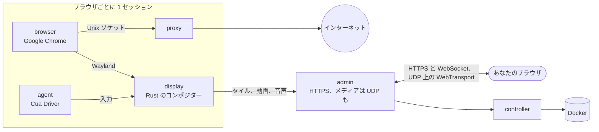

<div align="center">

<a href="https://easi.run/ja/"></a>

# easi.run

**本当に安全なブラウジングを、あなたとエージェントに。**

すべてのエージェントに、あなた自身のサーバー上で動く本物の Chrome を。ライブで見守り、ログイン、2FA コード、CAPTCHA
で止まったらワンクリックで操作を引き継げます。終わったら、エージェントに戻します。

[](https://github.com/julianosig/easi.run/actions/workflows/ci.yml)
[](../../LICENSE)
[](https://github.com/julianosig/easi.run/stargazers)
[](https://github.com/julianosig/easi.run/commits/main)
[](https://www.rust-lang.org)
[](https://docs.easi.run/ja/#/agents)

<a href="https://www.producthunt.com/products/easi-run?utm_source=badge-follow&utm_medium=badge&utm_source=badge-easi&#0045;run" target="_blank"></a>

[**▶ ライブデモを試す**](https://easi.run/demo/?locale=ja) · [機能](https://easi.run/ja/features/) ·
[ドキュメント](https://docs.easi.run/ja/) · [クイックスタート](#クイックスタート) · [比較](https://easi.run/ja/compare/)

[English](../../README.md) · [Português (Brasil)](pt-BR.md) · [Español](es.md) · [简体中文](zh-CN.md) · [हिन्दी](hi.md) ·
[Français](fr.md) · [Deutsch](de.md) · 日本語 · [Русский](ru.md) · [Bahasa Indonesia](id.md) · [한국어](ko.md)

<a href="https://easi.run/ja/"></a>

</div>

## これは何？

Web を使うエージェントにはブラウザが必要です。多くのチームはクラウドサービスから時間単位で借りるか、headless
Chrome と VNC サーバーを組み合わせています。easi.run は第三の道です。**コマンド 1 つで、あなた自身の Linux
サーバー上で起動します**。それ以降、各エージェントは分離された Google Chrome を手に入れます。まっさらな状態でも、
保存済みのログイン付きでも使えます。そしてあなたは、それぞれをライブで見られる窓を手に入れます。

人にしかできないことでエージェントが止まったら、セッションのバーから操作を引き継ぎます。エージェントは待ちます。
あなたがパスワードを入力し、2FA を承認し、パズルを解きます。操作を戻せば、エージェントは続きを進めます。

## 選ばれる理由

- 💸 **時間課金なし。** あなたのサーバーで動くので、払うのはサーバー代だけです。
- 🙋 **人が介入できる。** ワンクリックで引き継ぎ、あなたが戻すまでエージェントは待ちます。
- 🔔 **必要なときはエージェントが呼ぶ。** ログインや CAPTCHA では、エージェントが理由を添えてあなたを呼びます。セッションには時刻つきで*対応が必要*と表示され、
  署名付きの Webhook で Slack、Discord、自分のツールにも知らせられます。引き継いで操作を返せば続きを進めます。スキップすれば、
  あなたなしで進めるよう伝えられます（[仕組み](https://docs.easi.run/ja/#/agents)）。
- 🔑 **ログインしたままに。** 永続セッションは、再開するたびにログイン、サイトデータ（キャッシュを除く）、履歴、設定を復元します。
  Chrome を閉じてもログイン状態を保つサイトであれば、どこでも使えます。データは、あなたのパスワードだけが解錠できる鍵で暗号化されます
  （[仕組み](../security.md#boundaries)）。アップデートの前に、実行中のものは保存されます。保存に失敗したときは、セッションがそう知らせます。
- 🔒 **入力した内容はあなたのもの。** パスワード欄の内容は、ページ内のスクリプトを許可しない限り、エージェントに届くことはありません。
  あなたが引き継ぐとスクリーンショットは止まり、あなたが入力または貼り付けた 4 文字以上のテキストそのものは、
  `[redacted]` として届きます。あなた自身のチャットには画面が見え続けます（[仕組み](../security.md#boundaries)）。
- 🧱 **ブラウザごとに専用のサンドボックス。** 専用のコンテナを持ち、自前のネットワークはなく、あなたのプライベートネットワークには入れず、
  公開 Web には HTTPS だけでアクセスするため、HTTPS のないサイトは開きません（[セキュリティモデル](../security.md)）。
- 🕵️ **サイトが本物の Chrome として扱う、本物の Chrome。** Google Chrome そのもので、BrowserScan、sannysoft、
  rebrowser のボット検出でクリーンです（[サイトから見えるもの](../stealth.md)）。
- 📁 **ファイル、音声、クリップボードがそのまま使える。** ファイルをページにドラッグしたり、ページ自身の
  アップロードボタンで選んだりでき、ダウンロードはあなたの「ダウンロード」フォルダーに直接届き、ページの音が聞こえ、
  双方向にコピー＆ペーストできます。
- 🎥 **セッションを録画**できます。サーバー上で高画質に、必要ならカメラとマイクも一緒に。
- 🧾 **離れていた間のことがわかる。** 各セッションはエージェントの操作をタイムラインに残します。各操作を誰が行い、
  どうなったか。入力は文字数だけを記録します。録画がオン（既定）なら、エージェントの画面もリプレイできます
  （[仕組み](https://docs.easi.run/ja/#/sessions)）。
- 💬 **ページの横で自分のエージェントとチャット。** セッションの上のターミナルで、自分のアカウントの Claude Code や
  Codex を開けます。下側にもサイドバーにも置け、大きさを変えられ、一部が透けて見え、閉じたときのまま戻ります。1 つのアカウントを複数のセッションで開けます。
  届くのはそのブラウザーだけで、操作権があなたにある間は動けません([詳しく](https://docs.easi.run/#/sessions))。
- 🔍 **ページの構造を、見えない形で読む。** エージェントは、ページから見えない領域で、CSS セレクターを使ってページのどの部分でも読めます。
  セッションでデベロッパー ツールをオンにすると、そこでスクリプトも実行できます。サイトに気づかれることがあります（[仕組み](https://docs.easi.run/ja/#/agent)）。
- 🤖 **エージェントにつながる。** Claude Code、Codex、あらゆる MCP クライアント向けの
  [MCP サーバー](https://docs.easi.run/ja/#/agents)を内蔵。サーバー上や SSH 経由ならトークン不要、HTTPS 経由なら
  エージェントごとに 1 つのトークンで使えます。同じツールをシンプルな REST API でも提供します。Claude Code が
  インストール済みで、`easi` という名前の別のサーバーがなければ、インストーラーが Claude Code に追加します。
- 📂 **エージェント自身のダウンロードとアップロード。** ページがダウンロードしたものを保存し、自分で作った画像など自身のファイルをアップロードします。
  デフォルトでは、ファイルごとにあなたに確認します。設定でいつでも許可または拒否にできます（[仕組み](https://docs.easi.run/ja/#/agents)）。
- 🌍 **セッションごとに自分のプロキシ**を使えます。使う前にチェックされ、出口の場所からブラウザのタイムゾーンと言語
  が提案されます。
- ⚡ **VNC ではなく、独自のストリーミングエンジン。** Rust で書かれたコンポジターが Chrome を描画して配信します。
  静止したコンテンツはロスレスのタイルで、動きは AV1 で、ネットワークが許せば UDP で送ります。くっきりした文字、
  なめらかな動画、そして VNC ストリームのほんの一部の帯域（数値は下記）。

## 比較

<!-- compare:start -->

| | **easi.run** | Browserbase | Browserless | KasmVNC |
|---|:---:|:---:|:---:|:---:|
| 自分のサーバーで動く | ✅ | – | ✅ | ✅ |
| 利用料なし | ✅ | – | – | ✅ |
| 同時ブラウザー数にプランの上限なし | ✅ | – | – | ✅ |
| セッション時間にプランの上限なし | ✅ | – | – | ✅ |
| 交代中、エージェントは待機 | ✅ | – | ✅ | – |
| エージェントが呼び、通知も届く | ✅ | – | ✅ | – |
| 引き継ぎ画面を自作可能 | ✅ | – | – | – |
| エージェントが呼べるAPI | ✅ | ✅ | ✅ | – |
| エージェント向けMCPサーバー | ✅ | ✅ | ✅ | – |
| 入力内容をエージェントから隠す | ✅ | – | – | – |
| あなたのパスワードでしか開かない、暗号化セッション保管庫 | ✅ | – | – | – |
| プライベートネットワークへのアクセスを遮断 | ✅ | – | – | – |
| ステルス機能を内蔵 | ✅ | ✅ | ✅ | – |
| ライブ音声 | ✅ | – | – | – |
| ファイルをページに直接ドラッグ | ✅ | – | – | – |
| アップロードは手元のファイル選択 | ✅ | – | – | – |
| ダウンロードは手元のパソコンに | ✅ | – | – | – |
| 双方向のコピー＆ペースト | ✅ | – | ✅ | ✅ |
| セッションを録画 | ✅ | ✅ | ✅ | – |
| エージェントの操作のタイムラインとリプレイ | ✅ | ✅ | – | – |
| ライブブラウザーの横に自分の Claude Code や Codex | ✅ | – | – | – |
| セッションごとに入力・クリップボード・ファイル・音声をオフ | ✅ | – | – | ✅ |
| セッションごとの自前プロキシ、地域も一致 | ✅ | – | – | – |
| HTTPSポート1つで動作、TURN不要 | ✅ | – | – | ✅ |
| 監査できるオープンソース | ✅ | – | – | ✅ |

✅ あり · – なし、一部のみ、ドキュメントに記載なし、または該当なし。[完全な比較](https://easi.run/ja/compare/)では
19 の代替製品を、[出典と注記](../comparison.md)付きで取り上げています（2026 年 10〜11 月）。

<!-- compare:end -->

## クイックスタート

### 要件

| | 最小 | 快適 |
|---|---|---|
| サーバー | Docker が動く任意の Linux x86-64 マシン：どのクラウドの VPS でも（Hetzner、DigitalOcean、AWS EC2 x86…）、自前のサーバーでも | |
| ソフトウェア | Compose と Buildx を含む Docker Engine 28 以上（rootful、docker.service で実行）、systemd、git、curl、flock、iptables、ss、awk、stat、df、timeout、realpath | |
| アカウント | docker グループに属する root 以外のユーザー（`sudo usermod -aG docker $USER` のあと再ログイン）。sudo は不要：インストーラーはわずかな変更を、短時間だけ動く特権 Docker コンテナを通じて root として行います。Docker がこれを許可している必要があります | |
| CPU | 2 コア | 4 コア以上 |
| メモリ | 4 GB（ブラウザセッションは同時に 1 つ） | 8 GB 以上（8 GB で同時 2 セッション、16 GB で 4） |
| ディスク | 10 GB の空き（イメージ用） | |
| GPU | 不要 | |

各ブラウザセッションは独自の上限で動きます。デフォルトでは Chrome に 2 CPU と 2 GiB、さらに隣で動く display、
プロキシ、エージェント（合計 1152 MiB）があり、メモリは最大 3.2 GiB を使います。開いているチャットは最大 1 GiB、そのプロキシは 128 MiB を追加で使います。インストーラーは、サーバーの
メモリに収まる数（1〜16）のセッションを同時に動かし、その数を概要に表示します。各セッションは、あなたか
エージェントが求めたときに起動します。変更するには、`~/easi.run/.env` に `BROWSER_CPUS`、`BROWSER_MEMORY_MIB`、
`ADMIN_MAX_SESSIONS` のいずれかを書き、`bash install.sh` をもう一度実行します
（[設定](https://docs.easi.run/ja/#/configuration)）。

### 1. インストール

サーバー上のコーディングエージェント（Claude Code、Codex など）に、次のように頼みます：

```text
Read https://easi.run/install.md and install easi.run on this server.
```

または自分で実行します：

```sh
curl -fsSLO https://easi.run/install.sh && less install.sh && bash install.sh
```

インストーラーはサーバーをチェックし、ページがサーバー自身のサービスに届かないようにするファイアウォールルールを
設定し、遠くの視聴者向けにサーバーの TCP を調整し（カーネルに BBR があれば fq と BBR）、easi.run を起動し、
Claude Code がインストールされていれば追加します。sudo は不要です。ファイアウォールルールと TCP 設定は、ダイジェスト
で取得した Debian イメージの短時間だけ動く特権コンテナを通じて root として行われ、その `nsenter` がサーバー自身の
`iptables`、`systemctl`、`sysctl` を実行します。概要には、何をしたか、管理画面のパスワードをどこで作成するかが表示
されます。サーバー上では何もコンパイルしません。インストーラーは easi.run の CI がビルドして公開したイメージを、
それぞれインストーラーが示すダイジェストと照合して取得し、Google の署名付きリポジトリから Google Chrome をブラウザ
イメージに追加します（Google の規約では、他の誰も Chrome を配布できません）。初回は約 550 MB をダウンロードし、
2 コアと高速な回線で 1〜2 分かかります。

### 2. 管理画面を開く

- **サーバー上で：** `https://localhost:9443`。
- **自分のコンピューターから：** いつもサーバーにログインしているコマンドに `-N -L 9443:127.0.0.1:9443` を加え、
  実行したままにします。そのうえで `https://localhost:9443` を開きます。例：

  ```sh
  ssh -N -L 9443:127.0.0.1:9443 you@your-server
  ```

  インストーラーの概要には、わかる場合はあなたのログインを埋めた形で、この行が表示されます。
- **Remote-SSH の VS Code や Cursor** はポートを転送してくれます。そのターミナルからリンクを開くか、Ports ビューに
  ポート 9443 を追加します。どちらの場合も、ローカルポートも 9443 にする必要があります。

証明書はサーバー自身のものなので、ブラウザは警告を出します。インストーラーは `~/.config/easi-run/tls-cert.pem`
にコピーを保存し、管理画面はそのフィンガープリントをログに出します（`~/easi.run` で
`docker compose logs admin | grep fingerprint`）。比較に使ってください。

### 3. パスワードを作成する

インストールの直後に `https://localhost:9443` を開きます（自分のコンピューターから、手順 2 の SSH トンネル経由で）。
パスワードが設定されるまで、管理画面の最初の画面がパスワードを求めます。12 文字以上で決めると、すぐにログインした
状態になります。

- 管理画面が保存するのは、その Argon2id ハッシュだけです。間違ったパスワードと、間違った 2 段階目のコードは合わせて
  数えます。5 回目で次の試行まで 2 秒の待ち時間が始まり、それ以降は 1 回ごとに倍になり、最大 256 秒です。ログインが
  完了すると、カウントは最初からになります。

続いて、管理画面はログインの 2 段階目を提案します。任意ですが、おすすめします。有効にすると、パスワードだけでは
何も開けません。

- **認証アプリ**：どのブラウザでも使えます。6 桁のコードを表示する任意のアプリで QR コードを読み取り、表示された
  コードを入力します。各コードは 1 回だけログインに使えます。
- **パスキー**：ブラウザが提供する場合に使えます。指紋、顔、デバイスの PIN で、そのままログインできます。Chrome は、
  トンネル経由のサーバー自身のサイトのように、証明書を信頼していないサイトではパスキーを提供しません。その場合は
  ページがそう表示し、そこでは認証アプリが使えます。
- そのあと、一度だけ表示される 10 個の**リカバリーコード**を保存します。スマートフォンやパスキーをなくしたら、
  パスワードとそのうち 1 つでログインします。各コードは 1 回だけ使えます。

あとから**セキュリティ**で、どちらも有効化、無効化、置き換えができます。スマートフォンやパスキーとリカバリーコード
をなくした場合は、サーバーで `docker exec easi-run-admin-1 admin reset-second-step` を実行すれば、パスワードだけで
再びログインできます。

以降は、ログインしてセッションを始め、いつでもそのバーから操作を引き継げます。

### アップデート

```sh
curl -fsSLO https://easi.run/install.sh && bash install.sh --update
```

最新のインストーラーが示すリリースに easi.run を移し、前のリリースのイメージを削除します。その時点で動いている
セッションは終了することがあります。

### アンインストール

```sh
bash ~/easi.run/install.sh --uninstall
```

確認後、easi.run のコンテナ、ボリューム、イメージ、そのファイアウォールルールとそれを設定する docker.service の
drop-in、そして TCP 設定（置き換えた値に戻します。ただし、サーバー上の別の easi.run インストールがまだ必要とする
場合を除く）、`~/.config/easi-run` にある自身のファイル（ほかに何もなければディレクトリも）、このインストールの
ものであれば Claude Code の `easi` サーバーを削除します。チェックアウト `~/easi.run`、Docker のビルドキャッシュ、
root の手順を実行した Debian イメージは残し、その削除方法を表示します。

### どこからでも管理画面にアクセスする

SSH トンネルを使わずに、次のいずれかを管理画面の前に置けます。どちらもあなた自身のアカウントで使います。管理画面を
サーバーの外に公開するかどうかは、あなたが決めることです。どちらの場合も、開くアドレスを `ADMIN_ORIGIN` に設定します
（手順は[運用](https://docs.easi.run/ja/#/operations)にあります）：

- **Tailscale：** `sudo tailscale serve --bg https+insecure://localhost:9443` で
  `https://<machine>.<tailnet>.ts.net` から、あなたの tailnet だけに提供されます。管理画面はサーバーの `127.0.0.1`
  のままです。
- **Cloudflare Tunnel と Cloudflare Access：** `cloudflared` があなたのドメインの名前まで届け、どのリクエストも
  管理画面のログインページに届く前に、Access があなたが誰かを確認します。

そのとき管理画面を守るのは：そもそもそのアドレスに届けるのは誰か（あなたの tailnet のデバイス、または Access ポリシー）、
次に管理画面のログイン：あなたのパスワードと、有効にしていれば 2 段階目、またはパスキーです。

## エージェントをつなぐ

エージェントが始めるすべてのセッションには `watch_url` が付いています。開けばライブで見守り、引き継げます。

### 同じサーバー上のエージェント

インストーラーの概要に MCP の準備ができたと表示されていれば、easi.run は Claude Code と Codex に入っています
（どちらもインストーラーを実行したアカウント用にインストールされます）。新しいセッションを始めて、ブラウジングを
頼んでください。別のアカウントや、コマンドを実行する任意の MCP クライアントでは：

```sh
codex mcp add easi -- docker exec -i easi-run-admin-1 admin mcp
```

### エージェントは自分のコンピューター、サーバーは別の場所

同じコマンドを SSH で運びます（SSH 鍵でログイン）。トークン、ポート、証明書の設定は不要です。

```sh
claude mcp add --scope user easi -- ssh -T you@your-server docker exec -i easi-run-admin-1 admin mcp
codex mcp add easi -- ssh -T you@your-server docker exec -i easi-run-admin-1 admin mcp
```

`you@your-server` は、いつもサーバーに使っているログインに置き換えてください。ブラウザでセッションを見るために、
手順 2 の SSH トンネルを開いたままにします。

### HTTP を話すエージェント

管理画面の**エージェント**ページでトークンを作成し、`/mcp` の MCP か、`/api/agent/` 以下の同じツールを使います
（[エージェントガイド](https://docs.easi.run/ja/#/agents)）。

### エージェントのためのログイン

**永続**セッションを始め、その中でサイトにログインしてから停止します。Chrome を閉じてもサイトが保つログインを暗号化
して保存し、再開時に復元します。その保存済みセッションでエージェントのトークン（またはローカルの MCP クライアント）
を許可すると、エージェントは `list_saved_sessions` でそれを見つけ、`start_session` の `resume` で再開します。

## パフォーマンス

同じホスト、同じ CPU 予算で KasmVNC と比較した、headless 実行の中央値（2026-10-21、WebSocket 経由）：

| | easi.run | KasmVNC |
|---|---|---|
| なめらかなスクロール | **55 fps**、1.8 Mbit/s | 24 fps、12.4 Mbit/s |
| 全面が動くアニメーション | **38 fps**、2.0 Mbit/s | 24 fps、25.4 Mbit/s |
| 1080p 動画 | **36 fps**、2.1 Mbit/s | 24 fps、18.1 Mbit/s |
| スクロールする文字 | **1.9 Mbit/s**、SSIM 0.990 | 16.4 Mbit/s、SSIM 0.977 |
| タイピング、キー入力から描画まで | **28 ms** | 69 ms |
| 静止したページ | メディア通信なし | メディア通信なし |

すべての指標、方法、生の結果は[ベンチマーク](../benchmark.md)にあります。

## 仕組み



Rust で書かれた小さなコンポジター（`display`）が、Chrome のウィンドウを自身のメモリに描画します。静止した
コンテンツはロスレスのタイルで送ります。動きは、それが安くすむうちはロスレスのまま、そうでなければ AV1 動画で配信し、
動きが止まるとピクセル単位で正確になります。ページの音声は Opus で、1 つの HTTPS ポートを通り、ネットワークが通せば
UDP（WebTransport）でも送ります。これにより、パケットロスのあるネットワークでもストリームがなめらかに保たれます。
入力やクリックができるのは、操作権を持つ視聴者だけです。

- [セキュリティモデル](../security.md)：すべての境界と、それを証明するテスト
- [アーキテクチャ](../architecture.md)：リポジトリの構成と、各コードの置き場所を、1 フレームと 1 回のキー入力を
  たどって
- [設計](../design.md)と[トポロジー](../topology.md)：考え方、コンテナ、その上限

これらのドキュメントは英語です。

## コントリビュート

Issue とプルリクエストを歓迎します。[`CONTRIBUTING.md`](../../CONTRIBUTING.md) にはビルド、テスト、レビューの方法が
あり、`scripts/dev/run.sh scripts/check.sh` は、変更に必要なチェックを CI と同じイメージで実行します。セキュリティ
の問題は、[`SECURITY.md`](../../SECURITY.md) の説明に従って非公開で報告してください。

## ライセンス

easi.run は [GNU Affero General Public License バージョン 3 のみ](../../LICENSE)のもとで提供されるフリー
ソフトウェアです。実行し、変更し、共有してください。変更したバージョンをネットワーク越しに人に提供する場合は、
そのソースコードも提供してください。各依存関係はそれぞれのライセンスを保ち、[`docs/licenses.md`](../licenses.md)
に一覧があります。公開イメージは動画を、ロイヤリティフリーの AV1 でのみエンコードします。H.264 エンコーダーは
オプトインのビルド機能です（`--build-arg DISPLAY_FEATURES=h264`）。イメージは `ghcr.io/julianosig/easi.run-<role>`
として公開され、それぞれビルド元となったこのリポジトリのコミットでタグとラベルが付いており、そのコミットがソース
コードです。ブラウザイメージには Google Chrome は含まれず、各インストールが自分で追加します。各イメージは
`/usr/share/doc/easi.run` に、このライセンス、ソースの場所、同梱物のライセンスと通知の文面を収めています。

<div align="center">

**easi.run がエージェントの悩みを減らせたら、⭐ がほかの人に見つけてもらう助けになります。**

</div>
