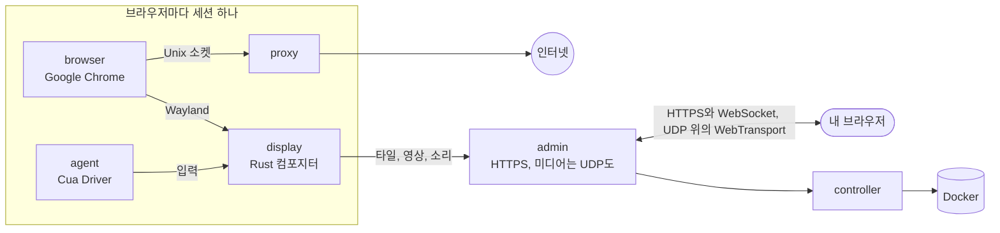

<div align="center">

<a href="https://easi.run/ko/"></a>

# easi.run

**진짜로 안전한 브라우징, 나와 나의 에이전트를 위해.**

모든 에이전트에게 내 서버에서 돌아가는 자신만의 진짜 Chrome을 주세요. 실시간으로 지켜보다가, 로그인이나 2FA 코드,
CAPTCHA에서 막히면 클릭 한 번으로 넘겨받으세요. 그런 다음 다시 돌려주면 됩니다.

[](https://github.com/julianosig/easi.run/actions/workflows/ci.yml)
[](../../CONTRIBUTING.md#coverage)
[](../../LICENSE)
[](https://github.com/julianosig/easi.run/stargazers)
[](https://github.com/julianosig/easi.run/commits/main)
[](https://www.rust-lang.org)
[](https://docs.easi.run/ko/#/agents)

<a href="https://www.producthunt.com/products/easi-run?utm_source=badge-follow&utm_medium=badge&utm_source=badge-easi&#0045;run" target="_blank"></a>

[**▶ 라이브 데모 체험하기**](https://easi.run/demo/?locale=ko) · [기능](https://easi.run/ko/features/) ·
[문서](https://docs.easi.run/ko/) · [빠른 시작](#빠른-시작) · [비교](https://easi.run/ko/compare/)

[English](../../README.md) · [Português (Brasil)](pt-BR.md) · [Español](es.md) · [简体中文](zh-CN.md) · [हिन्दी](hi.md) ·
[Français](fr.md) · [Deutsch](de.md) · [日本語](ja.md) · [Русский](ru.md) · [Bahasa Indonesia](id.md) · 한국어

<a href="https://easi.run/ko/"></a>

</div>

## 무엇인가요?

웹을 쓰는 에이전트에게는 브라우저가 필요합니다. 대부분의 팀은 클라우드 서비스에서 시간 단위로 빌리거나, headless
Chrome과 VNC 서버를 엮어서 씁니다. easi.run은 세 번째 방법입니다. **명령어 하나로 내 Linux 서버에서 시작되고**,
그때부터 모든 에이전트가 격리된 Google Chrome을 받습니다. 새것으로도, 저장된 로그인과 함께로도 쓸 수 있고, 나는
각각을 실시간으로 보는 창을 얻습니다.

에이전트가 사람만 할 수 있는 일에서 막히면, 세션의 바에서 제어를 넘겨받습니다. 에이전트는 기다립니다. 내가
비밀번호를 입력하고, 2FA 요청을 승인하거나, 퍼즐을 풉니다. 제어를 돌려주면 에이전트가 이어서 진행합니다.

## 왜 쓰나요

- 💸 **시간당 요금 없음.** 내 서버에서 돌아가므로 서버 비용만 내고, 그 밖에는 없습니다.
- 🙋 **사람이 끼어들 수 있음.** 클릭 한 번으로 넘겨받고, 내가 돌려줄 때까지 에이전트는 기다립니다.
- 🔔 **필요할 때 에이전트가 알려 줌.** 로그인이나 CAPTCHA에서 에이전트가 이유와 함께 나를 부릅니다. 세션에는
  요청 시각과 함께 *확인 필요*가 뜨고, 서명된 웹훅으로 Slack, Discord, 내 도구에도 알릴 수 있습니다
  ([방법](https://docs.easi.run/ko/#/agents)).
- 🔑 **로그인 유지.** 유지 세션은 다시 시작할 때마다 로그인, 사이트 데이터(캐시 제외), 방문 기록, 환경설정을
  되살립니다. Chrome을 닫아도 로그인이 유지되는 사이트라면 어디서든 그렇고, 내 비밀번호로만 열리는 키로
  암호화됩니다([방법](../security.md#boundaries)).
  업데이트 전에 실행 중인 세션은 먼저 저장됩니다.
- 🔒 **내가 입력한 것은 내 것.** 비밀번호 칸의 내용은 절대 에이전트에게 가지 않습니다. 내가 넘겨받는 순간 스크린샷이
  멈추고, 내가 입력하거나 붙여 넣은 네 글자 이상의 정확한 텍스트는 `[redacted]`로 전달됩니다
  ([방법](../security.md#boundaries)).
- 🧱 **브라우저마다 자신만의 샌드박스.** 자신만의 컨테이너가 있고, 자체 네트워크는 없으며, 내 사설 네트워크로 들어갈
  길도 없습니다([보안 모델](../security.md)).
- 🕵️ **사이트가 진짜 Chrome으로 대하는 진짜 Chrome.** Google Chrome 그 자체이며, BrowserScan, sannysoft,
  rebrowser의 봇 탐지기에서 깨끗합니다([사이트에 보이는 것](../stealth.md)).
- 📁 **파일, 소리, 클립보드가 그냥 됩니다.** 파일을 페이지로 끌어다 놓고, 페이지 자체의 업로드 버튼으로 고르고,
  다운로드는 내 다운로드 폴더로 바로 받고, 페이지 소리를 듣고, 양방향으로 복사하고 붙여 넣을 수 있습니다.
- 🎥 **세션 녹화**를 서버에서 고화질로, 원하면 내 카메라와 마이크까지 함께 할 수 있습니다.
- 🧾 **자리를 비운 사이 일어난 일.** 세션마다 에이전트 동작의 타임라인이 남습니다. 각 동작을 누가 했고 어떻게
  됐는지, 입력은 글자 수로만. 녹화가 켜져 있으면(기본값) 에이전트 화면도 리플레이할 수 있습니다
  ([방법](https://docs.easi.run/ko/#/sessions)).
- 🤖 **에이전트에 바로 연결.** Claude Code, Codex, 모든 MCP 클라이언트를 위한
  [MCP 서버](https://docs.easi.run/ko/#/agents)가 내장되어 있습니다. 내 서버에서나 SSH로는 토큰 없이, HTTPS로는
  에이전트마다 토큰 하나로 씁니다. 같은 도구를 간단한 REST API로도 제공합니다. Claude Code가 있고 `easi`라는 다른
  서버가 없으면, 설치 프로그램이 Claude Code에 대신 추가해 줍니다.
- 📂 **에이전트 자신의 다운로드와 업로드.** 페이지가 내려받은 것을 저장하고, 자신이 만든 이미지 같은 자신의 파일을
  업로드합니다. 기본적으로 파일마다 나에게 먼저 묻습니다
  ([방법](https://docs.easi.run/ko/#/agents)).
- 🌍 **세션마다 나만의 프록시**를 쓸 수 있습니다. 사용 전에 확인하고, 나가는 위치에 맞춰 브라우저의 시간대와 언어를
  제안합니다.
- ⚡ **VNC가 아닌 자체 스트리밍 엔진.** Rust로 작성한 컴포지터가 Chrome을 그리고 스트리밍합니다. 정지된 콘텐츠는
  무손실 타일로, 움직임은 AV1로, 네트워크가 허락하면 UDP로 보냅니다. 선명한 글자, 부드러운 영상, 그리고 VNC
  스트림의 일부에 불과한 대역폭(수치는 아래에).

## 비교

<!-- compare:start -->

| | **easi.run** | Browserbase | Browserless | KasmVNC |
|---|:---:|:---:|:---:|:---:|
| 내 서버에서 실행 | ✅ | – | ✅ | ✅ |
| 사용료 없음 | ✅ | – | – | ✅ |
| 동시 브라우저 수 요금제 제한 없음 | ✅ | – | – | ✅ |
| 세션 길이 요금제 제한 없음 | ✅ | – | – | ✅ |
| 직접 제어하는 동안 에이전트는 대기 | ✅ | – | ✅ | – |
| 에이전트가 나를 부르고 알림도 와요 | ✅ | – | ✅ | – |
| 제어 화면을 직접 만들기 | ✅ | – | – | – |
| 에이전트가 호출할 수 있는 API | ✅ | ✅ | ✅ | – |
| 에이전트용 MCP 서버 | ✅ | ✅ | ✅ | – |
| 에이전트에게 보이지 않는 내 입력 | ✅ | – | – | – |
| 내 비밀번호로만 열리는 암호화된 세션 금고 | ✅ | – | – | – |
| 사설 네트워크 접근 차단 | ✅ | – | – | – |
| 내장 스텔스 | ✅ | ✅ | ✅ | – |
| 실시간 소리 | ✅ | – | – | – |
| 파일을 페이지에 바로 끌어다 놓기 | ✅ | – | – | – |
| 업로드에 내 파일 선택기 사용 | ✅ | – | – | – |
| 다운로드는 내 컴퓨터로 | ✅ | – | – | – |
| 양방향 복사·붙여넣기 | ✅ | – | ✅ | ✅ |
| 세션 녹화 | ✅ | ✅ | ✅ | – |
| 에이전트 동작 타임라인과 리플레이 | ✅ | ✅ | – | – |
| 세션별로 입력, 클립보드, 파일, 소리 끄기 | ✅ | – | – | ✅ |
| 세션마다 내 프록시, 위치 일치 | ✅ | – | – | – |
| HTTPS 포트 하나로 작동, TURN 불필요 | ✅ | – | – | ✅ |
| 검증 가능한 오픈 소스 | ✅ | – | – | ✅ |

✅ 있음 · – 없음, 일부만, 문서에 없음 또는 해당 없음. [전체 비교](https://easi.run/ko/compare/)는 19개 대안을
[출처와 메모](../comparison.md)와 함께 다룹니다(2026년 10~11월).

<!-- compare:end -->

## 빠른 시작

### 요구 사항

| | 최소 | 여유 |
|---|---|---|
| 서버 | Docker가 있는 아무 Linux x86-64 머신: 어떤 클라우드의 VPS든(Hetzner, DigitalOcean, AWS EC2 x86…) 내 서버든 | |
| 소프트웨어 | Compose와 Buildx가 포함된 Docker Engine 28+(rootful, docker.service로 실행), systemd, git, curl, flock, iptables, ss, awk, stat, df, timeout, realpath | |
| 계정 | docker 그룹에 속한 root가 아닌 사용자(`sudo usermod -aG docker $USER` 후 다시 로그인). sudo는 필요 없습니다: 설치 프로그램은 몇 가지 변경을 잠깐만 실행되는 특권 Docker 컨테이너를 통해 root로 하며, Docker가 이를 허용해야 합니다 | |
| CPU | 2코어 | 4코어 이상 |
| 메모리 | 4 GB(브라우저 세션 한 번에 하나) | 8 GB 이상(8 GB에서 동시 2세션, 16 GB에서 4세션) |
| 디스크 | 10 GB 여유 공간(이미지) | |
| GPU | 필요 없음 | |

각 브라우저 세션은 자신만의 한도로 실행됩니다. 기본적으로 Chrome에 CPU 2개와 2 GiB, 그 옆에 display, 프록시,
에이전트(합쳐서 1152 MiB)가 붙으므로 메모리를 최대 3.2 GiB 씁니다. 설치 프로그램은 서버 메모리에 들어가는 만큼,
1개에서 16개까지 세션을 동시에 실행하고, 요약에 몇 개인지 알려 줍니다. 각 세션은 나나 에이전트가 요청할 때
시작됩니다. 바꾸려면 `~/easi.run/.env`에 `BROWSER_CPUS`, `BROWSER_MEMORY_MIB`, `ADMIN_MAX_SESSIONS` 중 하나를 넣고
`bash install.sh`를 다시 실행하세요([설정](https://docs.easi.run/ko/#/configuration)).

### 1. 설치

서버에서 코딩 에이전트(Claude Code, Codex 등)에게 이렇게 요청하세요:

```text
Read https://easi.run/install.md and install easi.run on this server.
```

또는 직접 실행하세요:

```sh
curl -fsSLO https://easi.run/install.sh && less install.sh && bash install.sh
```

설치 프로그램은 서버를 점검하고, 페이지가 서버 자신의 서비스에 닿지 못하게 하는 방화벽 규칙을 넣고, 멀리 있는
시청자를 위해 서버의 TCP를 조정하고(커널에 BBR이 있으면 fq와 BBR), easi.run을 시작하고, Claude Code가 설치되어
있으면 거기에 추가합니다. sudo는 필요 없습니다. 방화벽 규칙과 TCP 설정은 다이제스트로 받은 Debian 이미지의 잠깐만
실행되는 특권 컨테이너를 통해 root로 이루어지며, 그 `nsenter`가 서버 자신의 `iptables`, `systemctl`, `sysctl`을
실행합니다. 요약에는 무엇을 했는지, 관리자 비밀번호를 어디서 만드는지가 나옵니다. 서버에서는 아무것도 컴파일하지
않습니다. 설치 프로그램은 easi.run의 CI가 빌드하고 게시한 이미지를 받아 각각 설치 프로그램이 지정한 다이제스트와
대조하고, Google의 서명된 저장소에서 Google Chrome을 브라우저 이미지에 추가합니다(Google의 약관상 다른 누구도
Chrome을 배포할 수 없습니다). 첫 실행은 약 550 MB를 내려받고, 2코어와 빠른 연결에서 1~2분 걸립니다.

### 2. 관리자 열기

- **서버에서:** `https://localhost:9443`.
- **내 컴퓨터에서:** 서버에 로그인할 때 쓰는 명령에 `-N -L 9443:127.0.0.1:9443`을 붙여 실행해 두고,
  `https://localhost:9443`을 엽니다. 예를 들면:

  ```sh
  ssh -N -L 9443:127.0.0.1:9443 you@your-server
  ```

  설치 프로그램의 요약은 이 줄을 출력하며, 알아낼 수 있으면 내 로그인을 채워 넣습니다.
- **Remote-SSH를 쓰는 VS Code나 Cursor**는 포트를 대신 전달해 줍니다. 그 터미널에서 링크를 열거나 Ports 보기에서
  9443 포트를 추가하세요. 어느 쪽이든 로컬 포트도 9443이어야 합니다.

인증서가 서버 자신의 것이라 브라우저가 경고합니다. 설치 프로그램은 `~/.config/easi-run/tls-cert.pem`에 사본을
보관하고, 관리자는 그 지문을 로그에 남기므로(`~/easi.run`에서 `docker compose logs admin | grep fingerprint`)
비교해 볼 수 있습니다.

### 3. 비밀번호 만들기

설치 직후 `https://localhost:9443`을 여세요(내 컴퓨터에서, 2단계의 SSH 터널로). 비밀번호가 정해지기 전까지 관리자의
첫 화면이 비밀번호를 묻습니다. 12자 이상으로 정하면 바로 로그인됩니다.

- 관리자는 그 Argon2id 해시만 보관합니다. 틀린 비밀번호와 틀린 2단계 코드는 함께 셉니다. 다섯 번째부터 다음 시도
  전에 2초를 기다리게 되고, 한 번 더 틀릴 때마다 두 배가 되어 최대 256초까지 늘며, 로그인에 성공하면 처음부터 다시
  셉니다.

다음으로 관리자는 로그인 2단계를 권합니다. 선택 사항이지만 추천합니다. 켜 두면 비밀번호만으로는 아무것도 열리지
않습니다.

- **인증 앱**은 모든 브라우저에서 됩니다. 6자리 코드를 보여 주는 아무 앱으로 QR 코드를 스캔하고, 보이는 코드를
  입력하세요. 코드 하나로 한 번 로그인합니다.
- **패스키**는 브라우저가 제공하는 곳에서 됩니다. 지문, 얼굴, 기기 PIN으로 알아서 로그인해 줍니다. Chrome은 터널을
  통한 서버 자신의 사이트처럼 인증서를 신뢰하지 않는 사이트에서는 패스키를 제공하지 않습니다. 그때는 페이지가 그렇게
  알려 주고, 거기서는 인증 앱이 됩니다.
- 그런 다음 한 번만 보여 주는 **복구 코드** 10개를 저장하세요. 휴대폰이나 패스키를 잃어버리면 비밀번호와 그중
  하나로 로그인합니다. 각각 한 번만 쓸 수 있습니다.

둘 다 나중에 **보안**에서 켜고, 끄고, 바꿀 수 있습니다. 휴대폰이나 패스키와 복구 코드까지 잃어버렸나요? 서버에서
`docker exec easi-run-admin-1 admin reset-second-step`을 실행하면 다시 비밀번호만으로 로그인됩니다.

그때부터는 로그인하고, 세션을 시작하고, 원할 때마다 그 바에서 제어를 넘겨받으면 됩니다.

### 업데이트

```sh
curl -fsSLO https://easi.run/install.sh && bash install.sh --update
```

easi.run을 최신 설치 프로그램이 지정한 릴리스로 옮기고, 이전 릴리스의 이미지를 지웁니다. 그때 실행 중인 세션은
끝날 수 있습니다.

### 제거

```sh
bash ~/easi.run/install.sh --uninstall
```

확인하면 easi.run의 컨테이너, 볼륨, 이미지, 방화벽 규칙과 그것을 넣는 docker.service drop-in, 그리고 TCP 설정을
지우며, 바뀌었던 값을 되돌립니다(서버의 다른 easi.run 설치가 아직 필요로 하지 않는 한). `~/.config/easi-run`에 있는
자신의 파일(안에 다른 것이 없으면 디렉터리까지)과, 이 설치의 것이라면 Claude Code의 `easi` 서버도 지웁니다.
체크아웃 `~/easi.run`, Docker의 빌드 캐시, root 단계를 실행한 Debian 이미지는 남기고, 지우는 방법을 알려 줍니다.

### 어디서나 관리자에 접속하기

SSH 터널 없이, 관리자 앞에 다음 중 하나를 둘 수 있으며 각각 내 계정으로 씁니다. 관리자를 서버 밖으로 노출할지는
내가 정합니다. 어느 쪽이든 `ADMIN_ORIGIN`을 내가 열 주소로 설정하세요
(단계는 [운영](https://docs.easi.run/ko/#/operations)에 있습니다):

- **Tailscale:** `sudo tailscale serve --bg https+insecure://localhost:9443`로
  `https://<machine>.<tailnet>.ts.net`에서 내 tailnet에만 제공합니다. 관리자는 서버의 `127.0.0.1`에 그대로 있습니다.
- **Cloudflare Tunnel과 Cloudflare Access:** `cloudflared`가 내 도메인의 이름까지 연결하고, Access가 어떤 요청이든
  관리자 로그인 페이지에 닿기 전에 내가 누구인지 확인합니다.

이때 관리자를 지키는 것: 먼저 누가 그 주소에 닿을 수 있는지(내 tailnet의 기기나 내 Access 정책), 그다음 관리자
로그인: 내 비밀번호와, 켜 두었다면 2단계, 또는 패스키입니다.

## 에이전트 연결하기

에이전트가 시작하는 모든 세션에는 `watch_url`이 따라옵니다. 열면 실시간으로 지켜보고 넘겨받을 수 있습니다.

### 같은 서버의 에이전트

설치 프로그램의 요약에 MCP가 준비되었다고 나오면 easi.run은 이미 Claude Code와 Codex에 들어 있습니다(각각 설치
프로그램을 실행한 계정에 설치됩니다). 새 세션을 시작하고 브라우징을 요청하세요. 다른 계정이나 명령을 실행하는 아무 MCP
클라이언트라면:

```sh
codex mcp add easi -- docker exec -i easi-run-admin-1 admin mcp
```

### 에이전트는 내 컴퓨터에, 서버는 다른 곳에

같은 명령을 SSH로 실어 나릅니다(SSH 키로 로그인). 설정할 토큰, 포트, 인증서가 없습니다.

```sh
claude mcp add --scope user easi -- ssh -T you@your-server docker exec -i easi-run-admin-1 admin mcp
codex mcp add easi -- ssh -T you@your-server docker exec -i easi-run-admin-1 admin mcp
```

`you@your-server` 자리에 서버에 쓰는 로그인을 넣으세요. 브라우저에서 세션을 보려면 2단계의 SSH 터널을 열어 두세요.

### HTTP를 쓰는 에이전트

관리자의 **에이전트** 페이지에서 토큰을 만들고, `/mcp`의 MCP나 `/api/agent/` 아래의 같은 도구를 쓰세요
([에이전트 가이드](https://docs.easi.run/ko/#/agents)).

### 에이전트를 위한 내 로그인

**유지** 세션을 시작하고, 그 안에서 내 사이트들에 로그인한 뒤 멈추세요. Chrome을 닫아도 사이트가 유지하는 로그인을
암호화해서 보관하고, 다시 시작할 때 되살립니다. 그 저장된 세션에서 에이전트의 토큰(또는 로컬 MCP 클라이언트)을
허용하면, 에이전트는 `list_saved_sessions`로 찾아서 `start_session`의 `resume`으로 다시 시작합니다.

## 성능

같은 호스트, 같은 CPU 예산에서 KasmVNC와 비교한 headless 실행의 중앙값(2026-10-21, WebSocket 경유):

| | easi.run | KasmVNC |
|---|---|---|
| 부드러운 스크롤 | **55 fps**, 1.8 Mbit/s | 24 fps, 12.4 Mbit/s |
| 화면 전체가 움직이는 애니메이션 | **38 fps**, 2.0 Mbit/s | 24 fps, 25.4 Mbit/s |
| 1080p 영상 | **36 fps**, 2.1 Mbit/s | 24 fps, 18.1 Mbit/s |
| 스크롤되는 텍스트 | **1.9 Mbit/s**, SSIM 0.990 | 16.4 Mbit/s, SSIM 0.977 |
| 타이핑, 키 입력부터 그려진 프레임까지 | **28 ms** | 69 ms |
| 정지된 페이지 | 미디어 트래픽 없음 | 미디어 트래픽 없음 |

모든 지표, 방법, 원시 결과는 [벤치마크](../benchmark.md)에 있습니다.

## 작동 방식



Rust로 작성한 작은 컴포지터(`display`)가 Chrome의 창을 자신의 메모리에 그립니다. 정지된 콘텐츠는 무손실 타일로
전송하고, 움직임은 그 비용이 낮을 때는 무손실로, 아니면 AV1 영상으로 스트리밍하며 움직임이 멈추면 픽셀 단위로
정확해집니다. 페이지 소리는 Opus로, 하나의 HTTPS 포트를 통해, 네트워크가 통과시키면 UDP(WebTransport)로도 전송해,
손실이 있는 네트워크에서도 스트림을 부드럽게 유지합니다. 입력과 클릭은 제어권을 가진 시청자만 할 수 있습니다.

- [보안 모델](../security.md): 모든 경계와, 그것을 증명하는 테스트
- [아키텍처](../architecture.md): 저장소의 구성과 코드 각 부분의 위치를, 프레임 하나와 키 입력 하나를 따라가며
- [설계](../design.md)와 [토폴로지](../topology.md): 설계의 이유, 컨테이너, 그 한도

이 문서들은 영어로 되어 있습니다.

## 기여하기

이슈와 풀 리퀘스트를 환영합니다. [`CONTRIBUTING.md`](../../CONTRIBUTING.md)에 빌드, 테스트, 리뷰 방법이 있고,
`scripts/dev/run.sh scripts/check.sh`는 변경에 필요한 검사를 CI와 같은 이미지에서 실행합니다. 보안 문제는
[`SECURITY.md`](../../SECURITY.md)에 설명된 대로 비공개로 알려 주세요.

## 라이선스

easi.run은 [GNU Affero General Public License 버전 3 전용](../../LICENSE)의 자유 소프트웨어입니다. 실행하고, 고치고,
나누세요. 수정한 버전을 네트워크로 다른 사람에게 제공한다면 그 소스 코드도 함께 제공하세요. 각 의존성은 자신의
라이선스를 유지하며, [`docs/licenses.md`](../licenses.md)에 나열되어 있습니다. 게시된 이미지는 영상을 로열티가 없는
AV1로만 인코딩하며, H.264 인코더는 선택해서 켜는 빌드 기능입니다(`--build-arg DISPLAY_FEATURES=h264`). 이미지는
`ghcr.io/julianosig/easi.run-<role>`로 게시되며, 각각 빌드의 출처인 이 저장소의 커밋으로 태그와 레이블이 붙고, 그
커밋이 소스 코드입니다. 브라우저 이미지에는 Google Chrome이 들어 있지 않으며, 각 설치가 직접 추가합니다. 각 이미지는
`/usr/share/doc/easi.run`에 이 라이선스, 소스가 있는 곳, 함께 담긴 것들의 라이선스와 고지 문구를 담고 있습니다.

<div align="center">

**easi.run이 에이전트의 골칫거리를 덜어 주었다면, ⭐ 하나가 다른 사람들이 찾는 데 도움이 됩니다.**

</div>
