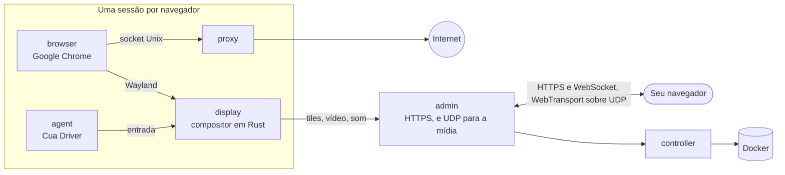

<div align="center">

<a href="https://easi.run/pt-BR/"></a>

# easi.run

**Navegação segura de verdade para você e seus agentes.**

Dê a cada agente o seu próprio Chrome de verdade, no seu próprio servidor. Acompanhe ao vivo e assuma com um clique
quando ele travar num login, num código de 2FA ou num CAPTCHA. Depois, devolva o controle.

[](https://github.com/julianosig/easi.run/actions/workflows/ci.yml)
[](../../LICENSE)
[](https://github.com/julianosig/easi.run/stargazers)
[](https://github.com/julianosig/easi.run/commits/main)
[](https://www.rust-lang.org)
[](https://docs.easi.run/pt-BR/#/agents)

<a href="https://www.producthunt.com/products/easi-run?utm_source=badge-follow&utm_medium=badge&utm_source=badge-easi&#0045;run" target="_blank"></a>

[**▶ Experimente a demo ao vivo**](https://easi.run/demo/?locale=pt-BR) · [Recursos](https://easi.run/pt-BR/features/) ·
[Documentação](https://docs.easi.run/pt-BR/) · [Início rápido](#início-rápido) · [Comparar](https://easi.run/pt-BR/compare/)

[English](../../README.md) · Português (Brasil) · [Español](es.md) · [简体中文](zh-CN.md) · [हिन्दी](hi.md) ·
[Français](fr.md) · [Deutsch](de.md) · [日本語](ja.md) · [Русский](ru.md) · [Bahasa Indonesia](id.md) · [한국어](ko.md)

<a href="https://easi.run/pt-BR/"></a>

</div>

## O que é?

Agentes que usam a web precisam de um navegador. A maioria das equipes aluga um por hora de um serviço na nuvem, ou
junta um Chrome headless com um servidor VNC. O easi.run é um terceiro caminho: **um comando o inicia no seu próprio
servidor Linux**, e a partir daí cada agente ganha um Google Chrome isolado, novo ou com os seus logins salvos, e você
ganha uma janela ao vivo para cada um.

Quando o agente trava em algo que só uma pessoa consegue fazer, você assume o controle pela barra da sessão. O agente
espera. Você digita a senha, aprova o 2FA ou resolve o desafio. Você devolve o controle, e o agente continua.

## Por que as pessoas usam

- 💸 **Sem cobrança por hora.** Ele roda no seu servidor, então você paga o servidor e nada mais.
- 🙋 **Uma pessoa pode entrar.** Um clique para assumir, e o agente espera até você devolver.
- 🔔 **Seu agente avisa quando precisa de você.** Num login ou num CAPTCHA, ele pede você e diz por quê: a sessão mostra
  *Precisa de você* com a hora do pedido, e um webhook assinado pode avisar o Slack, o Discord ou a sua ferramenta.
  Assuma o controle e devolva, e ele continua; Pular, e ele recebe a instrução de seguir sem você ([como](https://docs.easi.run/pt-BR/#/agents)).
- 🔑 **Continue logado.** Uma sessão persistente traz de volta os seus logins, os dados dos sites (menos os caches), o
  histórico e as preferências cada vez que você a retoma, em qualquer site que mantém você logado quando o Chrome fecha,
  criptografados com uma chave que só a sua senha destrava ([como](../security.md#boundaries)). Uma atualização salva
  antes as que estão rodando, e se um salvamento falhar, a sessão avisa.
  Depois da atualização, as sessões que estavam rodando voltam assim que você digita sua senha, e um chat que estava
  aberto abre de novo na conversa que tinha.
- 🔒 **O que você digita é só seu.** O que está num campo de senha nunca chega ao seu agente, a menos que você permita
  scripts na página. Quando você assume, as capturas de tela param, e o texto exato que você digita ou cola, de quatro
  caracteres ou mais, chega a ele como `[redacted]`; seu próprio chat continua vendo a tela ([como](../security.md#boundaries)).
- 🧱 **Cada navegador na sua própria sandbox.** Seus próprios contêineres, nenhuma rede própria, nenhum caminho para a
  sua rede privada, e a web pública apenas por HTTPS, então um site sem HTTPS não abre ([modelo de segurança](../security.md)).
- 🕵️ **Um Chrome de verdade, que os sites tratam como um Chrome de verdade.** O próprio Google Chrome, limpo no
  BrowserScan, no sannysoft e no detector de bots do rebrowser ([o que os sites veem](../stealth.md)).
- 📁 **Arquivos, som e área de transferência simplesmente funcionam.** Arraste um arquivo para a página, escolha um
  com o próprio botão de upload da página, receba os downloads direto na sua pasta Downloads, ouça a página, e copie e
  cole nos dois sentidos.
- 🎥 **Grave uma sessão** no servidor em alta qualidade, com a sua câmera e o seu microfone se quiser.
- 🧾 **Veja o que aconteceu enquanto você estava fora.** Cada sessão guarda uma linha do tempo das ações do agente:
  quem fez cada uma e como foi, com a digitação contada em caracteres. Com a gravação ligada, como vem por padrão,
  você também assiste ao replay da tela do agente ([como](https://docs.easi.run/pt-BR/#/sessions)). Os dois ficam criptografados no seu servidor e sobrevivem a um reinício.
- 💬 **Converse com seu próprio agente ao lado da página.** Abra seu Claude Code ou Codex em um terminal sobre a sessão,
  na sua conta: embaixo ou como barra lateral, redimensionável e parcialmente transparente, de volta como você o deixou.
  Uma conta abre em várias sessões. Ele só alcança aquele navegador e não pode agir enquanto você tem o controle ([como](https://docs.easi.run/#/sessions)).
- 🔍 **Lê a estrutura de uma página, sem ser visto.** Seu agente lê qualquer parte de uma página por seletor CSS, em um
  mundo que a página não enxerga. Ative as ferramentas do desenvolvedor em uma sessão, e ele também pode rodar scripts
  lá; os sites podem notar ([como](https://docs.easi.run/pt-BR/#/agent)).
- 🤖 **Conecta no seu agente.** Um [servidor MCP](https://docs.easi.run/pt-BR/#/agents) embutido para Claude Code,
  Codex e qualquer cliente MCP: no seu servidor ou por SSH sem token, ou por HTTPS com um token por agente. As mesmas
  ferramentas numa API REST simples. O instalador o adiciona ao Claude Code para você quando o Claude Code está lá e
  não tem outro servidor chamado `easi`.
- 📂 **Os downloads e uploads do próprio agente.** Ele salva o que a página baixa e envia arquivos próprios, como uma
  imagem que ele fez. Por padrão ele pergunta a você antes de cada arquivo; em Configurações você pode sempre permitir
  ou recusar ([como](https://docs.easi.run/pt-BR/#/agents)).
- 🌍 **O seu próprio proxy por sessão**, verificado antes do uso, com o fuso horário e os idiomas do navegador sugeridos
  a partir de onde ele sai.
- ⚡ **O nosso próprio motor de streaming, não VNC.** Um compositor escrito em Rust desenha o Chrome e o transmite:
  conteúdo parado como tiles sem perda, movimento como AV1, por UDP onde a sua rede permite. Texto nítido, vídeo
  fluido, e uma fração da banda de um stream VNC (números abaixo).

## Como se compara

<!-- compare:start -->

| | **easi.run** | Browserbase | Browserless | KasmVNC |
|---|:---:|:---:|:---:|:---:|
| Roda no seu próprio servidor | ✅ | – | ✅ | ✅ |
| Sem taxas de uso | ✅ | – | – | ✅ |
| Sem limite do plano para navegadores simultâneos | ✅ | – | – | ✅ |
| Sem limite do plano na duração da sessão | ✅ | – | – | ✅ |
| Você assume e o agente espera | ✅ | – | ✅ | – |
| O agente chama você, e você é avisado | ✅ | – | ✅ | – |
| Crie sua própria tela de controle | ✅ | – | – | – |
| Uma API para seus agentes chamarem | ✅ | ✅ | ✅ | – |
| Um servidor MCP para seus agentes | ✅ | ✅ | ✅ | – |
| O agente não vê sua digitação | ✅ | – | – | – |
| Cofres de sessão criptografados que só a sua senha abre | ✅ | – | – | – |
| Rede privada inacessível | ✅ | – | – | – |
| Stealth nativo | ✅ | ✅ | ✅ | – |
| Som ao vivo | ✅ | – | – | – |
| Arraste um arquivo direto na página | ✅ | – | – | – |
| Seu seletor de arquivos para envios | ✅ | – | – | – |
| Downloads chegam ao seu computador | ✅ | – | – | – |
| Copiar e colar nos dois sentidos | ✅ | – | ✅ | ✅ |
| Gravar a sessão | ✅ | ✅ | ✅ | – |
| Linha do tempo das ações do agente, com replay | ✅ | ✅ | – | – |
| Seu próprio Claude Code ou Codex ao lado do navegador ao vivo | ✅ | – | – | – |
| Desligue entrada, área de transferência, arquivos ou som por sessão | ✅ | – | – | ✅ |
| Seu próprio proxy por sessão, com a mesma localização | ✅ | – | – | – |
| Funciona com uma só porta HTTPS, sem TURN | ✅ | – | – | ✅ |
| Código aberto que você pode auditar | ✅ | – | – | ✅ |

✅ tem · – não tem, tem em parte, não está na documentação deles, ou não se aplica. A
[comparação completa](https://easi.run/pt-BR/compare/) cobre 19 alternativas, com [as fontes e notas](../comparison.md) (outubro a novembro de 2026).

<!-- compare:end -->

## Início rápido

### Requisitos

| | Mínimo | Confortável |
|---|---|---|
| Servidor | Qualquer máquina Linux x86-64 com Docker: uma VPS de qualquer nuvem (Hetzner, DigitalOcean, AWS EC2 x86…) ou o seu próprio servidor | |
| Software | Docker Engine 28+ (rootful, executado pelo docker.service) com Compose e Buildx, systemd, git, curl, flock, iptables, ss, awk, stat, df, timeout e realpath | |
| Conta | Um usuário não root no grupo docker (`sudo usermod -aG docker $USER`, depois entre de novo); sem sudo: o instalador faz as suas poucas alterações como root por meio de um contêiner Docker privilegiado de curta duração, que o Docker precisa permitir | |
| CPU | 2 núcleos | 4+ núcleos |
| Memória | 4 GB (uma sessão de navegador por vez) | 8 GB+ (2 sessões ao mesmo tempo com 8 GB, 4 com 16 GB) |
| Disco | 10 GB livres (as imagens), mais o que os replays ocupam: até 10% do disco, ajustável em Configurações | |
| GPU | nenhuma | |

Cada sessão de navegador roda com os seus próprios limites: 2 CPUs e, para o Chrome, 2 GiB de memória ou o que a memória do seu servidor deixa para cada sessão, até 8 GiB, mais um display,
um proxy e um agente ao lado (1152 MiB juntos); um chat aberto soma até 2 GiB e o proxy dele 128 MiB. O instalador roda tantas sessões
ao mesmo tempo quanto a memória do seu servidor comporta, de 1 a 16, e o resumo dele diz quantas e quanta memória cada navegador recebe; cada uma começa
quando você ou um agente pede uma. Para mudar isso, coloque `BROWSER_CPUS`, `BROWSER_MEMORY_MIB`, `CHAT_MEMORY_MIB` ou
`ADMIN_MAX_SESSIONS` em `~/easi.run/.env` e rode `bash install.sh` de novo
([Configuração](https://docs.easi.run/pt-BR/#/configuration)).

### 1. Instale

Peça ao seu agente de programação (Claude Code, Codex ou outro) no seu servidor:

```text
Read https://easi.run/install.md and install easi.run on this server.
```

Ou rode você mesmo:

```sh
curl -fsSLO https://easi.run/install.sh && less install.sh && bash install.sh
```

Ele verifica o servidor, cria a regra de firewall que mantém as páginas longe dos serviços do próprio servidor, ajusta
o TCP do servidor para quem assiste de longe (fq e BBR, quando o kernel tem BBR), inicia o easi.run e o adiciona ao
Claude Code quando o Claude Code está instalado. Ele não precisa de sudo: a regra de firewall e as configurações de TCP
são feitas como root por meio de um contêiner privilegiado de curta duração da imagem Debian, obtida pelo seu digest,
cujo `nsenter` executa o `iptables`, o `systemctl` e o `sysctl` do próprio servidor. O resumo dele diz o que foi feito
e onde você cria a senha do admin. Nada é compilado no seu servidor: o instalador baixa as imagens que a CI do easi.run
construiu e publicou, cada uma conferida com o digest que o instalador indica, e adiciona o Google Chrome à imagem do
navegador a partir do repositório assinado do Google (os termos do Google não deixam mais ninguém distribuir o Chrome).
A primeira execução baixa cerca de 550 MB e leva de um a dois minutos com 2 núcleos e uma conexão rápida.

### 2. Abra o admin

- **No servidor:** `https://localhost:9443`.
- **No seu computador:** use o comando que você já usa para entrar no servidor, acrescentando
  `-N -L 9443:127.0.0.1:9443`, e deixe-o rodando; depois abra `https://localhost:9443`. Por exemplo:

  ```sh
  ssh -N -L 9443:127.0.0.1:9443 you@your-server
  ```

  O resumo do instalador imprime essa linha, preenchida com o seu login quando ele consegue identificá-lo.
- **VS Code ou Cursor com Remote-SSH** encaminham a porta para você: abra o link pelo terminal deles, ou adicione a
  porta 9443 na visão Ports; de qualquer jeito, a porta local também precisa ser 9443.

O certificado é do próprio servidor, então o navegador avisa sobre ele: o instalador guarda uma cópia em
`~/.config/easi-run/tls-cert.pem`, e o admin registra a impressão digital dele (`docker compose logs admin | grep
fingerprint`, em `~/easi.run`) para você comparar.

### 3. Crie a sua senha

Abra `https://localhost:9443` (do seu computador, pelo túnel SSH do passo 2) logo depois da instalação: enquanto não
houver senha, a primeira tela do admin pede uma. Escolha uma com 12 caracteres ou mais; você já entra na hora.

- O admin guarda só o hash Argon2id dela. Senhas erradas e códigos de segunda etapa errados contam juntos: o quinto
  inicia uma espera de 2 segundos antes da próxima tentativa, cada um a mais a dobra, até 256 segundos, e um login
  concluído zera a contagem.

Em seguida, o admin oferece uma segunda etapa no login. Ela é opcional, e nós a recomendamos: com ela ligada, a sua
senha sozinha não abre nada.

- **Um app autenticador**, em qualquer navegador: escaneie o QR code com qualquer app que mostre códigos de 6 dígitos,
  e digite o código que ele mostra. Cada código entra uma vez.
- **Uma passkey**, onde o seu navegador oferecer uma: ela faz o login sozinha, com a sua digital, o seu rosto ou o PIN
  do aparelho. O Chrome não oferece nenhuma num site cujo certificado ele não confia, como o do próprio servidor pelo
  túnel; a página então avisa, e o app funciona ali.
- Depois, guarde os dez **códigos de recuperação** que ela mostra uma única vez: se você perder o celular ou a
  passkey, entre com a senha e um deles; cada um funciona uma vez.

Ligue, desligue ou troque qualquer uma depois em **Segurança**. Perdeu o celular ou a passkey e os códigos de
recuperação? Rode `docker exec easi-run-admin-1 admin reset-second-step` no servidor, e só a senha volta a fazer o
login.

A partir daí, entre, inicie uma sessão e assuma o controle pela barra dela quando quiser.

### Atualizar

```sh
curl -fsSLO https://easi.run/install.sh && bash install.sh --update
```

Ele leva o easi.run para a release que o instalador mais novo indica e remove as imagens da anterior; as sessões
rodando nesse momento podem terminar.

### Remover

```sh
bash ~/easi.run/install.sh --uninstall
```

Depois que você confirma, ele remove os contêineres, volumes e imagens do easi.run, a regra de firewall dele e o
drop-in do docker.service que a coloca no lugar, e as configurações de TCP dele, devolvendo os valores que elas
substituíram (a não ser que outra instalação do easi.run no servidor ainda precise deles), os seus próprios arquivos em
`~/.config/easi-run` (o diretório também, quando não há mais nada nele), e o servidor `easi` do Claude Code quando ele é
desta instalação. Ele mantém o checkout, `~/easi.run`, o cache de build do Docker e a imagem Debian em que os passos
como root rodaram, e diz como removê-los.

### Acesse o admin de qualquer lugar

Sem um túnel SSH, você pode colocar um destes na frente do admin, cada um com a sua própria conta. Expor o admin além
do servidor é escolha sua. De qualquer jeito, defina `ADMIN_ORIGIN` com o endereço que você vai abrir
([Operações](https://docs.easi.run/pt-BR/#/operations) tem os passos):

- **Tailscale:** `sudo tailscale serve --bg https+insecure://localhost:9443` o serve em
  `https://<machine>.<tailnet>.ts.net`, só para a sua tailnet; o admin continua no `127.0.0.1` do servidor.
- **Cloudflare Tunnel com Cloudflare Access:** o `cloudflared` o leva a um nome no seu domínio, e o Access confere quem
  você é antes que qualquer requisição chegue à página de login do admin.

O que o protege então: quem pode chegar ao endereço (os dispositivos da sua tailnet, ou a sua política do Access), e
depois o login do admin: a sua senha e, quando você a ligou, a segunda etapa, ou uma passkey.

## Conecte o seu agente

Cada sessão que o seu agente inicia vem com uma `watch_url`: abra-a para acompanhar ao vivo e assumir.

### Agente no mesmo servidor

Quando o resumo do instalador diz que o MCP está pronto, o easi.run está no Claude Code e no Codex (cada um instalado
para a conta que rodou o instalador): abra uma nova sessão e peça para ele navegar. Para outra conta, ou qualquer
cliente MCP que roda um comando:

```sh
codex mcp add easi -- docker exec -i easi-run-admin-1 admin mcp
```

### Agente no seu computador, servidor em outro lugar

O mesmo comando, levado pelo SSH (entre com a sua chave SSH): nenhum token, porta ou certificado para configurar.

```sh
claude mcp add --scope user easi -- ssh -T you@your-server docker exec -i easi-run-admin-1 admin mcp
codex mcp add easi -- ssh -T you@your-server docker exec -i easi-run-admin-1 admin mcp
```

Use o login que você já usa no servidor no lugar de `you@your-server`. Deixe o túnel SSH do passo 2 aberto para
acompanhar as sessões no seu navegador.

### Agentes que falam HTTP

Crie um token na página **Agentes** do admin, e use o MCP em `/mcp` ou as mesmas ferramentas em `/api/agent/`
([guia de agentes](https://docs.easi.run/pt-BR/#/agents)).

### Playwright, Puppeteer ou Selenium via CDP

Inicie uma sessão com **CDP para Playwright, Puppeteer e Selenium** ativado: a barra dela mostra a porta (`CDP :9222`; um clique
copia `http://127.0.0.1:9222`), no loopback do servidor. Conecte-se ao navegador que já está lá:

```js
const browser = await chromium.connectOverCDP('http://127.0.0.1:9222');
const page = browser.contexts()[0].pages()[0];
```

No Puppeteer, use `puppeteer.connect({ browserURL: 'http://127.0.0.1:9222' })`; nas opções do Chrome no Selenium,
`debuggerAddress` com `127.0.0.1:9222`. No seu computador, primeiro encaminhe a porta por SSH:
`ssh -N -L 9222:127.0.0.1:9222 you@your-server`. Qualquer cliente que se conecta controla o navegador inteiro e lê tudo o que ele contém,
inclusive o que você digita nele, e qualquer pessoa no servidor pode se conectar: ative isso nas sessões que você automatiza com scripts.

### Os seus logins para o agente

Inicie uma sessão **Persistente**, entre nos seus sites nela e pare-a: ela guarda, criptografados, os logins que um site
mantém quando o Chrome fecha, e os traz de volta quando é retomada. Permita o token do agente (ou os clientes MCP
locais) nessa sessão salva; o agente então a encontra com `list_saved_sessions` e a retoma com o `resume` de
`start_session`.

## Desempenho

Contra o KasmVNC no mesmo host e com o mesmo orçamento de CPU, medianas das execuções headless (2026-10-21, pelo
WebSocket):

| | easi.run | KasmVNC |
|---|---|---|
| Rolagem suave | **55 fps**, 1,8 Mbit/s | 24 fps, 12,4 Mbit/s |
| Animação em movimento total | **38 fps**, 2,0 Mbit/s | 24 fps, 25,4 Mbit/s |
| Vídeo 1080p | **36 fps**, 2,1 Mbit/s | 24 fps, 18,1 Mbit/s |
| Texto rolando | **1,9 Mbit/s**, SSIM 0,990 | 16,4 Mbit/s, SSIM 0,977 |
| Digitação, da tecla ao quadro desenhado | **28 ms** | 69 ms |
| Página parada | nenhum tráfego de mídia | nenhum tráfego de mídia |

Cada métrica, o método e os resultados brutos estão no [benchmark](../benchmark.md).

## Como funciona



Um pequeno compositor escrito em Rust (`display`) desenha as janelas do Chrome na sua própria memória. O conteúdo
parado viaja como tiles sem perda; o movimento continua sem perda enquanto isso é barato, e senão vai como vídeo AV1
que fica perfeito pixel a pixel quando o movimento para; o som da página viaja como Opus, por uma única porta HTTPS, e
por UDP (WebTransport) onde a sua rede deixa passar, o que mantém o stream fluido em redes com perda. Só quem tem o
controle pode digitar e clicar.

- [Modelo de segurança](../security.md): cada fronteira, e o teste que a comprova
- [Arquitetura](../architecture.md): a organização do repositório, e onde cada parte do código fica, seguindo um quadro
  e uma tecla
- [Design](../design.md) e [topologia](../topology.md): o raciocínio, os contêineres, os seus limites

Esses documentos estão em inglês.

## Contribuindo

Issues e pull requests são bem-vindos. O [`CONTRIBUTING.md`](../../CONTRIBUTING.md) cobre build, testes e revisão, e
`scripts/dev/run.sh scripts/check.sh` roda as verificações de que uma mudança precisa na mesma imagem que a CI usa.
Por favor, reporte problemas de segurança em privado, como o [`SECURITY.md`](../../SECURITY.md) descreve.

## Licença

O easi.run é software livre sob a [GNU Affero General Public License, somente a versão 3](../../LICENSE). Rode,
modifique e compartilhe; se você oferecer uma versão modificada a pessoas por uma rede, ofereça a elas o código-fonte
também. Cada dependência mantém a sua própria licença, listadas em [`docs/licenses.md`](../licenses.md). As imagens
publicadas codificam vídeo só como AV1, que é livre de royalties; um codificador H.264 é um recurso de build opcional
(`--build-arg DISPLAY_FEATURES=h264`). Elas são publicadas como `ghcr.io/julianosig/easi.run-<role>`, cada uma com a
tag e o rótulo do commit deste repositório a partir do qual foi construída, que é o seu código-fonte; a imagem do
navegador não traz o Google Chrome, que cada instalação adiciona por conta própria. Cada uma traz, em
`/usr/share/doc/easi.run`, esta licença, onde está o seu código-fonte, e os textos de licença e de aviso do que ela
inclui.

<div align="center">

**Se o easi.run poupa uma dor de cabeça aos seus agentes, uma ⭐ ajuda outras pessoas a encontrá-lo.**

</div>
