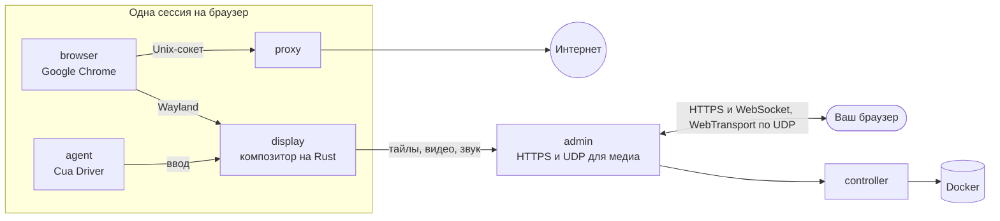

<div align="center">

<a href="https://easi.run/ru/"></a>

# easi.run

**По-настоящему безопасный браузер для вас и ваших агентов.**

Дайте каждому агенту собственный настоящий Chrome на вашем собственном сервере. Смотрите вживую и перехватывайте
управление одним кликом, когда он упирается во вход, код 2FA или CAPTCHA. Потом верните управление ему.

[](https://github.com/julianosig/easi.run/actions/workflows/ci.yml)
[](../../CONTRIBUTING.md#coverage)
[](../../LICENSE)
[](https://github.com/julianosig/easi.run/stargazers)
[](https://github.com/julianosig/easi.run/commits/main)
[](https://www.rust-lang.org)
[](https://docs.easi.run/ru/#/agents)

[**▶ Попробуйте живое демо**](https://easi.run/demo/?locale=ru) · [Возможности](https://easi.run/ru/features/) ·
[Документация](https://docs.easi.run/ru/) · [Быстрый старт](#быстрый-старт) · [Сравнение](https://easi.run/ru/compare/)

[English](../../README.md) · [Português (Brasil)](pt-BR.md) · [Español](es.md) · [简体中文](zh-CN.md) · [हिन्दी](hi.md) ·
[Français](fr.md) · [Deutsch](de.md) · [日本語](ja.md) · Русский · [Bahasa Indonesia](id.md) · [한국어](ko.md)

<a href="https://easi.run/ru/"></a>

</div>

## Что это?

Агентам, которые работают в вебе, нужен браузер. Большинство команд арендуют его по часам у облачного сервиса или
склеивают headless Chrome с VNC-сервером. easi.run — третий путь: **одна команда запускает его на вашем собственном
Linux-сервере**, и с этого момента каждый агент получает изолированный Google Chrome, новый или с вашими сохранёнными
входами, а вы получаете живое окно в каждый из них.

Когда агент застревает на том, что может сделать только человек, вы перехватываете управление с панели сессии. Агент
ждёт. Вы вводите пароль, подтверждаете запрос 2FA или решаете головоломку. Вы возвращаете управление, и агент
продолжает.

## Почему им пользуются

- 💸 **Никаких почасовых счетов.** Он работает на вашем сервере, так что вы платите за сервер и больше ни за что.
- 🙋 **Человек может вмешаться.** Один клик, чтобы перехватить управление, и агент ждёт, пока вы его не вернёте.
- 🔑 **Оставайтесь в аккаунтах.** Постоянная сессия при каждом возобновлении возвращает ваши входы, данные сайтов (кроме
  кешей), историю и настройки — на любом сайте, который не разлогинивает вас при закрытии Chrome, — в зашифрованном
  виде, с ключом, который открывает только ваш пароль ([как](../security.md#boundaries)).
- 🔒 **То, что вы вводите, остаётся вашим.** Содержимое поля пароля никогда не доходит до агента. Как только вы
  перехватываете управление, скриншоты прекращаются, а точный текст, который вы вводите или вставляете, от четырёх
  символов, доходит до него как `[redacted]` ([как](../security.md#boundaries)).
- 🧱 **Каждый браузер в своей песочнице.** Свои контейнеры, никакой собственной сети и никакого пути в вашу частную сеть
  ([модель безопасности](../security.md)).
- 🕵️ **Настоящий Chrome, который сайты считают настоящим Chrome.** Сам Google Chrome, чистый в BrowserScan, sannysoft и
  детекторе ботов rebrowser ([что видят сайты](../stealth.md)).
- 📁 **Файлы, звук и буфер обмена просто работают.** Перетащите файл на страницу, выберите его собственной кнопкой
  загрузки страницы, получайте загрузки прямо в папку «Загрузки», слушайте страницу и копируйте и вставляйте в обе
  стороны.
- 🎥 **Записывайте сессию** на сервере в высоком качестве, при желании с вашей камерой и микрофоном.
- 🤖 **Подключается к вашему агенту.** Встроенный [MCP-сервер](https://docs.easi.run/ru/#/agents) для Claude Code, Codex
  и любого MCP-клиента: на вашем сервере или через SSH без токена, или через HTTPS с отдельным токеном для каждого
  агента. Те же инструменты через простой REST API. Установщик сам добавит его в Claude Code, если Claude Code
  установлен и в нём нет другого сервера с именем `easi`.
- 📂 **Собственные загрузки и отправки вашего агента.** Он сохраняет то, что скачивает страница, и отправляет
  собственные файлы, например созданное им изображение. По умолчанию он спрашивает вас перед каждым файлом, а отправка
  на страницу выключена, пока вы её не включите ([как](https://docs.easi.run/ru/#/agents)).
- 🌍 **Свой прокси для каждой сессии**, проверенный перед использованием, с часовым поясом и языками браузера,
  предложенными по месту выхода.
- ⚡ **Собственный движок стриминга, а не VNC.** Композитор, написанный на Rust, отрисовывает Chrome и транслирует его:
  неподвижное содержимое — тайлами без потерь, движение — в AV1, по UDP, где это позволяет ваша сеть. Чёткий текст,
  плавное видео и малая доля трафика VNC-потока (цифры ниже).

## Сравнение

<!-- compare:start -->

| | **easi.run** | Browserbase | Browserless | KasmVNC |
|---|:---:|:---:|:---:|:---:|
| Работает на вашем сервере | ✅ | – | ✅ | ✅ |
| Без платы за использование | ✅ | – | – | ✅ |
| Тариф не ограничивает число браузеров одновременно | ✅ | – | – | ✅ |
| Тариф не ограничивает длину сессии | ✅ | – | – | ✅ |
| Вы берёте управление — агент ждёт | ✅ | – | ✅ | – |
| Свой экран перехвата управления | ✅ | – | – | – |
| API для ваших агентов | ✅ | ✅ | ✅ | – |
| MCP-сервер для ваших агентов | ✅ | ✅ | ✅ | – |
| Ваш ввод скрыт от агента | ✅ | – | – | – |
| Зашифрованные сейфы сессий, которые открывает только ваш пароль | ✅ | – | – | – |
| Доступ к внутренней сети закрыт | ✅ | – | – | – |
| Встроенная маскировка | ✅ | ✅ | ✅ | – |
| Звук в реальном времени | ✅ | – | – | – |
| Перетащить файл прямо на страницу | ✅ | – | – | – |
| Ваше окно выбора файлов для загрузки | ✅ | – | – | – |
| Скачанное — на вашем компьютере | ✅ | – | – | – |
| Копирование и вставка в обе стороны | ✅ | – | ✅ | ✅ |
| Запись сессии | ✅ | ✅ | ✅ | – |
| Отключение ввода, буфера обмена, файлов или звука для каждой сессии | ✅ | – | – | ✅ |
| Свой прокси для каждой сессии, с учётом местоположения | ✅ | – | – | – |
| Работает через один порт HTTPS, без TURN | ✅ | – | – | ✅ |
| Открытый код, который можно проверить | ✅ | – | – | ✅ |

✅ есть · – нет, частично, нет в их документации или неприменимо. [Полное сравнение](https://easi.run/ru/compare/)
охватывает 19 альтернатив, с [источниками и примечаниями](../comparison.md) (октябрь 2026).

<!-- compare:end -->

## Быстрый старт

### Требования

| | Минимум | Комфортно |
|---|---|---|
| Сервер | Любая машина Linux x86-64 с Docker: VPS в любом облаке (Hetzner, DigitalOcean, AWS EC2 x86…) или ваш собственный сервер | |
| ПО | Docker Engine 28+ (rootful, запускаемый docker.service) с Compose и Buildx, systemd, git, curl, flock, iptables, ss, awk, stat, df, timeout и realpath | |
| Учётная запись | Пользователь без root в группе docker (`sudo usermod -aG docker $USER`, затем войдите заново); sudo не нужен: установщик делает свои немногие изменения от root через короткоживущий привилегированный Docker-контейнер, который Docker должен разрешать | |
| CPU | 2 ядра | 4+ ядер |
| Память | 4 ГБ (одна сессия браузера за раз) | 8 ГБ+ (2 сессии одновременно на 8 ГБ, 4 на 16 ГБ) |
| Диск | 10 ГБ свободно (образы) | |
| GPU | не нужен | |

Каждая сессия браузера работает со своими лимитами: по умолчанию 2 CPU и 2 ГиБ для Chrome, плюс display, прокси и
агент рядом (вместе 1152 МиБ), так что она занимает до 3,2 ГиБ памяти. Установщик запускает столько сессий
одновременно, сколько вмещает память вашего сервера, от 1 до 16, и его сводка говорит сколько; каждая запускается,
когда вы или агент её запрашиваете. Чтобы изменить это, задайте `BROWSER_CPUS`, `BROWSER_MEMORY_MIB` или
`ADMIN_MAX_SESSIONS` в `~/easi.run/.env` и снова запустите `bash install.sh`
([Настройка](https://docs.easi.run/ru/#/configuration)).

### 1. Установите

Попросите своего агента для программирования (Claude Code, Codex или другого) на сервере:

```text
Read https://easi.run/install.md and install easi.run on this server.
```

Или запустите сами:

```sh
curl -fsSLO https://easi.run/install.sh && less install.sh && bash install.sh
```

Он проверяет сервер, ставит правило файрвола, которое не пускает страницы к сервисам самого сервера, настраивает TCP
сервера для удалённых зрителей (fq и BBR, если в ядре есть BBR), запускает easi.run и добавляет его в Claude Code, если
Claude Code установлен. Ему не нужен sudo: правило файрвола и настройки TCP применяются от root через короткоживущий
привилегированный контейнер из образа Debian, загруженного по digest, чей `nsenter` запускает собственные `iptables`,
`systemctl` и `sysctl` сервера. Его сводка сообщает, что он сделал и где создать пароль админки. На вашем сервере
ничего не компилируется: установщик загружает образы, которые собрала и опубликовала CI easi.run, каждый проверяется по
digest, указанному в установщике, и добавляет Google Chrome в образ браузера из подписанного репозитория Google (условия
Google не позволяют никому другому распространять Chrome). Первый запуск скачивает около 550 МБ и занимает одну-две
минуты на 2 ядрах при быстром соединении.

### 2. Откройте админку

- **На сервере:** `https://localhost:9443`.
- **Со своего компьютера:** возьмите команду, которой вы уже входите на сервер, добавьте `-N -L 9443:127.0.0.1:9443`
  и оставьте её работать; затем откройте `https://localhost:9443`. Например:

  ```sh
  ssh -N -L 9443:127.0.0.1:9443 you@your-server
  ```

  Сводка установщика печатает эту строку, подставив ваш логин, когда может его определить.
- **VS Code или Cursor через Remote-SSH** пробрасывают порт за вас: откройте ссылку из их терминала или добавьте порт
  9443 в их панели Ports; в любом случае локальный порт тоже должен быть 9443.

Сертификат принадлежит самому серверу, поэтому браузер предупреждает о нём: установщик хранит копию в
`~/.config/easi-run/tls-cert.pem`, а админка пишет в лог его отпечаток (`docker compose logs admin | grep fingerprint`,
в `~/easi.run`), чтобы вы могли сравнить.

### 3. Создайте пароль

Откройте `https://localhost:9443` (со своего компьютера, через SSH-туннель из шага 2) сразу после установки: пока
пароль не задан, первый экран админки просит его. Выберите пароль от 12 символов; вы сразу войдёте.

- Админка хранит только его хеш Argon2id. Неверные пароли и неверные коды второго шага считаются вместе: пятая ошибка
  включает ожидание 2 секунды перед следующей попыткой, каждая следующая удваивает его, до 256 секунд, а успешный вход
  обнуляет счёт.

Затем админка предлагает второй шаг при входе. Он необязателен, и мы его советуем: с ним один только пароль ничего не
открывает.

- **Приложение-аутентификатор**, в любом браузере: отсканируйте QR-код любым приложением, которое показывает
  6-значные коды, и введите показанный код. Каждый код срабатывает один раз.
- **Passkey**, где браузер его предлагает: он входит сам, по отпечатку пальца, лицу или PIN-коду устройства. Chrome не
  предлагает его на сайте, сертификату которого не доверяет, например на сайте самого сервера через туннель; тогда
  страница об этом сообщает, а приложение там работает.
- Затем сохраните десять **кодов восстановления**, которые показываются один раз: если вы потеряете телефон или
  passkey, войдите с паролем и одним из них; каждый работает один раз.

Включайте, выключайте или заменяйте любой из них позже в разделе **Безопасность**. Потеряли телефон или passkey и коды
восстановления? Выполните `docker exec easi-run-admin-1 admin reset-second-step` на сервере, и снова будет достаточно
одного пароля.

Дальше входите, запускайте сессию и перехватывайте управление с её панели, когда захотите.

### Обновление

```sh
curl -fsSLO https://easi.run/install.sh && bash install.sh --update
```

Он переводит easi.run на релиз, указанный в новейшем установщике, и удаляет образы предыдущего; сессии, работающие в
этот момент, могут завершиться.

### Удаление

```sh
bash ~/easi.run/install.sh --uninstall
```

После вашего подтверждения он удаляет контейнеры, тома и образы easi.run, его правило файрвола и drop-in docker.service,
который его ставит, и его настройки TCP, возвращая значения, которые они заменили (если только они не нужны другой
установке easi.run на сервере), его собственные файлы в `~/.config/easi-run` (и сам каталог, когда в нём больше ничего
нет), а также сервер `easi` в Claude Code, если он принадлежит этой установке. Он оставляет checkout, `~/easi.run`, кеш
сборки Docker и образ Debian, в котором выполнялись шаги от root, и говорит, как их удалить.

### Доступ к админке откуда угодно

Без SSH-туннеля можно поставить перед админкой один из этих сервисов, каждый со своей учётной записью. Открывать доступ
к админке за пределами сервера — ваш выбор. В любом случае задайте в `ADMIN_ORIGIN` адрес, который будете открывать
(шаги — в разделе [Эксплуатация](https://docs.easi.run/ru/#/operations)):

- **Tailscale:** `sudo tailscale serve --bg https+insecure://localhost:9443` отдаёт её по адресу
  `https://<machine>.<tailnet>.ts.net`, только вашему tailnet; админка остаётся на `127.0.0.1` сервера.
- **Cloudflare Tunnel с Cloudflare Access:** `cloudflared` выводит её на имя в вашем домене, а Access проверяет, кто вы,
  прежде чем любой запрос дойдёт до страницы входа админки.

Что её тогда защищает: кто вообще может достучаться до адреса (устройства вашего tailnet или ваша политика Access), а
затем вход в админку: ваш пароль и, если вы его включили, второй шаг, или passkey.

## Подключите агента

Каждая сессия, которую запускает агент, приходит с `watch_url`: откройте его, чтобы смотреть вживую и перехватывать
управление.

### Агент на том же сервере

Когда сводка установщика сообщает, что MCP готов, easi.run уже в Claude Code: откройте новую сессию Claude Code и
попросите его поработать в браузере. Для Codex или любого MCP-клиента, запускающего команду:

```sh
codex mcp add easi -- docker exec -i easi-run-admin-1 admin mcp
```

### Агент на вашем компьютере, сервер в другом месте

Та же команда, но через SSH (входите по SSH-ключу): ни токена, ни порта, ни сертификата настраивать не нужно.

```sh
claude mcp add --scope user easi -- ssh -T you@your-server docker exec -i easi-run-admin-1 admin mcp
codex mcp add easi -- ssh -T you@your-server docker exec -i easi-run-admin-1 admin mcp
```

Вместо `you@your-server` подставьте логин, которым вы уже входите на сервер. Держите SSH-туннель из шага 2 открытым,
чтобы смотреть сессии в браузере.

### Агенты, которые говорят по HTTP

Создайте токен на странице **Агенты** в админке и используйте MCP по адресу `/mcp` или те же инструменты под
`/api/agent/` ([руководство по агентам](https://docs.easi.run/ru/#/agents)).

### Ваши входы для агента

Запустите **Постоянную** сессию, войдите в ней на свои сайты и остановите её: она хранит, в зашифрованном виде, входы,
которые сайт сохраняет при закрытии Chrome, и возвращает их при возобновлении. Разрешите токену агента (или локальным
MCP-клиентам) эту сохранённую сессию; тогда агент находит её через `list_saved_sessions` и возобновляет через `resume` в
`start_session`.

## Производительность

Против KasmVNC на том же хосте и с тем же бюджетом CPU, медианы headless-прогонов (2026-10-21, через WebSocket):

| | easi.run | KasmVNC |
|---|---|---|
| Плавная прокрутка | **55 fps**, 1,8 Мбит/с | 24 fps, 12,4 Мбит/с |
| Анимация на весь экран | **38 fps**, 2,0 Мбит/с | 24 fps, 25,4 Мбит/с |
| Видео 1080p | **36 fps**, 2,1 Мбит/с | 24 fps, 18,1 Мбит/с |
| Прокрутка текста | **1,9 Мбит/с**, SSIM 0,990 | 16,4 Мбит/с, SSIM 0,977 |
| Ввод, от нажатия до отрисованного кадра | **28 мс** | 69 мс |
| Неподвижная страница | нет медиатрафика | нет медиатрафика |

Все метрики, методика и сырые результаты — в [бенчмарке](../benchmark.md).

## Как это работает



Небольшой композитор, написанный на Rust (`display`), рисует окна Chrome в собственной памяти. Неподвижное содержимое
передаётся тайлами без потерь; движение остаётся без потерь, пока это дёшево, а иначе идёт видеопотоком AV1, который
становится попиксельно точным, как только движение останавливается; звук страницы передаётся в Opus, через один порт
HTTPS, и по UDP (WebTransport), где сеть его пропускает, что сохраняет плавность потока в сетях с потерями. Печатать и
кликать может только тот зритель, у которого управление.

- [Модель безопасности](../security.md): каждая граница и тест, который её доказывает
- [Архитектура](../architecture.md): устройство репозитория и где живёт каждая часть кода, на примере кадра и нажатия
  клавиши
- [Дизайн](../design.md) и [топология](../topology.md): обоснования, контейнеры, их лимиты

Эти документы на английском.

## Участие

Issues и pull requests приветствуются. [`CONTRIBUTING.md`](../../CONTRIBUTING.md) описывает сборку, тестирование и
ревью, а `scripts/dev/run.sh scripts/check.sh` запускает нужные изменению проверки в том же образе, что использует CI.
Пожалуйста, сообщайте о проблемах безопасности приватно, как описано в [`SECURITY.md`](../../SECURITY.md).

## Лицензия

easi.run — свободное ПО под [GNU Affero General Public License, только версии 3](../../LICENSE). Запускайте, изменяйте
и распространяйте; если вы предоставляете изменённую версию людям по сети, предоставьте им и её исходный код. Каждая
зависимость сохраняет свою лицензию, они перечислены в [`docs/licenses.md`](../licenses.md). Опубликованные образы
кодируют видео только в AV1, свободном от роялти; кодировщик H.264 — опциональная функция сборки
(`--build-arg DISPLAY_FEATURES=h264`). Они публикуются как `ghcr.io/julianosig/easi.run-<role>`, каждый с тегом и меткой
коммита этого репозитория, из которого он собран и который является его исходным кодом; образ браузера не содержит
Google Chrome — каждая установка добавляет его сама. Каждый содержит в `/usr/share/doc/easi.run` эту лицензию, указание,
где его исходный код, и тексты лицензий и уведомлений того, что он поставляет.

<div align="center">

**Если easi.run избавляет ваших агентов от головной боли, ⭐ поможет другим его найти.**

</div>
