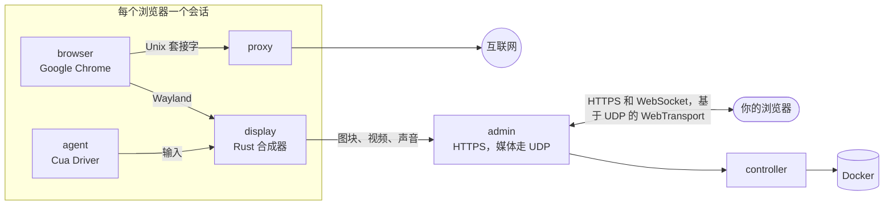

<div align="center">

<a href="https://easi.run/zh-CN/"></a>

# easi.run

**真正安全的浏览，为你和你的智能体。**

给每个智能体一个属于它自己的真实 Chrome，运行在你自己的服务器上。实时观看；当它卡在登录、2FA 验证码或 CAPTCHA
时，一键接管。然后再把控制权交还给它。

[](https://github.com/julianosig/easi.run/actions/workflows/ci.yml)
[](../../CONTRIBUTING.md#coverage)
[](../../LICENSE)
[](https://github.com/julianosig/easi.run/stargazers)
[](https://github.com/julianosig/easi.run/commits/main)
[](https://www.rust-lang.org)
[](https://docs.easi.run/zh-CN/#/agents)

<a href="https://www.producthunt.com/products/easi-run?utm_source=badge-follow&utm_medium=badge&utm_source=badge-easi&#0045;run" target="_blank"></a>

[**▶ 试用在线演示**](https://easi.run/demo/?locale=zh-CN) · [功能](https://easi.run/zh-CN/features/) ·
[文档](https://docs.easi.run/zh-CN/) · [快速开始](#快速开始) · [对比](https://easi.run/zh-CN/compare/)

[English](../../README.md) · [Português (Brasil)](pt-BR.md) · [Español](es.md) · 简体中文 · [हिन्दी](hi.md) ·
[Français](fr.md) · [Deutsch](de.md) · [日本語](ja.md) · [Русский](ru.md) · [Bahasa Indonesia](id.md) · [한국어](ko.md)

<a href="https://easi.run/zh-CN/"></a>

</div>

## 这是什么？

使用网页的智能体需要一个浏览器。大多数团队要么按小时从云服务租一个，要么把 headless Chrome 和 VNC 服务器拼在一起。
easi.run 是第三条路：**一条命令就能在你自己的 Linux 服务器上启动它**，从此每个智能体都会得到一个隔离的 Google
Chrome，全新的或带着你保存的登录状态，而你可以实时看到每一个的画面。

当智能体卡在只有人才能完成的事情上时，你可以从会话的工具栏接管控制。智能体会等待。你输入密码、批准 2FA 请求或
解开验证题。你交还控制权，智能体继续工作。

## 为什么用它

- 💸 **不按小时计费。** 它运行在你的服务器上，所以你只为服务器付费，别无其他。
- 🙋 **人可以随时介入。** 一键接管，智能体会一直等到你交还。
- 🔔 **需要你时，智能体会告诉你。** 遇到登录或 CAPTCHA，它会叫你并说明原因：会话上显示*需要你*和发起时间，签名的
  webhook 还能通知 Slack、Discord 或你自己的工具（[原理](https://docs.easi.run/zh-CN/#/agents)）。
- 🔑 **保持登录。** 持久会话每次恢复时都会带回你的登录状态、网站数据（缓存除外）、历史记录和偏好设置，适用于任何在
  Chrome 关闭后仍保持登录的网站，并用只有你的密码才能解锁的密钥加密（[原理](../security.md#boundaries)）。
  更新前会先保存正在运行的会话。
- 🔒 **你输入的内容只属于你。** 密码框中的内容永远不会到达你的智能体。一旦你接管，截图就会停止，你输入或粘贴的
  四个字符及以上的确切文本，会以 `[redacted]` 的形式到达它（[原理](../security.md#boundaries)）。
- 🧱 **每个浏览器都在自己的沙箱里。** 它有自己的容器，没有自己的网络，也无法进入你的私有网络
  （[安全模型](../security.md)）。
- 🕵️ **网站视为真实 Chrome 的真实 Chrome。** 就是 Google Chrome 本身，在 BrowserScan、sannysoft 和 rebrowser 的
  机器人检测中都表现干净（[网站看到了什么](../stealth.md)）。
- 📁 **文件、声音和剪贴板开箱即用。** 把文件拖到页面上，用页面自己的上传按钮选择文件，下载直接进入你的“下载”
  文件夹，听到页面的声音，还能双向复制粘贴。
- 🎥 **录制会话**，在服务器上高质量录制，愿意的话可以加上你的摄像头和麦克风。
- 🧾 **看看你不在时发生了什么。** 每个会话都有一条智能体操作的时间线：每个操作由谁发起、结果如何，输入只记字符数。
  录制开启时（默认开启），还能回放智能体的屏幕（[原理](https://docs.easi.run/zh-CN/#/sessions)）。
- 🤖 **接入你的智能体。** 内置 [MCP 服务器](https://docs.easi.run/zh-CN/#/agents)，适用于 Claude Code、Codex 和任何
  MCP 客户端：在你的服务器上或通过 SSH 无需令牌，或通过 HTTPS 为每个智能体使用一个令牌。同样的工具也通过一个简单的
  REST API 提供。当 Claude Code 已安装且没有其他名为 `easi` 的服务器时，安装程序会替你把它添加到 Claude Code。
- 📂 **智能体自己的下载和上传。** 它会保存页面下载的内容，也会上传它自己的文件，比如它生成的图片。默认情况下，
  每个文件它都会先问你（[原理](https://docs.easi.run/zh-CN/#/agents)）。
- 🌍 **每个会话使用你自己的代理**，使用前会检查，并根据出口位置建议浏览器的时区和语言。
- ⚡ **我们自己的串流引擎，不是 VNC。** 一个用 Rust 编写的合成器绘制 Chrome 并将其串流：静止内容以无损图块传输，
  运动画面以 AV1 传输，在网络允许时走 UDP。文字清晰，视频流畅，带宽只有 VNC 串流的一小部分（数据见下文）。

## 对比

<!-- compare:start -->

| | **easi.run** | Browserbase | Browserless | KasmVNC |
|---|:---:|:---:|:---:|:---:|
| 在你自己的服务器上运行 | ✅ | – | ✅ | ✅ |
| 无使用费 | ✅ | – | – | ✅ |
| 套餐不限同时运行的浏览器数量 | ✅ | – | – | ✅ |
| 套餐不限会话时长 | ✅ | – | – | ✅ |
| 接管时智能体等着 | ✅ | – | ✅ | – |
| 智能体会叫你，你会收到通知 | ✅ | – | ✅ | – |
| 自建接管界面 | ✅ | – | – | – |
| 智能体可调用的 API | ✅ | ✅ | ✅ | – |
| 给智能体用的 MCP 服务器 | ✅ | ✅ | ✅ | – |
| 智能体看不到你的输入 | ✅ | – | – | – |
| 只有你的密码能解锁的加密会话保险库 | ✅ | – | – | – |
| 禁止访问内网 | ✅ | – | – | – |
| 内置隐身 | ✅ | ✅ | ✅ | – |
| 实时声音 | ✅ | – | – | – |
| 把文件直接拖到页面上 | ✅ | – | – | – |
| 上传时用你自己的文件选择器 | ✅ | – | – | – |
| 下载直接存到你的电脑 | ✅ | – | – | – |
| 双向复制粘贴 | ✅ | – | ✅ | ✅ |
| 录制会话 | ✅ | ✅ | ✅ | – |
| 智能体操作的时间线，附回放 | ✅ | ✅ | – | – |
| 按会话关闭输入、剪贴板、文件或声音 | ✅ | – | – | ✅ |
| 每个会话用你自己的代理，地区一致 | ✅ | – | – | – |
| 只需一个 HTTPS 端口，无需 TURN | ✅ | – | – | ✅ |
| 开源，可审计 | ✅ | – | – | ✅ |

✅ 有 · – 没有、部分支持、文档中未提及或不适用。[完整对比](https://easi.run/zh-CN/compare/)涵盖 19 个替代方案，
并附有[来源和说明](../comparison.md)（2026 年 10 月至 11 月）。

<!-- compare:end -->

## 快速开始

### 要求

| | 最低 | 舒适 |
|---|---|---|
| 服务器 | 任何装有 Docker 的 Linux x86-64 机器：任意云的 VPS（Hetzner、DigitalOcean、AWS EC2 x86…）或你自己的服务器 | |
| 软件 | Docker Engine 28+（rootful，由 docker.service 运行），带 Compose 和 Buildx，以及 systemd、git、curl、flock、iptables、ss、awk、stat、df、timeout 和 realpath | |
| 账户 | 一个在 docker 组中的非 root 用户（`sudo usermod -aG docker $USER`，然后重新登录）；不需要 sudo：安装程序通过一个短暂存在的特权 Docker 容器以 root 身份做少量更改，Docker 必须允许这种容器 | |
| CPU | 2 核 | 4 核以上 |
| 内存 | 4 GB（同时一个浏览器会话） | 8 GB 以上（8 GB 可同时 2 个会话，16 GB 可 4 个） |
| 磁盘 | 10 GB 可用空间（镜像） | |
| GPU | 不需要 | |

每个浏览器会话都有自己的限额：默认给 Chrome 2 个 CPU 和 2 GiB，旁边还有 display、代理和智能体（合计 1152 MiB），
因此最多占用 3.2 GiB 内存。安装程序会按服务器内存能容纳的数量同时运行会话，从 1 到 16 个，并在摘要中说明数量；
每个会话在你或智能体请求时才启动。要修改这些设置，在 `~/easi.run/.env` 中设置 `BROWSER_CPUS`、`BROWSER_MEMORY_MIB`
或 `ADMIN_MAX_SESSIONS`，然后重新运行 `bash install.sh`（[配置](https://docs.easi.run/zh-CN/#/configuration)）。

### 1. 安装

在你的服务器上，让你的编程智能体（Claude Code、Codex 或其他）执行：

```text
Read https://easi.run/install.md and install easi.run on this server.
```

或者自己运行：

```sh
curl -fsSLO https://easi.run/install.sh && less install.sh && bash install.sh
```

它会检查服务器，设置防火墙规则，让页面无法访问服务器自身的服务，为远处的观看者调整服务器的 TCP（fq 和 BBR，内核
支持 BBR 时），启动 easi.run，并在已安装 Claude Code 时把它添加进去。它不需要 sudo：防火墙规则和 TCP 设置通过一个
短暂存在的 Debian 镜像特权容器以 root 身份完成，该镜像按 digest 拉取，容器的 `nsenter` 运行服务器自己的
`iptables`、`systemctl` 和 `sysctl`。它的摘要会告诉你做了什么，以及在哪里创建管理后台的密码。你的服务器上不会编译
任何东西：安装程序拉取 easi.run 的 CI 构建并发布的镜像，每个都与安装程序给出的 digest 校验，并从 Google 签名的软件
仓库把 Google Chrome 加入浏览器镜像（Google 的条款不允许其他人分发 Chrome）。首次运行下载约 550 MB，在 2 核和快速
网络下需要一到两分钟。

### 2. 打开管理后台

- **在服务器上：** `https://localhost:9443`。
- **在你的电脑上：** 使用你平时登录服务器的命令，加上 `-N -L 9443:127.0.0.1:9443`，保持运行；然后打开
  `https://localhost:9443`。例如：

  ```sh
  ssh -N -L 9443:127.0.0.1:9443 you@your-server
  ```

  安装程序的摘要会打印这一行，能识别时会填好你的登录名。
- **使用 Remote-SSH 的 VS Code 或 Cursor** 会替你转发端口：从它们的终端打开链接，或在 Ports 视图中添加 9443 端口；
  无论哪种方式，本地端口也必须是 9443。

证书是服务器自己的，所以浏览器会对它发出警告：安装程序在 `~/.config/easi-run/tls-cert.pem` 保留一份副本，管理后台
会在日志中记录其指纹（在 `~/easi.run` 中运行 `docker compose logs admin | grep fingerprint`），供你比对。

### 3. 创建密码

安装完成后立即打开 `https://localhost:9443`（在你的电脑上，通过第 2 步的 SSH 隧道）：在设置密码之前，管理后台的
第一个页面会要求你设置一个。选择一个 12 个字符或更长的密码；你会立即登录。

- 管理后台只保存它的 Argon2id 哈希。错误的密码和错误的第二步验证码合并计数：第五次错误后，下一次尝试前要等待 2
  秒，之后每多错一次等待时间翻倍，最长 256 秒；一次成功登录会重新开始计数。

接下来，管理后台会提供登录第二步。它是可选的，我们建议开启：开启后，仅凭密码打不开任何东西。

- **身份验证器应用**，所有浏览器都可用：用任何显示 6 位验证码的应用扫描二维码，然后输入它显示的验证码。每个验证码
  只能登录一次。
- **通行密钥（passkey）**，在浏览器提供时可用：它会自动让你登录，用你的指纹、面容或设备 PIN。对于 Chrome 不信任其
  证书的网站，比如通过隧道访问的服务器自身，Chrome 不会提供通行密钥；这时页面会提示，而身份验证器应用在那里可用。
- 然后保存只显示一次的十个**恢复码**：如果你丢了手机或通行密钥，用密码加其中一个登录；每个只能用一次。

之后可以在**安全**中开启、关闭或替换其中任意一个。手机或通行密钥和恢复码都丢了？在服务器上运行
`docker exec easi-run-admin-1 admin reset-second-step`，仅凭密码就能再次登录。

从此，登录、启动一个会话，随时从它的工具栏接管控制。

### 更新

```sh
curl -fsSLO https://easi.run/install.sh && bash install.sh --update
```

它会把 easi.run 升级到最新安装程序指定的版本，并删除上一个版本的镜像；当时正在运行的会话可能会结束。

### 卸载

```sh
bash ~/easi.run/install.sh --uninstall
```

你确认后，它会删除 easi.run 的容器、卷和镜像，它的防火墙规则及设置该规则的 docker.service drop-in，以及它的 TCP
设置并恢复被替换的值（除非服务器上另一个 easi.run 安装仍需要它们），它自己在 `~/.config/easi-run` 中的文件（目录
中没有其他内容时连目录一起），以及属于本安装的 Claude Code `easi` 服务器。它会保留检出目录 `~/easi.run`、Docker
的构建缓存，以及运行 root 步骤所用的 Debian 镜像，并告诉你如何删除它们。

### 从任何地方访问管理后台

不用 SSH 隧道时，你可以在管理后台前面放置以下任一服务，各自使用你自己的账户。是否把管理后台暴露到服务器之外由你
决定。无论哪种方式，都要把 `ADMIN_ORIGIN` 设为你将要打开的地址（步骤见[运维](https://docs.easi.run/zh-CN/#/operations)）：

- **Tailscale：** `sudo tailscale serve --bg https+insecure://localhost:9443` 会在
  `https://<machine>.<tailnet>.ts.net` 提供它，仅限你的 tailnet；管理后台仍留在服务器的 `127.0.0.1` 上。
- **Cloudflare Tunnel 加 Cloudflare Access：** `cloudflared` 把它带到你域名下的一个名称，Access 会在任何请求到达
  管理后台登录页之前先确认你的身份。

这时保护它的是：谁能访问这个地址（你 tailnet 中的设备，或你的 Access 策略），然后是管理后台的登录：你的密码，以及
你开启的第二步，或通行密钥。

## 连接你的智能体

你的智能体启动的每个会话都带有一个 `watch_url`：打开它即可实时观看并接管。

### 智能体在同一台服务器上

当安装程序的摘要显示 MCP 已就绪时，easi.run 已经在 Claude Code 和 Codex 里了（各自安装在运行安装程序的账户下）：
新开一个会话，让它去浏览。对于其他账户，或任何运行命令的 MCP 客户端：

```sh
codex mcp add easi -- docker exec -i easi-run-admin-1 admin mcp
```

### 智能体在你的电脑上，服务器在别处

同一条命令，经由 SSH 传输（用你的 SSH 密钥登录）：无需设置令牌、端口或证书。

```sh
claude mcp add --scope user easi -- ssh -T you@your-server docker exec -i easi-run-admin-1 admin mcp
codex mcp add easi -- ssh -T you@your-server docker exec -i easi-run-admin-1 admin mcp
```

把 `you@your-server` 换成你登录服务器时用的登录名。保持第 2 步的 SSH 隧道打开，以便在浏览器中观看会话。

### 使用 HTTP 的智能体

在管理后台的**智能体**页面创建一个令牌，然后使用 `/mcp` 上的 MCP，或 `/api/agent/` 下的同样工具
（[智能体指南](https://docs.easi.run/zh-CN/#/agents)）。

### 给智能体用的登录状态

启动一个**持久**会话，在其中登录你的网站，然后停止它：它会加密保存网站在 Chrome 关闭后仍保留的登录状态，并在恢复
时带回来。在这个已保存的会话上允许智能体的令牌（或本地 MCP 客户端）；之后智能体用 `list_saved_sessions` 找到它，
并用 `start_session` 的 `resume` 恢复它。

## 性能

在同一主机、同样的 CPU 预算下与 KasmVNC 对比，headless 运行的中位数（2026-10-21，经由 WebSocket）：

| | easi.run | KasmVNC |
|---|---|---|
| 平滑滚动 | **55 fps**，1.8 Mbit/s | 24 fps，12.4 Mbit/s |
| 全动态动画 | **38 fps**，2.0 Mbit/s | 24 fps，25.4 Mbit/s |
| 1080p 视频 | **36 fps**，2.1 Mbit/s | 24 fps，18.1 Mbit/s |
| 滚动文字 | **1.9 Mbit/s**，SSIM 0.990 | 16.4 Mbit/s，SSIM 0.977 |
| 打字，从按键到画面绘出 | **28 ms** | 69 ms |
| 静止页面 | 无媒体流量 | 无媒体流量 |

每项指标、方法和原始结果都在[基准测试](../benchmark.md)中。

## 工作原理



一个用 Rust 编写的小型合成器（`display`）把 Chrome 的窗口绘制到它自己的内存中。静止内容以无损图块传输；运动画面在
代价不高时保持无损，否则以 AV1 视频串流，运动一停止就变得像素级精确；页面的声音以 Opus 传输，经由同一个 HTTPS
端口，并在网络放行时走 UDP（WebTransport），这让串流在丢包网络上依然流畅。只有持有控制权的观看者才能打字和点击。

- [安全模型](../security.md)：每一道边界，以及证明它的测试
- [架构](../architecture.md)：仓库的布局，以及每部分代码的位置，跟随一帧画面和一次按键
- [设计](../design.md)和[拓扑](../topology.md)：设计思路、容器及其限额

这些文档为英文。

## 参与贡献

欢迎提交 issue 和 pull request。[`CONTRIBUTING.md`](../../CONTRIBUTING.md) 介绍了构建、测试和评审，
`scripts/dev/run.sh scripts/check.sh` 会在 CI 使用的同一镜像中运行一项改动所需的检查。安全问题请按
[`SECURITY.md`](../../SECURITY.md) 的说明私下报告。

## 许可证

easi.run 是自由软件，采用 [GNU Affero General Public License，仅限第 3 版](../../LICENSE)。运行它、修改它、分享它；
如果你通过网络向他人提供修改后的版本，也要向他们提供其源代码。每个依赖都保留自己的许可证，列在
[`docs/licenses.md`](../licenses.md) 中。发布的镜像只以 AV1 编码视频，它无需专利费；H.264 编码器是可选的构建功能
（`--build-arg DISPLAY_FEATURES=h264`）。镜像以 `ghcr.io/julianosig/easi.run-<role>` 发布，每个都以构建它的本仓库
提交打上标签和 label，该提交就是它的源代码；浏览器镜像不包含 Google Chrome，由每个安装自行添加。每个镜像都在
`/usr/share/doc/easi.run` 中附带本许可证、其源代码所在位置，以及它所包含内容的许可证和声明文本。

<div align="center">

**如果 easi.run 帮你的智能体省了心，点一个 ⭐ 能帮更多人发现它。**

</div>
